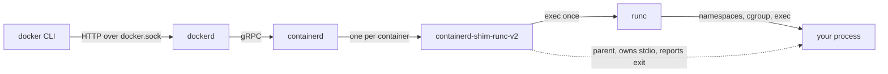
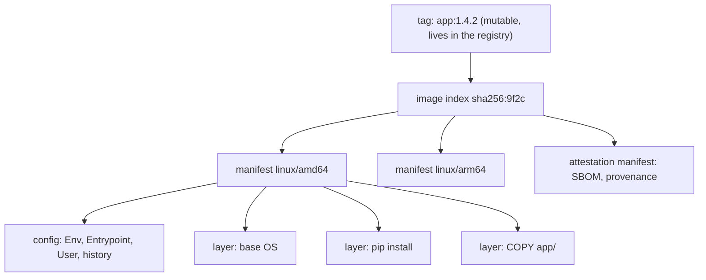
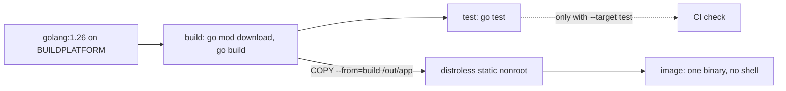
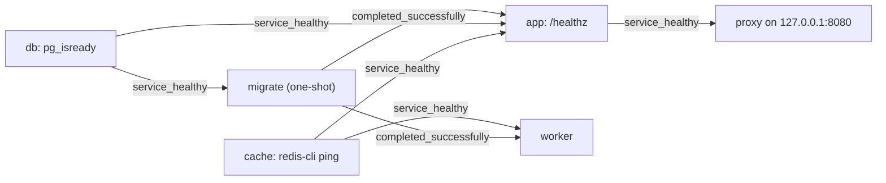
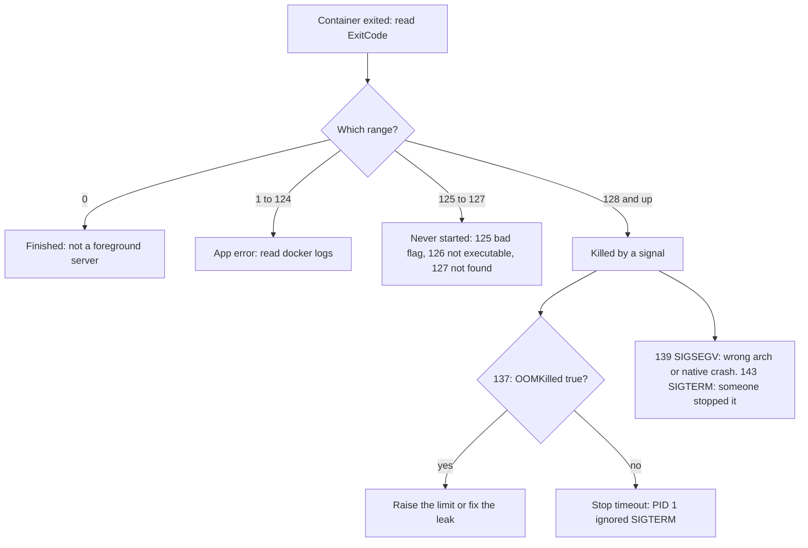

# Docker, A→Z

> One route from what a container really is to running a hardened, scanned, signed stack: the daily CLI, Dockerfiles that behave, BuildKit and bake, Compose, networks and volumes on Fedora, locking containers down, and the troubleshooting tree for every exit code. Podman equivalents are noted along the way.
> Full version: [Docker Field Manual](./docker-field-manual.md)

## Contents

- 01 · [A container is a process](#ch01)
- 02 · [Images, tags and digests](#ch02)
- 03 · [Pick and set up the engine](#ch03)
- 04 · [The daily CLI](#ch04)
- 05 · [Dockerfiles that behave](#ch05)
- 06 · [Build, cache and ship](#ch06)
- 07 · [Compose for real stacks](#ch07)
- 08 · [Networks, ports and volumes](#ch08)
- 09 · [Run it hardened, keep it running](#ch09)
- 10 · [When it breaks](#ch10)
- Z · [One-screen reference](#appendix)

---


<a id="ch01"></a>

## 01 · A container is a process

*A container is an ordinary Linux process: namespaces decide what it can see and cgroups decide what it can use. Docker is a stack of daemons above that process, and knowing which layer owns a failure tells you where to look.*

There is no container object in the kernel. There is a process with a few kernel features switched on, and **that set of settings is the container**. Every Docker behaviour that surprises you is one of those settings showing through.

### Look at one from the host

Start a container, then find it with ordinary host tools.

```bash
docker run -d --name sleeper --rm alpine:3.22 sleep 3600
PID=$(docker inspect -f '{{.State.Pid}}' sleeper)
ps -o pid,user,cmd -p "$PID"
ls -l /proc/$PID/ns
cat /proc/$PID/cgroup
sudo nsenter -t "$PID" -m -u -n -p -i sh
docker rm -f sleeper
```

`ps` shows a normal process. `/proc/PID/ns` shows its namespaces, `/proc/PID/cgroup` shows its budget, and `nsenter` is "exec" without Docker.

### What the kernel does to it

- **Namespaces decide what it sees.** `mnt` gives it its own mount table with an overlay root. `pid` makes it believe it is PID 1. `net` gives it its own interfaces and ports. `uts`, `ipc` and `cgroup` isolate the hostname, shared memory and its view of `/sys/fs/cgroup`. The `user` namespace is **off** in rootful Docker and on in rootless Docker and Podman.
- **cgroups v2 decide what it can use.** `memory.max`, `cpu.max`, `pids.max` and `io.max` are plain files. At the memory limit the kernel OOM-kills a process in the cgroup (exit 137). At the CPU limit it is throttled, never killed.
- **Capabilities, seccomp and SELinux decide what it may do.** Rootful Docker keeps 14 capabilities and drops the rest, including `SYS_ADMIN`, and applies a builtin seccomp profile.

Three consequences you will hit:

- **The kernel is shared.** `uname -r` inside the container prints the host kernel, and a kernel exploit is a host exploit.
- **Root in the container is root on the host** unless a user namespace remaps it. Namespaces hide things; they don't reduce the UID.
- **Sharing a network namespace is what a pod is.** `--network container:NAME` does it by hand.

> **Gotcha.** The default memory limit is **none**. A leaking container grows until the host OOM killer picks a victim, and on a workstation that may be your browser or `dockerd`. Set `--memory` on anything long-running.

### The daemon stack

`docker` the CLI is a thin REST client. The work happens four processes down.



- **dockerd** owns the API, networking and iptables rules, volumes, logging drivers, pulls and the embedded BuildKit.
- **containerd** owns the image content store, overlayfs snapshots and the container lifecycle.
- **The shim** owns stdio and the exit code. With `"live-restore": true` it keeps containers running while dockerd restarts.
- **runc** creates namespaces and the cgroup, applies seccomp and capabilities, execs your process, and exits.

When something fails, the message usually tells you which layer said it.

| Symptom | Layer | Look at |
|---|---|---|
| `Cannot connect to the Docker daemon` | CLI to dockerd | `systemctl status docker docker.socket`, `docker context show`, `$DOCKER_HOST` |
| Port publish or DNS broken | dockerd networking | `iptables -t nat -S DOCKER`, `journalctl -u docker` |
| Pull, snapshot, `no space left` | containerd | `journalctl -u containerd`, `docker system df` |
| `OCI runtime create failed` | runc | The rest of the line: a bad mount, missing binary, or seccomp or LSM denial |
| Exit 137, `OOMKilled=false` | Your process | Something sent SIGKILL: a stop timeout, `docker kill`, host OOM |

```bash
systemctl status docker containerd --no-pager | grep -E 'Active|Main PID'
docker info --format '{{.DefaultRuntime}} {{.Driver}} {{.CgroupDriver}}'
```

> **Note.** Everything under dockerd runs as root, and anyone who can write to `/var/run/docker.sock` can ask it to bind-mount `/`. That is why the `docker` group is root-equivalent, which the engine chapter deals with.

> **Note.** Podman runs the same images on the same kernel mechanics with no long-lived daemon: `podman` forks `conmon` (the shim equivalent) and `crun`, rootless by default, inside your user namespace.

---


<a id="ch02"></a>

## 02 · Images, tags and digests

*An image is a content-addressed tree of JSON and tarballs: the digest is its identity and the tag is a pointer that can move. Layers only ever add, so pin by the index digest and never "delete" a secret in a later layer.*

An image is not a file. It is a small graph of JSON documents and tar blobs, each named by the SHA-256 of its bytes. **Change one byte anywhere and every digest above it changes.**

### The tree behind a tag



The rules that fall out of this:

- **A digest is immutable and a tag is not.** `app:1.4.2` can be re-pushed to point at different bytes; `app@sha256:…` cannot.
- **Pin the index digest**, not a per-platform manifest digest, so every platform resolves. Pinning a platform digest silently breaks your arm64 build.
- **Layers are shared by digest.** Two images built on the same base store its layers once, locally and in the registry.
- **Deleting a file in a later layer does not shrink the image.** The earlier layer still has the bytes; the later one adds a "whiteout" marker. A secret copied in and `rm`'d later is still in the image.

Look at the real thing without pulling anything.

```bash
docker buildx imagetools inspect python:3.14-slim
docker buildx imagetools inspect python:3.14-slim --format '{{json .Manifest}}' | jq -r .digest
skopeo inspect --format '{{.Digest}}' docker://docker.io/library/python:3.14-slim
docker image history --no-trunc python:3.14-slim
```

`imagetools` talks to the registry directly, so it is the fastest answer to "which platforms does this tag have" and "what digest is `:latest` today".

### Pin it in the Dockerfile

Keep the tag for humans and Renovate; the digest is what gets used.

```dockerfile
FROM python:3.14-slim@sha256:caaf356f40667c496d405780745b9ac25771c189a51dfcc42430d531ea09f8a2
```

A pinned digest nobody updates is a pinned vulnerability, so let **Renovate** (`docker:pinDigests`) open the bump MRs. The build chapter shows the config.

### Layers and overlayfs

The root filesystem inside a container is an overlay mount: image layers are read-only `lowerdir`s, and the container gets one writable `upperdir` that dies with `docker rm`.

- **Reads** find the first layer, top down, that has the file.
- **The first write to a lower file copies the whole file up**, so the cost is the file size, not the write.
- **Deletes** add a whiteout; the bytes stay below.

See what a container changed against its image.

```bash
docker run -d --name ov --rm alpine:3.22 sleep 300
docker diff ov
findmnt -t overlay | head -3
docker rm -f ov
```

**Never put a database's data directory in the writable layer.** You get copy-up on multi-GB files, no persistence across `docker rm`, and disk you can't easily reclaim. Volumes bypass overlayfs entirely.

**Stopped containers keep their writable layer** until `docker rm`, which is why `--rm` should be your habit for anything interactive.

### Which image store you're on

Docker Engine 29 made the **containerd image store** the default for fresh installs. Check yours with `docker info`: `driver-type: io.containerd.snapshotter.v1` means containerd; `Storage Driver: overlay2` means the classic store.

| Behaviour | Classic `overlay2` store | containerd store |
|---|---|---|
| Multi-platform images locally | Only the host platform survives `--load` | Whole index kept; `docker image ls --tree` shows platforms |
| Attestations (SBOM, provenance) | Dropped on load | Kept alongside the image |
| Disk | Unpacked layers only | Compressed blobs and unpacked snapshots, often larger |
| Where bytes live | `/var/lib/docker/overlay2` | `/var/lib/containerd` |

> **One-way door.** Switching stores (`"features": {"containerd-snapshotter": true}` in `daemon.json`, or back) makes existing images and containers **invisible**, not deleted. People "lose" 200 GB of images, pull them all again, and the old ones still sit on disk.

> **Gotcha.** Pulling another platform of a tag with the containerd store can repoint what the local tag means. After `docker run --platform linux/arm64 alpine:3 true`, a plain `docker run alpine:3` ran the arm64 image and failed with `exec format error`. Test other platforms under a separate tag, or inspect with `imagetools` instead of pulling.

---


<a id="ch03"></a>

## 03 · Pick and set up the engine

*On Fedora the default engine is rootless Podman, with rootless Docker where a tool needs the Docker API, and the docker group is treated as passwordless root. Any rootful daemon you keep gets a hardened daemon.json and is reached over SSH, never bare TCP.*

The biggest Docker risk isn't inside a container; it's whoever can reach the daemon socket. Decide that first, then make the daemon's defaults fail closed.

### The docker group is root

The socket is `root:docker 0660`, and anyone who can write to it can do this:

```bash
# Illustration only. Do not run on a machine you care about.
docker run --rm -it -v /:/host alpine chroot /host sh
```

That is a root shell on the host, with no password prompt and no sudo log entry. **Treat adding a user to `docker` exactly like adding them to `wheel` with `NOPASSWD`.** No flag or SELinux policy makes rootful Docker's API safe to hand out.

Check who holds it right now.

```bash
getent group docker
id -nG
```

| Need | Do this | Why |
|---|---|---|
| Developer workstation | **Podman rootless**, or rootless Docker | An escape gets the attacker your UID, not root |
| A tool that insists on the Docker API | Rootless Docker, or point it at `podman.socket` | Tiebreaker: if the tool can use Podman's socket, use Podman |
| CI runner building images | Rootless BuildKit or Podman, or a throwaway VM per job | The runner is compromised by design once any job can run arbitrary Dockerfiles |

> **One-way door.** Adding a user to the `docker` group grants passwordless root. Removing them later doesn't undo anything they already did.

### Rootless Podman: the default

Nothing to install on Fedora. Confirm what you have.

```bash
podman info --format '{{.Host.Security.Rootless}} cgroups={{.Host.CgroupsVersion}} selinux={{.Host.Security.SELinuxEnabled}}'
podman unshare cat /proc/self/uid_map
```

Container root maps to your UID and container UIDs 1 and up map to your range in `/etc/subuid`. **A container root that escapes lands as an unprivileged host user.**

### Rootless Docker, when you need Docker

The rootful daemon must be off and you must be out of the `docker` group, or the root path is still there.

```bash
sudo systemctl disable --now docker.service docker.socket
dockerd-rootless-setuptool.sh install
sudo loginctl enable-linger "$USER"
docker context use rootless
docker info --format '{{.SecurityOptions}}'
```

Expect `name=rootless`. Ports below 1024 and resource limits need extra host setup.

### Harden any rootful daemon you keep

A stock docker-ce install has **no `daemon.json` at all**: no log rotation, no SELinux labelling, and open inter-container traffic on the default bridge. This is the hardened file.

```json
# file: /etc/docker/daemon.json
{
  "live-restore": true,
  "no-new-privileges": true,
  "selinux-enabled": true,
  "icc": false,
  "userland-proxy": false,
  "ip": "127.0.0.1",
  "log-driver": "local",
  "log-opts": { "max-size": "10m", "max-file": "3" },
  "default-address-pools": [ { "base": "10.200.0.0/16", "size": 24 } ],
  "init": true
}
```

What each line buys you:

- **`live-restore`**: a daemon restart stops being an outage.
- **`no-new-privileges`**: setuid escalation is blocked even when nobody passes the flag.
- **`selinux-enabled`**: containers run as `container_t` instead of unconfined `spc_t`.
- **`icc: false`** and **`ip: 127.0.0.1`**: safer defaults, but **only for the default bridge**. Compose networks ignore both.
- **`log-driver: local`**: rotated, compressed logs. The default `json-file` never rotates and fills `/var/lib/docker`.
- **`default-address-pools`**: networks come from a range that won't collide with your VPN.
- **`init: true`**: tini as PID 1 everywhere, for signals and zombie reaping.

Validate, restart, and check the result.

```bash
sudo dockerd --validate --config-file /etc/docker/daemon.json
sudo systemctl restart docker
docker run --rm alpine:3 cat /proc/self/attr/current
```

You want `container_t`, not `spc_t`.

> **Gotcha.** Log settings, ulimits and `no-new-privileges` apply **only to containers created after the restart**. Recreate the rest (`docker compose up -d --force-recreate`). And turning on `selinux-enabled` makes every bind mount without `:z` or `:Z` fail with `Permission denied` at once.

> **Note.** Skip `userns-remap`. It hides every existing image and container, and on Docker 29 it can't use the containerd image store. Rootless gets you the same benefit without the migration.

### Reach remote daemons over SSH

A context bundles an endpoint under a name. SSH contexts reuse your keys and never expose the daemon on TCP.

```bash
docker context create build-box --docker "host=ssh://USER@build-box.internal"
docker --context build-box ps
DOCKER_CONTEXT=build-box docker compose ps
```

`docker context use` is global and sticky: switch to the build server, forget, and your next `prune` runs **there**. Prefer `DOCKER_CONTEXT` set per project by direnv, and show the context in your prompt.

> **One-way door.** `-H tcp://0.0.0.0:2375` is an unauthenticated remote root shell, found by scanners within minutes. **Treat minutes of exposure as a compromise: rebuild the host, don't clean it.** If TCP is truly required, it is port 2376 with `tlsverify` (client certificates), never `tls` alone.

To drive rootless Podman with the docker CLI and Compose, start its socket.

```bash
systemctl --user enable --now podman.socket
docker context create podman --docker "host=unix:///run/user/$(id -u)/podman/podman.sock"
docker --context podman ps
```

---


<a id="ch04"></a>

## 04 · The daily CLI

*Twenty flags do most of the work, and three habits cause most of the mess: -p without an address, -v with a typo'd path, and no --rm. Learn the CLI by what you are trying to do, and let inspect --format answer questions before grep does.*

Podman accepts nearly all of these verbatim; `alias docker=podman` works for daily use. The one Podman habit to add: **always use fully qualified image names** (`docker.io/library/nginx`), because short names prompt or fail in scripts.

### Run a container

| Flag | Does | Use it when |
|---|---|---|
| `--rm` | Delete the container on exit | **Every interactive or one-shot run** |
| `-d` / `--name NAME` | Detach; give it a stable name | Services you'll `exec` or `logs` later |
| `-it` | Interactive with a TTY | Shells. Drop `-t` when piping output |
| `--init` | tini as PID 1 | The process doesn't handle SIGTERM or reap zombies |
| `-p 127.0.0.1:8080:80` | Publish on host loopback | **The default form.** Bare `-p 8080:80` binds every interface |
| `--mount type=bind,src=…,dst=…` | Bind mount that errors if the source is missing | Scripts and anything shared |
| `--memory 512m` | cgroup memory limit | Anything long-running |
| `--restart unless-stopped` | dockerd restarts it | Workstation services |
| `--entrypoint sh` | Override the entrypoint | Debugging an image that exits immediately |

A sane dev service, with every habit in place:

```bash
docker run -d --name pg \
  --restart unless-stopped \
  --memory 1g \
  -e POSTGRES_PASSWORD \
  -p 127.0.0.1:5432:5432 \
  --mount type=volume,src=pgdata,dst=/var/lib/postgresql \
  postgres:18-alpine
```

> **Gotcha.** `-v ./data:/data` with a path that doesn't exist **silently creates an empty root-owned directory** and mounts it. `--mount type=bind` fails loudly instead. And `-v data:/data`, with no `./`, is a named volume called `data`, not your directory. Use `--mount` in anything shared and `-v` only at the prompt.

### Get inside

Open a shell, as root if you need to, even when the image sets `USER`.

```bash
docker exec -it NAME sh
docker exec -it -u 0 NAME sh
```

When the image has **no shell at all** (distroless, scratch), borrow one by joining its namespaces. Nothing changes in the target.

```bash
docker run --rm -it --pid container:NAME --network container:NAME nicolaka/netshoot
```

`docker debug` is a Docker Desktop plugin and isn't in Docker CE; this is the free equivalent.

### Read logs

Follow the tail, or pick a time window.

```bash
docker logs -f --tail 100 NAME
docker logs --since 10m NAME
docker logs -t NAME 2>&1 | grep -i error
```

`docker logs` shows only what the process wrote to stdout and stderr. An app logging to `/var/log/app.log` inside the container shows nothing, so point its logs at stdout.

### Ask inspect, not grep

`--format` takes a Go template and needs no extra tool. These answer most questions.

```bash
# why did it die?
docker inspect -f '{{.State.ExitCode}} oom={{.State.OOMKilled}} err={{.State.Error}}' NAME
# health history
docker inspect -f '{{json .State.Health}}' NAME | jq '.Status, (.Log[] | {ExitCode, Output})'
# what the image defaults to, without running it
docker image inspect -f '{{.Config.User}} {{json .Config.Entrypoint}} {{json .Config.Cmd}}' IMAGE
# containers with no memory limit
docker ps -q | xargs docker inspect -f '{{.Name}} {{.HostConfig.Memory}}' | awk '$2==0'
```

List and filter with `ps`, and ask the daemon's event stream who restarted what.

```bash
docker ps --format 'table {{.Names}}\t{{.Status}}\t{{.Ports}}'
docker ps --filter label=com.docker.compose.project=PROJECT
docker events --since 1h --filter type=container --filter event=die \
  --format '{{.Time}} {{.Actor.Attributes.name}} exit={{.Actor.Attributes.exitCode}}'
docker stats --no-stream --format 'table {{.Name}}\t{{.CPUPerc}}\t{{.MemUsage}}\t{{.PIDs}}'
```

> **Gotcha.** Anything passed with `-e` or `environment:` is readable in plain text by anyone who can run `docker inspect`. Real secrets go through files.

### Three shell functions worth stealing

```bash
# file: ~/.zshrc.d/docker.zsh
dwhy() {
  docker inspect -f 'exit={{.State.ExitCode}} oom={{.State.OOMKilled}} error="{{.State.Error}}" restarts={{.RestartCount}}' "${1:?container}"
  docker logs --tail 30 "$1" 2>&1
}
dnet() { docker run --rm -it --network "container:${1:?container}" --pid "container:$1" nicolaka/netshoot; }
dexposed() {
  docker ps -q | xargs -r docker inspect -f '{{.Name}} {{range $p,$b := .HostConfig.PortBindings}}{{range $b}}{{.HostIp}}:{{.HostPort}}->{{$p}} {{end}}{{end}}' \
    | grep -E ' (0\.0\.0\.0|::)?:[0-9]' || echo "none"
}
```

Run `dexposed` now; on a laptop it should print `none`. For a TUI, use **lazydocker**, and **dive** to see what each layer added.

### Clean up

Prune images and build cache freely; prune volumes only by name.

```bash
docker container prune -f --filter until=24h
docker image prune -a -f --filter until=168h
docker builder prune -f --max-used-space 50GB
docker volume prune -f
docker system df
```

`docker volume prune` with no `-a` removes **anonymous** volumes only.

> **One-way door.** `docker system prune -a --volumes` deletes every unused image and all build cache. `docker volume prune -a` also deletes **named volumes not attached to a container**, including the Postgres data of any Compose stack that is currently down. There is no trash and no undo.

---


<a id="ch05"></a>

## 05 · Dockerfiles that behave

*A Dockerfile is a build graph with a cache, not a shell script: order steps by how often their inputs change, and keep secrets and caches out of layers with mounts. Use multi-stage builds so the image carries only the runtime, and exec-form entrypoints so it stops cleanly.*

A Dockerfile that behaves **rebuilds fast**, **carries only the runtime**, and **stops cleanly** when asked. Everything here serves one of those three.

### Start every file the same way

These two lines give you the current Dockerfile frontend on any daemon and turn build-check warnings into failures.

```dockerfile
# syntax=docker/dockerfile:1
# check=error=true
```

`docker build --check .` lints without building, and catches secrets in `ARG`/`ENV` and shell-form `CMD` for free.

### The cache rule, and the order it forces

A step is reused only if its instruction, its inputs and **every step above it** are unchanged. The first miss rebuilds everything below. So order by change rate: base, OS packages, lockfile, dependency install, source, build.

The canonical mistake, and why it hurts:

```dockerfile
COPY . .                              # any file change busts the cache here
RUN pip install -r requirements.txt   # so every build reinstalls everything
```

Copy the lockfile first, install, then copy the rest. Add a `.dockerignore` too: `.git`, `node_modules`, `.venv` and build output slow the upload and bust the cache on unrelated changes.

> **Gotcha.** `.env` in the build context plus `COPY . .` bakes your local secrets into a layer. Ignore `.env*` by default and un-ignore the example with `!.env.example`.

### Multi-stage: build fat, ship thin

Only the last stage (or the `--target`) becomes the image. Earlier stages are scratch space you `COPY --from`.



This is the Go example from the full manual. It builds for both amd64 and arm64 with no emulation, because the compiler runs natively and cross-compiles.

```dockerfile
# syntax=docker/dockerfile:1
# check=error=true
FROM --platform=$BUILDPLATFORM golang:1.26 AS build
ARG TARGETOS TARGETARCH
WORKDIR /src
RUN --mount=type=cache,target=/go/pkg/mod \
    --mount=type=bind,source=go.mod,target=go.mod \
    --mount=type=bind,source=go.sum,target=go.sum \
    go mod download -x
ARG VERSION=dev
RUN --mount=type=cache,target=/go/pkg/mod \
    --mount=type=cache,target=/root/.cache/go-build \
    --mount=type=bind,target=. \
    CGO_ENABLED=0 GOOS=$TARGETOS GOARCH=$TARGETARCH \
    go build -trimpath -ldflags="-s -w -X main.version=${VERSION}" -o /out/app ./cmd/app

FROM build AS test
RUN --mount=type=cache,target=/go/pkg/mod \
    --mount=type=cache,target=/root/.cache/go-build \
    --mount=type=bind,target=. \
    go test ./...

FROM gcr.io/distroless/static-debian13:nonroot AS runtime
COPY --from=build /out/app /app
USER 65532:65532
EXPOSE 8080
HEALTHCHECK --interval=30s --timeout=3s --start-period=5s CMD ["/app", "healthcheck"]
ENTRYPOINT ["/app"]
CMD ["serve"]
```

`docker build --target test .` runs the tests; a plain build skips that stage. The binary has its own `healthcheck` subcommand because distroless has no shell or curl.

### Mounts keep things out of layers

`RUN --mount` attaches something to one step **without it becoming part of any layer**.

| Mount | Example | Use for |
|---|---|---|
| `cache` | `--mount=type=cache,target=/root/.cache/uv` | Package-manager download caches that persist on this builder |
| `secret` | `--mount=type=secret,id=npmrc,target=/root/.npmrc` | Tokens and credentials. Never in a layer or the history |
| `bind` | `--mount=type=bind,source=uv.lock,target=uv.lock` | Read context files without a `COPY` layer |

Pass the secret at build time from a file or an environment variable.

```dockerfile
RUN --mount=type=secret,id=npmrc,target=/root/.npmrc npm ci
RUN --mount=type=secret,id=pip_index,env=PIP_INDEX_URL pip install -r requirements.txt
```

```bash
docker build --secret id=npmrc,src="$HOME/.npmrc" .
docker build --secret id=pip_index,env=PIP_INDEX_URL .
```

**Never pass secrets as `ARG` or `ENV`.** Both are readable forever in `docker history` and the image config.

> **Gotcha.** Mount the package manager's **download** cache, never the install target. A cache mount over `node_modules` means the files never reach the image. Cache mounts also live in the builder, so a fresh CI runner starts empty.

### PID 1 and clean stops

Shell form (`CMD python app.py`) makes `/bin/sh` PID 1, and sh doesn't forward SIGTERM. `docker stop` waits ten seconds and SIGKILLs: **exit 137 on every stop**. Use exec form, and end wrapper scripts with `exec "$@"` so the app replaces the shell.

PID 1 also ignores any signal it has no handler for. If the app doesn't handle SIGTERM or spawns children, run it with `--init` (Compose `init: true`), or install tini in the image for Kubernetes. The default pattern is `ENTRYPOINT ["/binary"]` plus `CMD ["default-args"]`, so `docker run IMAGE --help` works.

### Users, healthchecks and bases

- **`USER 10001:10001`, numeric.** Kubernetes `runAsNonRoot` can't verify a name. Distroless `:nonroot` ships 65532. `COPY` creates files as root regardless, so use `--chown`.
- **`HEALTHCHECK` checks this process, not the database.** Docker doesn't restart unhealthy containers; Compose uses the status for startup ordering, and Kubernetes ignores it.
- **Bases:** `python:3.14-slim` (alpine's musl forces source builds), distroless `static-debian13:nonroot` for Go and Rust, `node:24-slim` for Node when you need native addons or a shell, distroless `nodejs24` otherwise.

### Lint in CI

Run both: `--check` understands heredocs and new syntax, and hadolint adds ShellCheck and package rules.

```bash
docker build --check .
docker run --rm -i hadolint/hadolint < Dockerfile
```

> **Gotcha.** hadolint can't parse heredocs; don't let that silently disable the lint job.

---


<a id="ch06"></a>

## 06 · Build, cache and ship

*BuildKit does the building, buildx picks the builder, cache and output, and bake puts the whole build graph in one file. In CI, export a mode=max registry cache, attach an SBOM and provenance, then scan and sign the exact digest the build produced.*

`docker build`, `buildx build`, `buildx bake` and `compose build` are all clients of the same BuildKit. Three choices decide everything else: **the builder, the cache backend and the output.**

### Locally: the default builder is enough

On the containerd image store, the default `docker` driver exports `mode=max` cache and loads multi-platform images directly. **That removes most reasons to run a `docker-container` builder locally.**

The default builder's garbage collection is sized for a server; one machine had 148 GB of build cache. Cap it.

```json
# file: /etc/docker/daemon.json
{
  "builder": {
    "gc": {
      "enabled": true,
      "defaultMaxUsedSpace": "30GB",
      "defaultMinFreeSpace": "20GB"
    }
  }
}
```

> **Version-sensitive.** Since Docker 28, `defaultKeepStorage` is deprecated and means a **floor** GC won't reclaim below, not a cap. An old `"defaultKeepStorage": "30GB"` no longer limits anything. Set `defaultMaxUsedSpace` and restart dockerd.

### Multi-arch without the pain

| Method | How | Speed | Use when |
|---|---|---|---|
| **Cross-compile** | `FROM --platform=$BUILDPLATFORM` plus `GOOS`/`GOARCH` | Native | **Go, Rust, JVM, pure JS. Try this first** |
| Native nodes | `docker buildx create --append` an arm64 node | Native | Heavy native compiles, Python wheels from source |
| QEMU emulation | binfmt handlers run arm64 steps emulated | 5 to 20 times slower | Small `RUN`s only |

Build both platforms and push, or load them locally on the containerd store.

```bash
docker buildx build --platform linux/amd64,linux/arm64 -t IMAGE:TAG --push .
docker buildx build --platform linux/amd64,linux/arm64 -t IMAGE:TAG --load .
docker image ls --tree IMAGE:TAG
```

> **Gotcha.** Emulated builds fail like app bugs: `Illegal instruction`, segfaults in `npm install`. If an arm64 step misbehaves only in CI, suspect QEMU before your code. And a multi-platform build with neither `--push` nor `--load` builds everything, then discards it.

### Cache that survives CI

The **layer** cache can be exported so a fresh runner starts warm. Cache mounts are not exported. `mode=min`, the default, caches only the final stage, which in a multi-stage build is almost nothing useful. **Use `mode=max`.**

Read from main and your branch, write only to your branch.

```bash
docker buildx build \
  --cache-from type=registry,ref=REG/cache/app:main \
  --cache-from type=registry,ref=REG/cache/app:BRANCH \
  --cache-to   type=registry,ref=REG/cache/app:BRANCH,mode=max,image-manifest=true,oci-mediatypes=true \
  -t REG/app:SHA --push .
```

### Bake: the build graph in one file

`docker buildx bake` builds many targets from one file in one BuildKit session, in parallel. It replaces the `build.sh` that loops over images, and `--print` is a dry run you can review in an MR.

```hcl
# file: docker-bake.hcl
variable "REGISTRY" { default = "registry.gitlab.example.com/group/project" }
variable "TAG"      { default = "dev" }
variable "CI" {
  type    = bool
  default = false
}

group "default" { targets = ["api"] }

target "_common" {
  dockerfile = "Dockerfile"
  context    = "services/go"
  target     = "runtime"
  attest     = CI ? ["type=provenance,mode=max", "type=sbom"] : []
}

target "api" {
  inherits   = ["_common"]
  tags       = ["${REGISTRY}/api:${TAG}"]
  cache-from = ["type=registry,ref=${REGISTRY}/cache/api:main"]
  cache-to   = CI ? ["type=registry,ref=${REGISTRY}/cache/api:${TAG},mode=max,image-manifest=true,oci-mediatypes=true"] : []
}
```

Drive it the same way locally and in CI.

```bash
docker buildx bake --print
docker buildx bake --load api
TAG=feature-x docker buildx bake --push --metadata-file bake-meta.json
```

> **Gotcha.** On `inherits`, list attributes like `cache-from`, `cache-to` and `attest` are **appended**, not replaced. Inherit from abstract `_base` targets, never from a sibling image, or you read the wrong cache.

### In GitLab CI

The default pick: a `docker:29-cli` job driving **rootless BuildKit as a service**. No privileged runner, and unlike `buildctl-daemonless` it runs bake.

```yaml
# file: .gitlab-ci.yml
build:
  image: docker:29-cli
  services:
    - name: moby/buildkit:rootless
      alias: buildkitd
      entrypoint: ["rootlesskit", "buildkitd"]
      command: ["--addr", "tcp://0.0.0.0:1234", "--oci-worker-no-process-sandbox"]
  before_script:
    - docker buildx create --name ci --driver remote tcp://buildkitd:1234 --use
  script:
    - CI=true TAG=$CI_COMMIT_REF_SLUG REGISTRY=$CI_REGISTRY_IMAGE docker buildx bake --push --metadata-file bake-meta.json
  artifacts:
    paths: [bake-meta.json]
```

On the Kubernetes executor, use `tcp://localhost:1234`. kaniko was archived in June 2025; treat any kaniko job as debt.

### Scan and sign the digest

**Every step after the build refers to the digest.** Scan a tag and you scanned something you may never deploy; sign a tag and you signed whatever it pointed to that second. Take the digest from `--metadata-file`, never by re-resolving the tag.

Gate on what you can act on: HIGH and CRITICAL with a fix available.

```bash
trivy image --severity HIGH,CRITICAL --ignore-unfixed --exit-code 1 \
  --ignorefile .trivyignore.yaml REGISTRY/APP@sha256:DIGEST
cosign sign --key cosign.key REGISTRY/APP@sha256:DIGEST
cosign verify --key cosign.pub REGISTRY/APP@sha256:DIGEST
```

Every ignore entry carries an expiry date and a reason. Sign keyless in connected CI; **air-gapped consumers need a key pair**, because keyless verification needs Fulcio and Rekor. Build with `--sbom=true --provenance=mode=max`, and remember `mode=max` records build-arg values.

> **Gotcha.** Trivy itself was a supply-chain target: a malicious v0.69.4 release and hijacked action tags in March 2026. **Pin the scanner by digest like any other dependency**, and never float `aquasec/trivy:latest` in CI.

---


<a id="ch07"></a>

## 07 · Compose for real stacks

*A compose.yaml describes one project on one host: its services, networks, volumes and the order they become healthy. Keep the base file production-shaped, put the dev loop in an override, and render it with docker compose config before you trust it.*

Use the `docker compose` plugin (v2.20 or later; v5 is current) and name the file `compose.yaml`. The top-level `version:` key is obsolete and ignored. Every resource is prefixed with the project name, so **the project name is the identity**.

### Startup order that actually waits



A trimmed version of the stack from the full manual, which came up in exactly this order.

```yaml
# file: compose.yaml
name: shop

x-app: &app
  image: ${REGISTRY:-local}/shop-app:${APP_VERSION:-dev}
  build: { context: ., target: runtime }
  init: true
  restart: unless-stopped
  environment:
    DATABASE_HOST: db
    DATABASE_USER: shop
    DATABASE_PASSWORD_FILE: /run/secrets/db_password
  secrets: [db_password]
  networks: [backend]
  read_only: true
  tmpfs: ["/tmp:size=64m"]
  security_opt: ["no-new-privileges:true"]
  cap_drop: [ALL]

services:
  proxy:
    image: caddy:2-alpine
    ports: ["127.0.0.1:8080:80"]
    networks: [frontend, backend]
    depends_on:
      app: { condition: service_healthy, restart: true }

  app:
    <<: *app
    healthcheck:
      test: ["CMD", "python", "-c", "import urllib.request,sys; sys.exit(0 if urllib.request.urlopen('http://127.0.0.1:8000/healthz', timeout=2).status == 200 else 1)"]
      interval: 10s
      start_period: 20s
      start_interval: 2s
    depends_on:
      migrate: { condition: service_completed_successfully }
      db: { condition: service_healthy }

  migrate:
    <<: *app
    entrypoint: ["python", "-m", "myapp.migrate"]
    command: []
    healthcheck: { disable: true }
    restart: "no"
    depends_on:
      db: { condition: service_healthy }

  db:
    image: postgres:18-alpine
    environment:
      POSTGRES_DB: shop
      POSTGRES_USER: shop
      POSTGRES_PASSWORD_FILE: /run/secrets/db_password
    secrets: [db_password]
    volumes: ["pgdata:/var/lib/postgresql"]
    networks: [backend]
    shm_size: 256m
    stop_grace_period: 30s
    healthcheck:
      test: ["CMD-SHELL", "pg_isready -U shop -d shop"]
      interval: 5s
      retries: 10

networks:
  frontend: {}
  backend: { internal: true }

volumes:
  pgdata: {}

secrets:
  db_password: { file: ./secrets/db_password.txt }
```

Why the load-bearing lines are there:

- **`name: shop`**: without it, renaming the checkout directory orphans your volumes.
- **Only the proxy publishes, and only on `127.0.0.1`.** `backend: internal: true` gives app and db no route out.
- **`*_FILE` plus `secrets:`**: the password is a file in `/run/secrets`, never in `docker inspect`.
- **`pgdata:/var/lib/postgresql`**: Postgres 18 images moved the volume there. `shm_size` beats the 64 MB `/dev/shm` default.
- **`healthcheck: disable: true` on migrate**: it reuses the app image and would inherit its HTTP check.

> **Gotcha.** A service reusing an image for another role inherits its `HEALTHCHECK`; this stack's first run failed `--wait` because a worker kept curling a port nothing listened on. And YAML anchors are **shallow**: override `deploy:` in one service and the whole anchored block is replaced.

### depends_on and --wait

| Form | Waits for | Use |
|---|---|---|
| `depends_on: [db]` | Container **started**, not ready | Almost never enough |
| `condition: service_healthy` | Healthcheck passes | Databases, caches, anything with a readiness signal |
| `condition: service_completed_successfully` | Container exited 0 | Migrations, seeders, init jobs |
| `restart: true` | Restart this when Compose restarts the dependency | Proxies and clients that cache connections |

`--wait` blocks until everything is healthy and exits non-zero if anything isn't, so it replaces every `sleep` in your scripts.

```bash
docker compose up -d --wait --build
```

`depends_on` orders startup **within one `up`** only. The app must still retry when the database blips later.

### Base file plus dev override

`docker compose` with no `-f` reads `compose.yaml` **and** `compose.override.yaml`. `-f` replaces that with an explicit list. Put the dev loop in the override so it can't leak into production.

```yaml
# file: compose.override.yaml
services:
  app:
    read_only: false
    ports: ["127.0.0.1:8000:8000"]
    develop:
      watch:
        - action: sync+restart
          path: ./src/myapp
          target: /app/.venv/lib/python3.14/site-packages/myapp
        - action: rebuild
          path: uv.lock
```

```bash
docker compose up --watch
docker compose -f compose.yaml -f compose.prod.yaml config
```

Mappings like `environment` merge by key; lists like `ports` append. **You can't remove a base port in an override** without `ports: !override [...]`, or `!reset` to clear a field. The override sets `read_only: false` because watch writes into the container.

> **Gotcha.** `.env` in the project directory is read for **interpolation** of `${VAR}` in the YAML, not injected into containers; use `env_file:` for that. And `--env-file other.env` silently stops `.env` being read.

### Render before you trust

`docker compose config` resolves interpolation, merges every file and prints the model Compose will actually run.

```bash
docker compose config
docker compose config -q
docker compose config --lock-image-digests -o compose.digests.yaml
```

It also prints secrets passed through `environment:` in cleartext, so check before pasting it into an MR.

> **One-way door.** `docker compose down -v` removes the project's **named volumes**: the database. It is plain `down` plus two characters, and it doesn't belong in a README.

> **Note.** On Podman, `podman compose` runs the real docker-compose provider against Podman's socket. Enable `podman.socket` first, and add `:Z` to bind mounts.

---


<a id="ch08"></a>

## 08 · Networks, ports and volumes

*Put containers on a user-defined network so they find each other by name, and publish ports on 127.0.0.1, because Docker's NAT rules run before firewalld ever sees the packet. Keep data in named volumes, relabel bind mounts with :Z on narrow paths only, and back up databases with their own dump tool.*

Docker networking is Linux bridges plus NAT rules that dockerd writes **ahead of your firewall**. Storage is either managed by Docker (volumes) or borrowed from the host (bind mounts). On Fedora, the firewall and SELinux are where both bite.

### Always use a user-defined network

The default bridge has **no DNS between containers**. A network you create gets Docker's embedded resolver at `127.0.0.11`, so container names and aliases resolve. Compose makes one per project for you.

```bash
docker network create app-net
docker run -d --name db --network app-net postgres:18-alpine
docker run --rm --network app-net alpine:3.22 getent hosts db
docker network create --internal backend
```

An `--internal` network has no gateway: containers talk to each other but not the outside. It's the cheapest egress control you have.

> **Gotcha.** When DNS works on the host but not in containers after a VPN connects, the VPN's resolvers live only in systemd-resolved, which containers can't reach. Set `"dns": [...]` in `daemon.json`, or `--dns` per container.

### Publishing ports, and why firewalld doesn't help

`-p` makes dockerd write a DNAT rule in `PREROUTING`. The packet's destination becomes a container IP, so it is **forwarded**, not delivered to `INPUT`, where firewalld's zone rules live. `firewall-cmd --list-all` can look locked down while `-p 5432:5432` is open to the whole LAN.

| Publish form | Binds | Reachable from |
|---|---|---|
| `-p 8080:80` | `0.0.0.0:8080` **and** `[::]:8080` | **Everything that can route to you** |
| `-p 127.0.0.1:8080:80` | Loopback only | This host |
| `-p 192.168.0.42:8080:80` | One interface | That network |
| `-p 127.0.0.1::80` | Random high port on loopback | This host; `docker port NAME` tells you which |
| `-P` | Every `EXPOSE`d port, random ports on `0.0.0.0` | Everything; avoid |

The fix, in order of preference:

1. **Write `127.0.0.1:` on every publish**, including every Compose `ports:` entry. It's the only form that's correct on every host.
2. **Make loopback the default for user-defined networks**, which is where Compose puts everything.
3. **Set `"ip": "127.0.0.1"` in `daemon.json`** as a safety net. It covers the **default bridge only**.

```yaml
# file: compose.yaml
networks:
  default:
    driver_opts:
      com.docker.network.bridge.host_binding_ipv4: "127.0.0.1"
```

When you must publish on the LAN but restrict who reaches it, filter in `DOCKER-USER`, which Docker evaluates before its own rules. IPv6 needs an `ip6tables` twin.

```bash
sudo iptables -I DOCKER-USER -i wlp0s20f3 ! -s 10.20.0.0/16 -j DROP
```

> **One-way door.** Publishing on `0.0.0.0` on a machine that joins untrusted networks exposes the service to everyone on the segment, and firewalld won't stop it. For a database with a default password, that exposure is the incident.

> **Note.** Rootless Podman publishes through `pasta`, an ordinary userspace listener, so firewalld filters it like any other process's port. That's a real security difference, not just a mechanism.

### Volumes, bind mounts and tmpfs

- **Named volumes for data.** They bypass overlayfs, survive `docker rm`, and avoid host UID and SELinux problems.
- **Bind mounts for dev source and host config.** They hide whatever the image had at that path.
- **tmpfs for scratch** with `--read-only`. It counts against the memory limit.

```bash
docker volume create pgdata
docker volume ls --filter dangling=true
docker volume inspect pgdata -f '{{.Mountpoint}}'
```

> **Gotcha.** A new, empty named volume is **populated from the image** on first mount. Great for Postgres; a trap over `/app/node_modules`, where the stale volume then beats every rebuilt image forever.

### SELinux: :z and :Z

When SELinux confines containers (Podman, or Docker with `selinux-enabled`), a bind mount without a label fails with `Permission denied`. `:Z` relabels the path private to this container; `:z` relabels it shared.

```bash
podman run --rm -v ./data:/data:Z alpine:3.22 ls /data
ls -Zd ./data
```

On stock docker-ce the suffixes are no-ops. **Keep them in your files anyway**, so the same file works on Podman and after you enable SELinux for Docker.

> **One-way door.** Never `:Z` or `:z` a home or system directory. It relabels the host tree recursively, and logins or services start failing on AVC denials. Recovery is `sudo restorecon -Rv PATH`, if you know which path it was.

For rootless Podman **ownership** problems, as opposed to labels, use `--userns=keep-id` or `podman unshare chown`.

### Back up and restore a volume

A throwaway container mounts the volume and a host directory, and `tar` does the work. It's identical on Podman.

```bash
docker run --rm -v pgdata:/data:ro -v "$PWD":/backup \
  alpine:3.22 tar -czf /backup/pgdata-$(date +%F).tgz -C /data .
docker volume create pgdata-restored
docker run --rm -v pgdata-restored:/data -v "$PWD":/backup:ro \
  alpine:3.22 sh -c 'cd /data && tar -xzf /backup/pgdata-DATE.tgz'
```

**Restore into a new volume, never over the live one.** A file copy of a running database is crash-consistent at best, so stop it first or use its dump tool.

```bash
docker compose exec -T db pg_dump -U shop -Fc shop > shop-$(date +%F).dump
```

---


<a id="ch09"></a>

## 09 · Run it hardened, keep it running

*Start every service from the hardened template: non-root, no capabilities, no new privileges, read-only root, memory and PID limits, a loopback port and a digest. Then give it exactly one supervisor, rotated logs, and a prune policy that never touches volumes.*

Each flag removes a privilege the container would inherit by default. Remove a restriction only when something breaks and you know why.

### The hardened docker run template

```bash
docker run -d \
  --name APP \
  --user 10001:10001 \
  --read-only \
  --tmpfs /tmp:rw,noexec,nosuid,nodev,size=64m \
  --cap-drop ALL \
  --security-opt no-new-privileges=true \
  --pids-limit 256 \
  --memory 512m --memory-swap 512m \
  --init \
  --restart unless-stopped \
  --log-driver local --log-opt max-size=10m --log-opt max-file=3 \
  -p 127.0.0.1:8080:8080 \
  -v APP-data:/data \
  REGISTRY/APP@sha256:DIGEST
```

| Line | Why |
|---|---|
| `--user 10001:10001` | Non-root, and a UID that doesn't exist on the host, so it can't write your home directory |
| `--read-only` + `--tmpfs` | An attacker can't drop a binary or persist anything; scratch is RAM-backed and capped |
| `--cap-drop ALL` | Zero capabilities. Add one back with `--cap-add` only on proven need |
| `no-new-privileges` | setuid binaries and file capabilities can't escalate |
| `--pids-limit`, `--memory`, `--memory-swap` | One container can't take the host down. Docker's defaults are unlimited |
| `--init` | tini reaps zombies and forwards signals |
| `-p 127.0.0.1:…` | Not on every interface; a reverse proxy fronts it |
| `@sha256:DIGEST` | You run exactly what you scanned and signed |

The builtin seccomp profile applies automatically. **Never run `--security-opt seccomp=unconfined`.** If it starts under these flags, it will start under a restricted Kubernetes PodSecurity profile.

Before locking an app down, run it once and check `docker diff`: every path it lists needs a tmpfs, a volume, or a config change.

> **Gotcha.** Official images like `postgres`, `redis` and `nginx` start as root and step down. Under `--cap-drop ALL` they fail with `chown: Operation not permitted`. Add back exactly `CHOWN SETUID SETGID`, or start them as the service user with a pre-owned data directory.

In Compose the same keys are `user`, `read_only`, `tmpfs`, `cap_drop`, `security_opt`, `pids_limit`, `mem_limit` and `init`; put them in an `x-hardened` anchor and merge it into every service.

### Two things never to do

- **Never `--privileged`.** Every capability, no seccomp, no SELinux, every host device: a root shell with extra steps. Use `--device` or a single `--cap-add`.
- **Never mount `docker.sock`.** Any code execution in that container becomes host root, and **`:ro` doesn't help**: it stops writes to the socket file, not API calls. If a tool insists, use a socket proxy that allows only the read endpoints it needs.

### Limits: memory always, CPU rarely

Memory isn't compressible, so **always set `--memory`, with `--memory-swap` equal** so swap can't hide a leak as latency. A CPU limit (`--cpus`) throttles even when the host is idle, which shows up as tail-latency spikes, so **drop CPU limits for latency-sensitive services** and use `--cpu-shares` for relative priority. Change limits live with `docker update`.

```bash
docker update --memory 1g --memory-swap 1g --pids-limit 512 CONTAINER
```

### One supervisor per container

A Docker restart policy plus a systemd unit that also restarts is the most common single-host outage: restarts double, and stop doesn't stop.

- **Docker:** `--restart unless-stopped`. It restarts after a crash and a reboot, but respects your manual `docker stop`. `always` resurrects things you stopped.
- **Podman on Fedora:** a **Quadlet** unit, so systemd owns restarts, ordering and logs. `podman generate systemd` is deprecated.

> **Gotcha.** Plain Docker **does not restart an unhealthy container**. The health status is informational outside Swarm; Compose uses it only for startup ordering. Podman can act on it (`HealthOnFailure=kill`), and systemd then restarts the unit.

### A Quadlet unit

Drop a `.container` file in `~/.config/containers/systemd/` and systemd generates a service at `daemon-reload`.

```ini
# file: ~/.config/containers/systemd/app.container
[Unit]
Description=APP web service
After=network-online.target

[Container]
Image=registry.example.com/team/app:1.4
AutoUpdate=registry
User=10001
ReadOnly=true
DropCapability=ALL
NoNewPrivileges=true
PidsLimit=256
Memory=512m
PublishPort=127.0.0.1:8080:8080
Volume=app-data.volume:/data:Z
HealthCmd=/app/healthcheck
HealthOnFailure=kill
Notify=healthy

[Service]
Restart=always

[Install]
WantedBy=default.target
```

`Volume=app-data.volume` refers to a sibling unit, which also adds the right `Requires=` and `After=` for you.

```ini
# file: ~/.config/containers/systemd/app-data.volume
[Volume]
VolumeName=app-data
```

Validate, load, start, and let rootless units run without a login.

```bash
/usr/libexec/podman/quadlet -dryrun -user
systemctl --user daemon-reload
systemctl --user start app.service
journalctl --user -u app.service -f
loginctl enable-linger "$USER"
```

> **Gotcha.** Don't `systemctl enable` a generated unit; it errors. `[Install]` is what makes it start at boot. And without `enable-linger`, rootless units stop when your last session ends.

`AutoUpdate=registry` lets `podman auto-update` pull a moved tag and roll back if the unit fails to come up healthy. **Use it only for tags you control.** For Docker, let Renovate bump the digest and CI deploy it, so each update is a reviewable, revertible MR.

### Logs and disk

Logs: `local` on Docker, `journald` on Podman; never unrotated `json-file`. Run this prune policy from a systemd timer: daily on build hosts, weekly on workstations.

```bash
docker container prune -f --filter 'until=24h'
docker image prune -a -f --filter 'until=168h'
docker builder prune -f --max-used-space 50GB
docker network prune -f --filter 'until=24h'
```

> **One-way door.** Never automate `docker volume prune -a`. It deletes named volumes no container currently uses, including the database of any stack you've brought down. **A backup you've never restored is a hypothesis**, so restore into a scratch volume on a schedule.

---


<a id="ch10"></a>

## 10 · When it breaks

*Almost every container failure is one of a dozen shapes, and the exit code, the inspect output and the last fifty log lines tell you which before you touch anything. Read state first, change things second, and never re-run with --rm while you still need the evidence.*

A container that exited isn't gone until it's removed; its logs and writable layer are still there. **Don't `docker rm` it, and don't re-run with `--rm`, while you're investigating.**

### The first five commands

Collect this before any theory.

```bash
docker ps -a --filter name=CONTAINER --format 'table {{.Names}}\t{{.Status}}\t{{.Image}}'
docker inspect CONTAINER --format 'exit={{.State.ExitCode}} oom={{.State.OOMKilled}} err={{.State.Error}} restarts={{.RestartCount}}'
docker logs --tail 50 -t CONTAINER
docker inspect CONTAINER --format 'cmd={{json .Config.Cmd}} entrypoint={{json .Config.Entrypoint}} user={{.Config.User}}'
docker events --since 30m --filter container=CONTAINER
```

On Podman, the same with `podman`; for a Quadlet unit add `systemctl --user status UNIT` and `journalctl --user -u UNIT -n 100`.

### Read the exit code first



| Code | Typical cause | Confirm | Fix |
|---|---|---|---|
| **0** | `bash` with no TTY, or a script that daemonises | `--format '{{json .Config.Cmd}}'` | Run the server in the foreground |
| **125** | Bad flag, name conflict, invalid mount | The `docker` CLI prints it | Fix the command line |
| **126** | Missing `+x`, a directory, a `noexec` mount | `docker run --entrypoint sh IMAGE -c 'ls -l /path'` | `COPY --chmod=0755` |
| **127** | Typo, not on `PATH`, missing dynamic loader (musl vs glibc) | `docker run --entrypoint /bin/sh IMAGE -c 'command -v X'` | Correct path; build for the right libc |
| **137** | OOM kill, `docker kill`, or stop timeout | `OOMKilled`; `memory.events` | Raise the limit; handle SIGTERM |
| **139** | Wrong-arch binary under emulation, libc mismatch | `docker image inspect --format '{{.Architecture}}'` | Build for the host arch |

> **Gotcha.** Don't treat every 137 as OOM. If `OOMKilled` is false and you see 137 **on every stop**, PID 1 ignored SIGTERM and Docker SIGKILLed it after ten seconds. Fix with `--init` or an exec-form entrypoint in an app that handles SIGTERM.

### It exits immediately

Get a shell in the same image with the entrypoint bypassed, and look around.

```bash
docker run --rm -it --entrypoint sh IMAGE -c 'ls -l /app; env | sort'
```

Usual causes: the command isn't a foreground process, a missing env var or secret, `exec format error` (wrong architecture), or CRLF line endings in an entrypoint script, which reports `no such file or directory` although the file exists.

### OOMKilled

Check the flag, then the cgroup's own counters.

```bash
docker inspect CONTAINER --format 'oom={{.State.OOMKilled}} limit={{.HostConfig.Memory}}'
ID=$(docker inspect CONTAINER --format '{{.Id}}')
cat /sys/fs/cgroup/system.slice/docker-$ID.scope/memory.events
cat /sys/fs/cgroup/system.slice/docker-$ID.scope/memory.peak
```

`OOMKilled=false` with `oom_kill` above zero means a child died and PID 1 survived. Steady climbing is a leak; a startup spike means the limit is below the working set, so raise it to peak times 1.25.

### Permission denied on a bind mount

On Fedora there are two causes, and the audit log tells them apart.

```bash
sudo ausearch -m avc -ts recent | grep -E 'container_t|comm='
```

A denial means **SELinux**: add `:Z` or `:z` on a narrow path. No denial means **UID mismatch**: `chown` to the container's UID, `podman unshare chown` for rootless, or `--userns keep-id`. Never fix it with `label=disable` or `setenforce 0`.

### DNS, and ports that don't answer

Service names that don't resolve almost always mean the **default bridge**; move to a user-defined network. If names resolve but connections time out, it isn't DNS: outbound NAT is broken, so restart Docker, and never set `"iptables": false`.

For a published port that doesn't answer, work from the inside out.

```bash
docker exec CONTAINER ss -tlnp
docker port CONTAINER
curl -sS -m 3 http://127.0.0.1:8080/
```

The classic finding: **the app listens on `127.0.0.1` inside the container**, where nothing outside can reach it. Bind the app to `0.0.0.0` in the container and restrict exposure with `-p 127.0.0.1:…` on the host.

### No space left, and slow builds

Check `df -i` as well as `df -h`, then `docker system df`. The usual answer is reclaimable images and build cache, then unrotated `json-file` logs. Prune images and cache, never named volumes. For a build that ignores its cache, run it with `--progress=plain` and find the first step without `CACHED`: typically `COPY . .` before the install, a missing `.dockerignore`, a different builder, or a volatile `ARG` declared too early.

### Debugging distroless and dead containers

Attach a tools container to the target's namespaces, or use `nsenter -n` for host tools against its network.

```bash
docker run --rm -it --network container:APP --pid container:APP nicolaka/netshoot
sudo nsenter -t "$(docker inspect APP --format '{{.State.Pid}}')" -n ss -tlnp
```

You can't join a **stopped** container's namespaces. For a dead one, copy files out or export the whole filesystem.

```bash
docker diff CONTAINER
docker cp CONTAINER:/var/log/app ./app-logs
docker export CONTAINER -o dead.tar
```

---


<a id="appendix"></a>

## Z · One-screen reference

*The commands worth keeping in muscle memory, the Podman spelling where it differs, and the flags that should never appear in anything you ship. Print this page.*

### Commands by task

```bash
docker run -d --name APP -p 127.0.0.1:8080:8080 IMAGE@sha256:DIGEST
docker run --rm -it --entrypoint sh IMAGE
docker logs -f --tail 100 APP
docker inspect APP --format 'exit={{.State.ExitCode}} oom={{.State.OOMKilled}}'
docker run --rm -it --network container:APP --pid container:APP nicolaka/netshoot
docker buildx imagetools inspect IMAGE
docker buildx build --check .
docker buildx bake --print
docker compose up -d --wait --build
docker compose config
docker system df
docker image prune -a -f --filter until=168h
docker builder prune -f --max-used-space 50GB
```

### Docker to Podman

| Task | Docker | Podman |
|---|---|---|
| Run as a service | `--restart unless-stopped` | Quadlet `.container` unit |
| Compose | `docker compose` | `podman compose` plus `podman.socket` |
| Act on health | Nothing (informational) | `HealthOnFailure=kill` |
| Keep host UID | n/a | `--userns keep-id` |
| Chown as container user | n/a | `podman unshare chown` |
| SELinux labels | Only with `selinux-enabled` | On by default; `:Z` / `:z` |
| Remote engine | `docker context create` | `podman system connection add` |
| Default capabilities | 14 | 11 |
| Default PIDs limit | Unlimited | 2048 |

### Flags to never use

| Flag | Use instead |
|---|---|
| `--privileged` | `--device`, or one `--cap-add` |
| `-v /var/run/docker.sock:…` | A read-only socket proxy, or nothing |
| `--security-opt seccomp=unconfined` | A custom profile allowing one syscall |
| `--security-opt label=disable` | `:Z` on a narrow path |
| `--cap-add SYS_ADMIN` | The specific capability |
| `-H tcp://0.0.0.0:2375` | `ssh://` contexts |
| `"iptables": false` | Rules in `DOCKER-USER` |
| `--build-arg TOKEN=…` | `--mount=type=secret` |
| `-p 5432:5432` | `-p 127.0.0.1:5432:5432` |
| `image: …:latest` in production | `tag@sha256:digest` |

### Exit codes

| Code | Meaning |
|---|---|
| 0 | Finished; probably not a foreground server |
| 1–124 | App error; read the logs |
| 125 | Engine couldn't run it; bad flag or config |
| 126 | Found but not executable |
| 127 | Not found, or missing dynamic loader |
| 137 | SIGKILL: OOM (check `OOMKilled`) or stop timeout |
| 139 | SIGSEGV: native crash or wrong arch |
| 143 | SIGTERM: something stopped it |

### One-way doors

> **One-way door.** `docker compose down -v`, `docker volume prune -a` and `docker system prune -a --volumes` delete data with no undo. Adding someone to the `docker` group, exposing port 2375, mounting `docker.sock`, and `:Z` on a home or system directory can't be taken back either.

---
