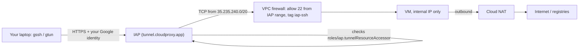
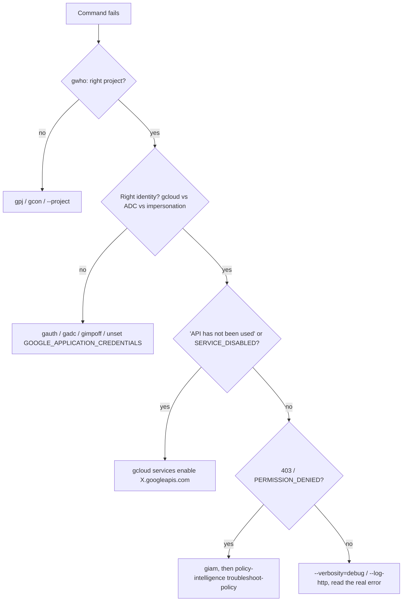

Ops Field Library · updated 2026-10-29 · gcloud SDK 585.0.0
# Google Cloud, A → Z
The essential route through `gcloud` for a typical small-team setup: per-environment projects in Montréal and Toronto, VMs reached only through IAP, GKE for CI and e2e, Artifact Registry for images, Terraform for everything that should outlive a shell session. Every chapter opens with the shortcut from `zsh/cloud.zsh`, then the full command, then the traps.
**Conventions.** Placeholders are uppercase: `PROJECT`, `VM`, `ZONE`, `SA`. Region defaults to `northamerica-northeast1` (Montréal); `northamerica-northeast2` is Toronto. The `$` prompt is omitted so blocks paste straight in.
**How to read it.** Each chapter: the two-sentence version, the shortcut, the long form, the traps. Bold callouts mark where people lose an afternoon. Chapter Z is the one to print.
**Opinionated defaults.** No external IPs, IAP for every shell. No service-account keys, ever: impersonation for humans, Workload Identity for CI and pods. Terraform for anything that should exist tomorrow, `gcloud` for looking and for one-offs.

## 01 · Mental model
Everything in Google Cloud lives in a project, projects sit under folders under the organization, and IAM policies set at any level flow down. Most surprises come from forgetting which project and which identity a command is about to use.

### The words that matter

| Term | Means | Note |
|---|---|---|
| Region / zone | `northamerica-northeast1` / `…-a`, `-b`, `-c` | VMs, disks and zonal GKE clusters live in a zone. Regional resources (regional GKE, AR, buckets) span zones. Canadian data residency means choosing `northeast1` or `northeast2` on purpose. |
| API / service | `compute.googleapis.com`, `container.googleapis.com` … | Disabled by default in a new project. "API has not been used in project" means `gcloud services enable`. |
| Principal | `user:`, `group:`, `serviceAccount:`, `principal://`, `principalSet://` | Grant to groups, not users, so offboarding is one change. |
| Role | `roles/viewer`, `roles/container.developer`, custom roles | Basic roles (owner/editor/viewer) are too broad for anything automated. |
| ADC | Application Default Credentials | What Terraform and the client libraries use. A separate login from `gcloud`'s own. Chapter 03. |
| Org policy | Constraints like "no SA keys", "no external IPs", "allowed locations" | Overrides what IAM would allow. The error usually says `constraints/…`. |
> **Three facts that explain most surprises.** `gcloud` uses the project in your active configuration unless you pass `--project`, so check `gwho` before you create or delete anything. `gcloud` and Terraform use different credentials, so "works in gcloud, 403 in Terraform" is normal until you run `gadc`. IAM changes take effect in seconds to a few minutes, so retry a fresh grant before you debug it.

## 02 · Shortcuts
These live in [`zsh/cloud.zsh`](../zsh/cloud.zsh) in this repo (installed to `~/.zsh/cloud.zsh`); the core functions are excerpted below. Every one that takes a VM or cluster name finds it in **any project you can see**, not only the active one: `gssh my-vm` works from any active project. Leave the name off and an fzf picker opens. The inventory is cached for 12 hours in `~/.cache/gx`; a name it doesn't know triggers one refresh, and `gxr` refreshes on demand. The names avoid the oh-my-zsh git aliases (`gcl`, `gcs`, `gst`, `gcp`, `gke` are git).

| Shortcut | Does | Long form |
|---|---|---|
| `gx` | gcloud, with tab-completion | `gcloud` |
| `gwho` | Account, project, region, impersonation, kube context in one box | `gcloud config list` + `kubectl config current-context` |
| `gpj [id]` | Switch project; no arg = fuzzy pick | `gcloud config set project ID` |
| `gcfg` / `gcon [name]` | List / switch named configurations | `gcloud config configurations list\|activate` |
| `gauth` | Log in for gcloud and ADC in one browser trip | `gcloud auth login --update-adc` |
| `gadc` | Refresh ADC only (Terraform, SDKs) | `gcloud auth application-default login` |
| `gvms` | VMs: zone, status, type, internal IP, spot or standard | `gcloud compute instances list --format=…` |
| `gvmsa` / `gkela` | Every VM / cluster across all your projects, with project column | cached inventory; `gxr` refreshes |
| `gin PREFIX CMD…` | Run any command or shortcut against another project, picked by unique prefix | `CLOUDSDK_CORE_PROJECT=… CMD` (`gin my-project-d gvms`, `gin my-project-p gsm`) |
| `gssh [vm] [-- cmd]` | SSH through IAP, any project, zone looked up | `gcloud compute ssh VM --zone Z --tunnel-through-iap` |
| `gscp SRC DST` | Copy through IAP, recursive; the VM in `vm:/path` is looked up in any project | `gcloud compute scp --tunnel-through-iap --recurse` |
| `gtun vm PORT [LOCAL]` | Forward a VM port to localhost through IAP | `gcloud compute start-iap-tunnel VM PORT --local-host-port=…` |
| `gvmon` / `gvmoff [vm]` | Start / stop a VM | `gcloud compute instances start\|stop` |
| `gkel` | Clusters: location, version, node count | `gcloud container clusters list` |
| `gkec [cluster]` | Write kubeconfig for a cluster in any project; extra flags pass through | `gcloud container clusters get-credentials C --location L --project P` |
| `gkestale [--delete]` | Kube contexts whose cluster (or fleet membership) is gone; `--delete` removes them | `kubectl config delete-context …` |
| `gkeops` | GKE operations still running (upgrades, resizes) | `gcloud container operations list --filter='status!=DONE'` |
| `garl` | Artifact Registry repos with size in GB | `gcloud artifacts repositories list` |
| `garauth [region]` | Docker login for AR in a region | `gcloud auth configure-docker REGION-docker.pkg.dev` |
| `gart PATH` | Images and tags in a repo | `gcloud artifacts docker images list PATH --include-tags` |
| `gsl [gs://…]` | List buckets or objects | `gcloud storage ls` |
| `gsm` / `gsmget NAME [ver]` | List secrets / print a secret's value | `gcloud secrets versions access latest --secret NAME` |
| `glogs 'FILTER' [1h] [50]` | Readable logs, newest first | `gcloud logging read FILTER --freshness … --format=table(…)` |
| `giam [project] [member]` | Your roles on a project (or someone else's) | `gcloud projects get-iam-policy … --flatten --filter` |
| `gbind PROJECT MEMBER ROLE` | Grant a project role without the interactive condition prompt | `gcloud projects add-iam-policy-binding … --condition=None` |
| `tf`, `tfi`, `tfp`, `tfa`, `tfo`, `tfv`, `tff`, `tfs` | terraform, init, plan, apply, output, validate, fmt -recursive, state list (tab-completion on `tf`) | `terraform …` |
| `gimp SA` / `gimpoff` | Act as a service account in this shell / stop | `CLOUDSDK_AUTH_IMPERSONATE_SERVICE_ACCOUNT=SA` |

### The source
*`zsh/cloud.zsh` (excerpt; the file is the source of truth, including `_gx_inv`)*
```sh
# VMs and clusters from every project, cached 12h in ~/.cache/gx (gxr refreshes)
# _gx_inv vms|clusters [refresh] prints "project  name  zone-or-location  status",
# listing all projects in parallel (about 2 s for nine projects)

# _gx_pick vms|clusters [name] → "name zone project"; fzf when no name or ambiguous
_gx_pick() {
  local kind=$1 name=$2 rows
  _gx_sel() {
    # GKE node VMs are reachable by exact name but kept out of the picker
    if [[ -n $name ]]; then _gx_inv $kind $1 | awk -F'\t' -v n="$name" '$2==n'
    else _gx_inv $kind $1 | awk -F'\t' '$2 !~ /^gke-/'; fi
  }
  rows=$(_gx_sel)
  [[ -z $rows && -n $name ]] && rows=$(_gx_sel refresh)
  [[ -z $rows ]] && { echo "no ${kind%s} named '$name' in any project (gxr to refresh)" >&2; return 1 }
  local -a lines=(${(f)rows})
  (( $#lines > 1 )) && rows=$(print -r -- $rows | column -t -s $'\t' | fzf --prompt="${kind%s}> " | awk '{print $1"\t"$2"\t"$3}')
  [[ -z $rows ]] && return 1
  print -r -- $rows | awk -F'\t' '{print $2, $3, $1}'
}

# ssh through IAP, any project: gssh [vm] [-- remote cmd]
gssh() {
  local vm; vm=($(_gx_pick vms "$1")) || return; shift 2>/dev/null
  gcloud compute ssh "${vm[1]}" --zone "${vm[2]}" --project "${vm[3]}" --tunnel-through-iap "$@"
}

# GKE credentials, any project; no arg = pick. Extra flags pass through (--dns-endpoint)
gkec() {
  local c; c=($(_gx_pick clusters "$1")) || return
  gcloud container clusters get-credentials "${c[1]}" --location "${c[2]}" --project "${c[3]}" "${@:2}"
}

# readable logs: glogs 'resource.type="k8s_container" severity>=ERROR' [1h]
glogs() {
  gcloud logging read "$1" --freshness="${2:-1h}" --order=desc --limit="${3:-50}" \
    --format='table(timestamp.date("%H:%M:%S"),severity,resource.labels.container_name,textPayload,jsonPayload.message)'
}

# gcloud/gsutil/bq completion, also on gx (at the bottom, after the last compinit)
source /usr/share/google-cloud-sdk/completion.zsh.inc
complete -o nospace -o default -F _python_argcomplete gx
```

### Put the project in your prompt
Your Powerlevel10k prompt already has the `gcloud` segment on the right. It shows `account:project` only while the command you're typing matches `POWERLEVEL9K_GCLOUD_SHOW_ON_COMMAND`, so it stays out of the way. The default pattern is `gcloud|gcs|gsutil`; yours now also covers the shortcuts, so typing `gssh` or `terraform` shows which project they'll hit:
*~/.p10k.zsh*
```sh
typeset -g POWERLEVEL9K_GCLOUD_SHOW_ON_COMMAND='gcloud|gx|gsutil|gssh|gscp|gtun|gvm.*|gke.*|gar.*|gsm.*|glogs|giam|gbind|terraform|tf.*'
```
> **Make the project visible before destructive commands.** Production and dev projects look alike in a terminal. Run `gwho`, or pass `--project` explicitly in anything you paste into a runbook. Every `delete` in this guide prompts unless you add `--quiet`; leave it off when typing by hand.

## 03 · Auth and configurations
There are two credentials on your laptop: gcloud's own login, and Application Default Credentials (ADC) for Terraform and every client library. Named configurations bundle account, project and region so switching environments is one command.

### Log in
```sh
gauth                                   # gcloud auth login --update-adc: both creds, one browser trip
gcloud auth list                        # which accounts are logged in, which is active
gcloud auth print-access-token | head -c 20; echo   # quick "am I logged in"

gadc                                    # ADC only: writes ~/.config/gcloud/application_default_credentials.json
gcloud auth application-default set-quota-project PROJECT   # silences the "quota project" warning for SDKs

# headless box (no browser): prints a URL to open elsewhere
gcloud auth login --no-browser
```

| Credential | Used by | Lives in | Refresh |
|---|---|---|---|
| gcloud user creds | `gcloud`, `gsutil`, `bq`, the GKE auth plugin | `~/.config/gcloud/credentials.db` | `gcloud auth login` |
| ADC | Terraform, Python/Go/Node SDKs, Helm plugins, anything with a Google client library | `~/.config/gcloud/application_default_credentials.json` | `gadc` |
| `GOOGLE_APPLICATION_CREDENTIALS` | Overrides ADC with a file path | wherever it points | Unset it unless you mean it. A stale value here explains many "wrong identity" bugs. |

### Named configurations, one per environment
```sh
# create once
gcloud config configurations create dev
gcloud config set account you@example.com
gcloud config set project my-project-dev
gcloud config set compute/region northamerica-northeast1
gcloud config set compute/zone northamerica-northeast1-c

gcloud config configurations create cicd
gcloud config set project my-cicd-project
# …same region and zone

# daily
gcfg                         # list; the active one has IS_ACTIVE True
gcon cicd                    # switch; gcon alone opens a picker
gwho                         # confirm

# one command against another config without switching
gcloud compute instances list --configuration=dev
CLOUDSDK_ACTIVE_CONFIG_NAME=dev terraform plan   # gcloud calls inside see dev
```
> **Project switch vs configuration switch.** `gpj` changes only the project in the current configuration. Use it for a quick look. Use `gcon` when the account or region also changes, so you never end up with your Toronto zone on a Montréal project.

### Any property, once or per command
```sh
gcloud config list --all | less                 # every property and its value
gcloud config get project                       # one value, script-friendly
gcloud config set core/disable_prompts true     # never prompt (only in CI images)
gcloud config set accessibility/screen_reader false
gcloud --verbosity=debug compute instances list # see the HTTP calls
gcloud --log-http compute instances list 2>&1 | less   # the full request/response
CLOUDSDK_CORE_PROJECT=my-project-dev gcloud compute instances list   # any property as env var
```

## 04 · IAM and service accounts
Grant roles to groups on the smallest resource that works, give automation its own service account, and never download a key. Humans act as a service account through impersonation; CI and pods do it through Workload Identity.

### Read who can do what
```sh
giam                                          # my roles on the current project
giam my-project-dev group:platform@example.com   # a group's roles on another project

# whole policy as role → members
gcloud projects get-iam-policy PROJECT --format=json | jq -r '.bindings[] | "\(.role)\t\(.members|join(", "))"'

# every binding for one person across everything you can see (needs Cloud Asset API)
gcloud asset search-all-iam-policies --scope=projects/PROJECT --query="policy:you@example.com"

# "why can't X do Y?" — Google evaluates it for you
gcloud policy-intelligence troubleshoot-policy iam \
  //cloudresourcemanager.googleapis.com/projects/PROJECT \
  --principal-email=SA@PROJECT.iam.gserviceaccount.com --permission=compute.instances.start

# what does a role contain
gcloud iam roles describe roles/container.developer --format='value(includedPermissions)' | tr ';' '\n'
gcloud iam list-testable-permissions //cloudresourcemanager.googleapis.com/projects/PROJECT --filter='name~^container' | head
```

### Grant and revoke
```sh
gcloud projects add-iam-policy-binding PROJECT \
  --member=group:platform@example.com --role=roles/container.developer --condition=None

gcloud projects remove-iam-policy-binding PROJECT \
  --member=user:someone@example.com --role=roles/editor

# time-boxed access: a condition that expires
gcloud projects add-iam-policy-binding PROJECT --member=user:contractor@example.com \
  --role=roles/viewer \
  --condition='expression=request.time < timestamp("2026-11-30T00:00:00Z"),title=until-nov-30'

# narrower than project: bind on the resource itself
gcloud artifacts repositories add-iam-policy-binding docker-images --location=northamerica-northeast1 \
  --member=serviceAccount:SA@PROJECT.iam.gserviceaccount.com --role=roles/artifactregistry.reader
gcloud storage buckets add-iam-policy-binding gs://BUCKET \
  --member=serviceAccount:SA@PROJECT.iam.gserviceaccount.com --role=roles/storage.objectViewer
```
> **Terraform owns IAM where Terraform exists.** A binding added by hand is either reverted by the next `terraform apply` (with `google_project_iam_policy` or `_binding`) or drifts silently (with `_member`). Hand grants are for a five-minute debug; then put it in code.

### Service accounts
```sh
gcloud iam service-accounts list --format='table(email,disabled)'
gcloud iam service-accounts create deployer --display-name="CI deployer"
SA=deployer@PROJECT.iam.gserviceaccount.com

# let a group impersonate it (this is the permission that matters)
gcloud iam service-accounts add-iam-policy-binding $SA \
  --member=group:platform@example.com --role=roles/iam.serviceAccountTokenCreator

# act as it
gcloud compute instances list --impersonate-service-account=$SA   # one command
gimp $SA                                                           # this shell
gimpoff                                                            # stop
gcloud config set auth/impersonate_service_account $SA            # persistent (shows in gwho)

# who can act as this SA?
gcloud iam service-accounts get-iam-policy $SA
```
> **No service-account keys.** A JSON key is a password that never expires and ends up in a repo, a laptop backup, a Slack paste. Use impersonation for people, Workload Identity Federation for GitLab CI and Workload Identity for pods. If an org policy (`constraints/iam.disableServiceAccountKeyCreation`) blocks `keys create`, that's the policy working. To find existing keys: `gcloud iam service-accounts keys list --iam-account=$SA --managed-by=user`.

### GitLab CI to Google Cloud without keys (Workload Identity Federation)
```sh
PROJECT_NUMBER=$(gcloud projects describe PROJECT --format='value(projectNumber)')

gcloud iam workload-identity-pools create gitlab --location=global --display-name="GitLab"
gcloud iam workload-identity-pools providers create-oidc gitlab-com \
  --location=global --workload-identity-pool=gitlab \
  --issuer-uri=https://gitlab.com \
  --allowed-audiences=https://gitlab.com \
  --attribute-mapping="google.subject=assertion.sub,attribute.project_path=assertion.project_path,attribute.ref=assertion.ref" \
  --attribute-condition="assertion.namespace_path.startsWith('my-group')"

# only this GitLab project may act as the deployer SA
gcloud iam service-accounts add-iam-policy-binding $SA --role=roles/iam.workloadIdentityUser \
  --member="principalSet://iam.googleapis.com/projects/$PROJECT_NUMBER/locations/global/workloadIdentityPools/gitlab/attribute.project_path/my-group/my-app"
```
*.gitlab-ci.yml*
```sh
deploy:
  id_tokens:
    GCP_ID_TOKEN:
      aud: https://gitlab.com
  script:
    - echo "$GCP_ID_TOKEN" > .gcp_token
    - gcloud iam workload-identity-pools create-cred-config
        projects/$PROJECT_NUMBER/locations/global/workloadIdentityPools/gitlab/providers/gitlab-com
        --service-account=$SA --credential-source-file=.gcp_token --output-file=.gcp_cred.json
    - gcloud auth login --cred-file=.gcp_cred.json
    - gcloud container clusters list
```
The attribute condition is what stops any other gitlab.com project from using your pool. Leave it out and every GitLab user on the internet can request a token from it; the SA binding is then your only defence.

## 05 · Compute Engine VMs
A VM is a boot disk plus a machine type in a zone. Create it without an external IP, reach it through IAP, make it spot when it can be interrupted, and stop it when you're done: a stopped VM pays only for its disks.

### Look
```sh
gvms                                                    # everything in the project
gvms --filter='status=RUNNING AND name~^app'          # aliases take extra flags
gcloud compute instances describe VM --zone ZONE --format=yaml | less
gcloud compute instances get-serial-port-output VM --zone ZONE | tail -50   # boot log, even when ssh is dead
gcloud compute machine-types list --zones=northamerica-northeast1-c --filter='name~^(e2|n2d)-standard' --format='table(name,guestCpus,memoryMb)'
gcloud compute images list --filter='family~(fedora|rocky|debian-12)' --format='table(name,family,project)'
```

### Create
```sh
gcloud compute instances create review-NAME \
  --zone=northamerica-northeast2-a \
  --machine-type=e2-custom-6-24576 \
  --image-family=rocky-linux-10 --image-project=rocky-linux-cloud \
  --boot-disk-size=100GB --boot-disk-type=pd-balanced \
  --no-address \
  --shielded-secure-boot --shielded-vtpm --shielded-integrity-monitoring \
  --service-account=vm-runtime@PROJECT.iam.gserviceaccount.com --scopes=cloud-platform \
  --metadata=enable-oslogin=TRUE \
  --labels=owner=you,purpose=review,ttl=2026-11-15 \
  --tags=iap-ssh \
  --metadata-from-file=startup-script=./startup.sh

# spot: up to ~60-91% cheaper, can be reclaimed with 30s notice
  --provisioning-model=SPOT --instance-termination-action=STOP

# self-destruct timer for throwaway boxes
  --max-run-duration=8h --instance-termination-action=DELETE
```

| Choice | Default pick | Why |
|---|---|---|
| Machine family | `e2-standard` for general, `n2d-standard` for CI builds | e2 is cheapest per vCPU; n2d (AMD) is faster per core, which is why the CI job pools use `n2d-standard-8`. |
| Custom shape | `e2-custom-CPUS-MEMMB` | When the workload is memory-heavy, like a review stack: `e2-custom-6-24576` is 6 vCPU, 24 GB. |
| Disk | `pd-balanced` | `pd-ssd` for databases and build caches, `pd-standard` only for cold data. Local SSD is fast and gone on stop. |
| Provisioning | Spot for CI and review, standard for anything a customer sees | Spot VMs get reclaimed. `STOP` keeps the disk; `DELETE` doesn't. |
| External IP | None | IAP for shells (chapter 06), Cloud NAT for outbound. |

### Operate
```sh
gssh                                  # pick a VM, ssh in through IAP
gssh review-vm-1 -- 'sudo systemctl status k3s'   # one remote command
gscp ./bundle.tar review-vm-1:/tmp/                # zone needed if ambiguous: add --zone
gtun review-vm-1 443 8443       # https://localhost:8443 → VM:443
gvmoff review-vm-1              # stop: pay for disk only
gvmon review-vm-1

gcloud compute instances set-machine-type VM --zone ZONE --machine-type=e2-standard-8   # must be stopped
gcloud compute disks resize VM --zone ZONE --size=200GB                                 # online; grow the FS after
gcloud compute instances add-labels VM --zone ZONE --labels=ttl=2026-12-01
gcloud compute config-ssh             # writes ~/.ssh/config Host entries so plain ssh/VS Code work
```

### Snapshots and images
```sh
gcloud compute disks snapshot VM --zone ZONE --snapshot-names=VM-$(date +%Y%m%d) --storage-location=northamerica-northeast1
gcloud compute snapshots list --filter='sourceDisk~VM' --format='table(name,diskSizeGb,creationTimestamp.date())'
gcloud compute images create app-golden-$(date +%Y%m%d) --source-disk=VM --source-disk-zone=ZONE --family=app-golden
# a schedule beats remembering
gcloud compute resource-policies create snapshot-schedule daily-7 --region=northamerica-northeast1 \
  --daily-schedule --start-time=06:00 --max-retention-days=7
gcloud compute disks add-resource-policies VM --zone ZONE --resource-policies=daily-7
```

## 06 · Networking and IAP
A VPC is global, its subnets are regional, and firewall rules apply by network tag or service account. Identity-Aware Proxy lets you reach a VM with no external IP: Google checks your IAM, then tunnels TCP from a fixed range into the VPC.


### Make IAP work for a project
```sh
gcloud services enable iap.googleapis.com

# 1. firewall: IAP's range to port 22 (and any port you'll tunnel), on tagged VMs
gcloud compute firewall-rules create allow-iap-ssh --network=NETWORK \
  --direction=INGRESS --action=allow --rules=tcp:22,tcp:443 \
  --source-ranges=35.235.240.0/20 --target-tags=iap-ssh

# 2. IAM: who may open tunnels (project-wide, or per VM)
gcloud projects add-iam-policy-binding PROJECT --member=group:platform@example.com \
  --role=roles/iap.tunnelResourceAccessor
# 3. OS Login: who may log in, and who gets sudo
gcloud projects add-iam-policy-binding PROJECT --member=group:platform@example.com --role=roles/compute.osAdminLogin

# test end to end, with Google's own diagnosis
gcloud compute ssh VM --zone ZONE --tunnel-through-iap --troubleshoot
```

### Look at the network
```sh
gcloud compute networks list
gcloud compute networks subnets list --filter='region:northamerica-northeast1' --format='table(name,network.basename(),ipCidrRange,privateIpGoogleAccess)'
gcloud compute firewall-rules list --format='table(name,network.basename(),direction,sourceRanges.list(),allowed[].map().firewall_rule().list(),targetTags.list())'
gcloud compute routers list
gcloud compute routers nats list --router=ROUTER --region=REGION
gcloud compute addresses list                       # reserved IPs (each unattached one costs money)
```

### Cloud NAT and Private Google Access
```sh
# outbound internet for VMs without external IPs
gcloud compute routers create nat-router --network=NETWORK --region=northamerica-northeast1
gcloud compute routers nats create nat --router=nat-router --region=northamerica-northeast1 \
  --auto-allocate-nat-external-ips --nat-all-subnet-ip-ranges --enable-logging

# reach Google APIs (AR, GCS, Secret Manager) without NAT
gcloud compute networks subnets update SUBNET --region=REGION --enable-private-ip-google-access
```
> **Firewall rules are per VPC and match by tag.** A VM created without `--tags=iap-ssh` doesn't match the IAP rule, and `gssh` times out with error 4003 "failed to connect to backend". Add the tag (`gcloud compute instances add-tags VM --zone ZONE --tags=iap-ssh`); no restart needed.

## 07 · GKE
gcloud's GKE job is the cluster's outside: create it, size its node pools, upgrade it, and hand `kubectl` a kubeconfig. Inside the cluster it's plain Kubernetes, covered in the Kubernetes guides.

### Connect
```sh
gkela                                  # every cluster in every project you can see
gkel                                   # only the active project's
gkec                                   # pick one from any project, kubeconfig written, context switched
gkec my-cluster         # by name: project and location found for you
gkestale                               # contexts whose cluster is gone (dry run)
gkestale --delete                      # remove them
gkec e2e-cluster --internal-ip           # extra flags pass through
gkec CLUSTER --dns-endpoint            # private control plane, reached via its DNS endpoint

# the context name is long: rename it once
kubectl config rename-context gke_my-cicd-project_northamerica-northeast1_cicd-cluster cicd
kctx cicd
```
> **Clusters get deleted; kubeconfig entries don't.** It is common to find most of the contexts in `~/.kube/config` pointing at clusters (old dev, MR, prod and Connect-gateway clusters) that no longer exist. Switching to one hangs until the request times out. Run `gkestale` after a cluster is torn down.
> **The auth plugin is required.** Since GKE 1.26, kubectl authenticates through `gke-gcloud-auth-plugin` (installed at `/usr/bin/gke-gcloud-auth-plugin`). It uses your gcloud login, so "You must be logged in to the server" after a laptop sleep means `gauth`, not a new kubeconfig.

### Look at the outside
```sh
gcloud container clusters describe CLUSTER --location LOC --format=yaml | less
gcloud container node-pools list --cluster CLUSTER --location LOC \
  --format='table(name,config.machineType,config.spot,autoscaling.minNodeCount,autoscaling.maxNodeCount,version)'
gcloud container get-server-config --location=northamerica-northeast1 --format='yaml(channels)'   # versions per channel
gcloud container operations list --location LOC --filter='status!=DONE'                           # is an upgrade running?
```

### Create a cluster you won't regret
```sh
gcloud container clusters create app-dev \
  --location=northamerica-northeast1 --node-locations=northamerica-northeast1-a,northamerica-northeast1-b \
  --release-channel=regular \
  --enable-ip-alias --network=NETWORK --subnetwork=SUBNET \
  --enable-private-nodes --master-ipv4-cidr=172.16.0.32/28 \
  --enable-dataplane-v2 \
  --workload-pool=PROJECT.svc.id.goog \
  --enable-shielded-nodes \
  --machine-type=e2-standard-4 --num-nodes=1 \
  --enable-autoscaling --min-nodes=1 --max-nodes=3 \
  --labels=env=dev,team=platform

# a spot pool for interruptible work, tainted so only opted-in pods land there
gcloud container node-pools create spot --cluster app-dev --location northamerica-northeast1 \
  --machine-type=n2d-standard-8 --spot \
  --enable-autoscaling --min-nodes=0 --max-nodes=10 \
  --node-taints=cloud.google.com/gke-spot=true:NoSchedule
```

| Flag | Why it's on | Reversible? |
|---|---|---|
| `--location` as a region | Regional control plane survives a zone outage. Zonal (like `e2e-cluster`) is cheaper for disposable clusters. | **No**. Recreate to change. |
| `--enable-private-nodes` | Nodes have no public IPs; pair with Cloud NAT. | Only on recent GKE versions, and it recreates nodes. Plan it up front. |
| `--enable-ip-alias` | VPC-native pod IPs; required for most modern features. | **No**. |
| `--enable-dataplane-v2` | Cilium-based dataplane, NetworkPolicy enforced natively. | **No**. |
| `--workload-pool` | Pods get Google identities without keys (below). | Yes, can enable later. |
| `--release-channel` | Automatic, tested upgrades. `regular` for most, `stable` for customer-facing. | Yes. |
> **Three of those are one-way doors, and one is close to it.** Location type, VPC-native and the dataplane can't change after creation, and switching to private nodes later recreates every node. Put them in Terraform and review them as you would a schema migration.

### Resize, upgrade, scale to zero
```sh
gcloud container clusters resize CLUSTER --location LOC --node-pool POOL --num-nodes=0   # park a pool
gcloud container node-pools update POOL --cluster CLUSTER --location LOC --enable-autoscaling --min-nodes=0 --max-nodes=6
gcloud container clusters upgrade CLUSTER --location LOC --master --cluster-version=1.35
gcloud container clusters upgrade CLUSTER --location LOC --node-pool=POOL      # nodes follow the master
gcloud container clusters update CLUSTER --location LOC \
  --add-maintenance-exclusion-name=release-freeze --add-maintenance-exclusion-start=2026-12-15T00:00:00Z \
  --add-maintenance-exclusion-end=2027-01-05T00:00:00Z --add-maintenance-exclusion-scope=no_upgrades
```

### Workload Identity: pods as Google identities
```sh
# direct grant to a Kubernetes service account, no Google SA needed
PROJECT_NUMBER=$(gcloud projects describe PROJECT --format='value(projectNumber)')
gcloud projects add-iam-policy-binding PROJECT --role=roles/secretmanager.secretAccessor \
  --member="principal://iam.googleapis.com/projects/$PROJECT_NUMBER/locations/global/workloadIdentityPools/PROJECT.svc.id.goog/subject/ns/external-secrets/sa/external-secrets"

# or the older pattern: KSA impersonates a GSA
gcloud iam service-accounts add-iam-policy-binding GSA@PROJECT.iam.gserviceaccount.com \
  --role=roles/iam.workloadIdentityUser --member="serviceAccount:PROJECT.svc.id.goog[NS/KSA]"
kubectl annotate serviceaccount KSA -n NS iam.gke.io/gcp-service-account=GSA@PROJECT.iam.gserviceaccount.com
```

## 08 · Artifact Registry
Artifact Registry holds Docker images, Helm charts (as OCI) and language packages, per region. The host is `REGION-docker.pkg.dev` and the path is `PROJECT/REPO/IMAGE`. Without a cleanup policy it only grows: a busy CI image repo reaches tens of GB within months.

### Push and pull
```sh
garauth                                     # docker login for your region (adds a credHelper to ~/.docker/config.json)
garauth northamerica-northeast2             # another region
REG=northamerica-northeast1-docker.pkg.dev/my-cicd-project/docker-images

docker tag myapp:dev $REG/myapp:$(git rev-parse --short=7 HEAD)
docker push $REG/myapp:$(git rev-parse --short=7 HEAD)

garl                                        # repos and size
gart $REG                                   # images + tags
gart $REG --filter='package~myapp' --sort-by=~createTime --limit=10
gcloud artifacts docker tags list $REG/myapp
gcloud artifacts docker images describe $REG/myapp:TAG --show-package-vulnerability   # needs scanning enabled
```

### Helm charts as OCI
```sh
gcloud auth print-access-token | helm registry login -u oauth2accesstoken --password-stdin https://northamerica-northeast1-docker.pkg.dev
helm package charts/myapp
helm push myapp-1.4.2.tgz oci://northamerica-northeast1-docker.pkg.dev/PROJECT/charts
helm pull oci://northamerica-northeast1-docker.pkg.dev/PROJECT/charts/myapp --version 1.4.2
```

### Create a repo, and keep it small
```sh
gcloud artifacts repositories create charts --repository-format=docker \
  --location=northamerica-northeast1 --description="Helm charts (OCI)" --immutable-tags

# remote repo: a pull-through cache of Docker Hub, so CI stops hitting rate limits
gcloud artifacts repositories create dockerhub --repository-format=docker --mode=remote-repository \
  --remote-docker-repo=DOCKER-HUB --location=northamerica-northeast1
```
*cleanup.json*
```sh
[
  { "name": "drop-untagged-after-7d", "action": {"type": "Delete"},
    "condition": {"tagState": "untagged", "olderThan": "7d"} },
  { "name": "drop-sha-tags-after-30d", "action": {"type": "Delete"},
    "condition": {"tagState": "tagged", "tagPrefixes": ["sha-"], "olderThan": "30d"} },
  { "name": "keep-10-newest", "action": {"type": "Keep"},
    "mostRecentVersions": {"keepCount": 10} },
  { "name": "keep-releases", "action": {"type": "Keep"},
    "condition": {"tagState": "tagged", "tagPrefixes": ["v", "release-"]} }
]
```
```sh
# dry run first (the default): see what it would delete in the audit log, then enforce
gcloud artifacts repositories set-cleanup-policies docker-images --location=northamerica-northeast1 --policy=cleanup.json --dry-run
gcloud artifacts repositories set-cleanup-policies docker-images --location=northamerica-northeast1 --policy=cleanup.json --no-dry-run
gcloud artifacts repositories list-cleanup-policies docker-images --location=northamerica-northeast1
```
> **Cleanup deletes are permanent.** Keep rules win over delete rules, so add a keep rule for anything a customer bundle or a running cluster pins by digest before you switch off dry run. This is a one-way door for every image it removes.

## 09 · Cloud Storage
`gcloud storage` replaced `gsutil`: same `gs://` paths, faster parallel transfers, consistent flags. Buckets get uniform access and public-access prevention from day one, and a lifecycle rule so they don't become an attic.
```sh
gsl                                              # buckets in the project
gsl gs://BUCKET/path/                            # objects
gcloud storage ls -l -r gs://BUCKET/logs/ | tail # sizes, recursive
gcloud storage du -s -r gs://BUCKET              # total size (-r = readable units)

gcloud storage cp ./bundle.tar gs://BUCKET/releases/
gcloud storage cp -r gs://BUCKET/releases/1.4.2/ ./
gcloud storage rsync -r --delete-unmatched-destination-objects ./site gs://BUCKET/site
gcloud storage cat gs://BUCKET/config.json | jq
gcloud storage mv gs://BUCKET/a gs://BUCKET/b
gcloud storage rm -r gs://BUCKET/tmp/

# share one object for an hour without making anything public
gcloud storage sign-url gs://BUCKET/releases/bundle.tar --duration=1h \
  --impersonate-service-account=signer@PROJECT.iam.gserviceaccount.com
```

### A bucket set up properly
```sh
gcloud storage buckets create gs://my-project-dev-artifacts \
  --location=northamerica-northeast1 \
  --uniform-bucket-level-access --public-access-prevention \
  --default-storage-class=STANDARD
gcloud storage buckets update gs://my-project-dev-artifacts --versioning
gcloud storage buckets update gs://my-project-dev-artifacts --lifecycle-file=lifecycle.json
gcloud storage buckets describe gs://my-project-dev-artifacts --format='yaml(location,storage_class,versioning_enabled,lifecycle_config,public_access_prevention)'
```
*lifecycle.json*
```sh
{ "rule": [
  { "action": {"type": "SetStorageClass", "storageClass": "NEARLINE"}, "condition": {"age": 30} },
  { "action": {"type": "Delete"}, "condition": {"age": 365} },
  { "action": {"type": "Delete"}, "condition": {"isLive": false, "numNewerVersions": 3} }
] }
```
> **gsutil still works, but don't start new scripts with it.** The flag mapping is close: `gsutil -m cp -r` → `gcloud storage cp -r` (parallel by default), `gsutil rsync -d` → `gcloud storage rsync --delete-unmatched-destination-objects`, `gsutil iam ch` → `gcloud storage buckets add-iam-policy-binding`.

## 10 · Secret Manager
A secret is a name; its value lives in numbered, immutable versions. Read with IAM, never with a key, and pin to `latest` only where a rotation should take effect without a deploy.
```sh
gsm                                          # list
gsmget app-db-password                     # latest value to stdout
gsmget app-db-password 3                   # a specific version

# create with Canadian residency, then add the value from stdin (keeps it out of shell history)
gcloud secrets create app-db-password --replication-policy=user-managed \
  --locations=northamerica-northeast1,northamerica-northeast2 --labels=app=myapp,env=dev
printf %s "$(pwgen -s 32 1)" | gcloud secrets versions add app-db-password --data-file=-

gcloud secrets versions list app-db-password --format='table(name,state,createTime.date())'
gcloud secrets versions disable 2 --secret=app-db-password    # reversible
gcloud secrets versions destroy 1 --secret=app-db-password    # permanent

# who can read it
gcloud secrets get-iam-policy app-db-password
gcloud secrets add-iam-policy-binding app-db-password \
  --member=serviceAccount:SA@PROJECT.iam.gserviceaccount.com --role=roles/secretmanager.secretAccessor
```

### Into Kubernetes with external-secrets
*clustersecretstore.yaml*
```sh
apiVersion: external-secrets.io/v1
kind: ClusterSecretStore
metadata: { name: gcp-sm }
spec:
  provider:
    gcpsm:
      projectID: my-project-dev
      # no auth block: the controller's KSA uses Workload Identity (chapter 07)
---
apiVersion: external-secrets.io/v1
kind: ExternalSecret
metadata: { name: app-db, namespace: app }
spec:
  refreshInterval: 1h
  secretStoreRef: { kind: ClusterSecretStore, name: gcp-sm }
  target: { name: app-db }
  data:
    - secretKey: password
      remoteRef: { key: app-db-password, version: latest }
```
> **`gsmget` prints the secret to your terminal.** That's the point, but terminal scrollback, tmux history and screen shares all keep it. Pipe it into the consumer (`gsmget X | kubectl create secret generic …--from-file=password=/dev/stdin`) rather than copying from the screen.

## 11 · Logging and monitoring
Every GKE container, VM serial console, audit event and load balancer request lands in Cloud Logging. `glogs` gives you the readable view; the filter language is what makes it useful.
```sh
# errors from one namespace in the last 30 minutes
glogs 'resource.type="k8s_container" resource.labels.namespace_name="app" severity>=ERROR' 30m

# one pod, last 200 lines
glogs 'resource.type="k8s_container" resource.labels.pod_name:"app-api-"' 2h 200

# who deleted that VM? (admin activity audit logs are always on)
glogs 'protoPayload.methodName:"compute.instances.delete"' 7d

# all IAM changes this week, with the actor
gcloud logging read 'protoPayload.methodName="SetIamPolicy"' --freshness=7d \
  --format='table(timestamp.date(),protoPayload.authenticationInfo.principalEmail,resource.type,protoPayload.resourceName)'

# spot preemptions (why did my CI node vanish?)
glogs 'protoPayload.methodName="compute.instances.preempted"' 1d

# GKE node and cluster events
glogs 'resource.type="k8s_cluster" severity>=WARNING' 6h

# raw JSON when the table hides the field you need
gcloud logging read 'FILTER' --freshness=1h --limit=5 --format=json | jq '.[0]'
```

| Filter piece | Means |
|---|---|
| `field="x"` | Exact match |
| `field:"x"` | Contains (substring; for labels, "has key") |
| `field=~"regex"` | Regular expression |
| `severity>=ERROR` | DEFAULT < DEBUG < INFO < NOTICE < WARNING < ERROR < CRITICAL |
| `A B` / `A OR B` / `NOT A` | Space is AND. Capitalise OR and NOT. |
| `timestamp>="2026-10-29T14:00:00Z"` | Exact window, instead of `--freshness` |
| `"some text"` | Bare string: searches every field (slow; scope it with resource.type first) |

### Keep, route, alert
```sh
gcloud logging buckets list --location=global
gcloud logging buckets update _Default --location=global --retention-days=30
gcloud logging sinks create audit-to-gcs storage.googleapis.com/my-audit-archive \
  --log-filter='logName:"cloudaudit.googleapis.com"'
gcloud logging metrics create app-api-5xx \
  --log-filter='resource.type="k8s_container" resource.labels.container_name="app-api" httpRequest.status>=500'
gcloud monitoring dashboards list --format='table(displayName,name.basename())'
gcloud alpha monitoring policies list --format='table(displayName,enabled)'
```
> **Logging costs by volume ingested.** A chatty debug log in a CI cluster can cost more than the nodes. Find the noisiest sources with the Logs Explorer's "Log fields" panel, then exclude them: `gcloud logging sinks update _Default --add-exclusion=name=drop-debug,filter='severity<=DEBUG'`.

## 12 · Terraform on GCP
Terraform uses ADC, not gcloud's login, keeps state in a versioned GCS bucket, and should run as a service account you impersonate so your own broad roles never leak into what it can do. gcloud stays useful for looking, importing and generating code.

### Provider and state
*versions.tf*
```sh
terraform {
  required_providers {
    google = { source = "hashicorp/google", version = "~> 7.0" }
  }
  backend "gcs" {
    bucket                      = "my-tfstate-dev"
    prefix                      = "app/dev"
    impersonate_service_account = "terraform@my-project-dev.iam.gserviceaccount.com"
  }
}

provider "google" {
  project                     = "my-project-dev"
  region                      = "northamerica-northeast1"
  impersonate_service_account = "terraform@my-project-dev.iam.gserviceaccount.com"
  default_labels              = { managed-by = "terraform", env = "dev" }
}
```
```sh
# the state bucket (once, by hand or from a bootstrap stack)
gcloud storage buckets create gs://my-tfstate-dev --location=northamerica-northeast1 \
  --uniform-bucket-level-access --public-access-prevention
gcloud storage buckets update gs://my-tfstate-dev --versioning   # your undo button for state

gadc                         # Terraform reads ADC
tfi && tfp                   # terraform init && terraform plan (tf* shortcuts, chapter 02)

# or impersonate for one run without touching the code
GOOGLE_IMPERSONATE_SERVICE_ACCOUNT=terraform@PROJECT.iam.gserviceaccount.com terraform plan
```

### Bring hand-made things under Terraform
```sh
# find the resource's full name
gcloud compute instances describe VM --zone ZONE --format='value(selfLink)'

# import block (Terraform 1.5+), then let it write the config
cat >> import.tf <<'EOF'
import {
  to = google_compute_instance.review
  id = "projects/my-cicd-project/zones/northamerica-northeast2-a/instances/review-vm-1"
}
EOF
terraform plan -generate-config-out=generated.tf

# or ask Google to export a whole project as HCL (needs Cloud Asset API)
gcloud beta resource-config bulk-export --project=PROJECT --resource-format=terraform --path=./export
```
> **"Works for me, fails in CI" is almost always identity.** Locally you're an owner; in CI you're a WIF-mapped service account with the roles in code. Run your plan the way CI does: `GOOGLE_IMPERSONATE_SERVICE_ACCOUNT=ci-sa@… terraform plan`. If it fails there, it would have failed in CI.

## 13 · Cost, quotas and cleanup
Most cloud waste is things nobody remembers starting: review VMs left running, unattached disks and IPs, registries without cleanup, CI pools that never scale to zero. Labels say who owns what, budgets tell you early, and Google's own recommender lists what's idle.

### Find the leftovers
```sh
# running VMs, oldest first, with owner label
gcloud compute instances list --filter='status=RUNNING' --sort-by=creationTimestamp \
  --format='table(name,zone.basename(),machineType.basename(),labels.owner,creationTimestamp.date())'

# VMs with no owner label (the ones nobody will claim)
gcloud compute instances list --filter='NOT labels.owner:*' --format='table(name,zone.basename(),status)'

# disks not attached to anything
gcloud compute disks list --filter='-users:*' --format='table(name,zone.basename(),sizeGb,creationTimestamp.date())'

# reserved IPs not in use (billed hourly)
gcloud compute addresses list --filter='status=RESERVED' --format='table(name,region.basename(),address)'

# old snapshots
gcloud compute snapshots list --filter="creationTimestamp<'2026-07-01'" --format='table(name,diskSizeGb,creationTimestamp.date())'

# Google's idle-resource recommendations, per zone
gcloud recommender recommendations list --project=PROJECT --location=northamerica-northeast1-c \
  --recommender=google.compute.instance.IdleResourceRecommender --format='table(description,primaryImpact.costProjection.cost.units)'
```

### Budgets and labels
```sh
gcloud billing projects describe PROJECT                      # which billing account
gcloud billing budgets create --billing-account=BILLING_ID \
  --display-name="dev monthly" --budget-amount=1500CAD \
  --filter-projects=projects/my-project-dev \
  --threshold-rule=percent=0.5 --threshold-rule=percent=0.9 --threshold-rule=percent=1.0

# label everything: owner, env, purpose, ttl. Billing export groups by these.
gcloud compute instances add-labels VM --zone ZONE --labels=owner=you,env=dev,purpose=review,ttl=2026-11-15
```

### Quotas
```sh
# regional CPU, IP and disk quotas with usage
gcloud compute regions describe northamerica-northeast1 --flatten=quotas \
  --format='table(quotas.metric,quotas.usage,quotas.limit)' | awk 'NR==1 || $2>0'
gcloud compute project-info describe --flatten=quotas --format='table(quotas.metric,quotas.usage,quotas.limit)' | awk 'NR==1 || $2>0'
```

| Lever | Typical saving | Cost of pulling it |
|---|---|---|
| Stop review VMs overnight (`gvmoff`, or an instance schedule) | ~65% of that VM | Boot time in the morning |
| Spot for CI job pools | 60–91% of those nodes | Occasional retried job |
| Node pool autoscaling to 0 | All idle-night hours | Cold start for the first job |
| AR cleanup policy | Storage grows flat instead of forever | One review of keep rules |
| Exclude debug logs from `_Default` | Often the surprise line item | None |
| Committed use discounts | Up to ~55% on steady baseline | **One-way door**: a 1 or 3 year commitment |
```sh
# instance schedule: stop at 19:00, start at 07:00 on weekdays, Toronto time
gcloud compute resource-policies create instance-schedule office-hours --region=northamerica-northeast2 \
  --vm-start-schedule='0 7 * * MON-FRI' --vm-stop-schedule='0 19 * * MON-FRI' --timezone=America/Toronto
gcloud compute instances add-resource-policies review-vm-1 --zone=northamerica-northeast2-a --resource-policies=office-hours
```

## 14 · Troubleshooting
Nearly every gcloud failure is one of four things: wrong project, wrong identity, missing API or missing permission. Check them in that order, then add `--verbosity=debug`.


| Symptom | Cause | Fix |
|---|---|---|
| `Reauthentication required` / `invalid_grant` | gcloud session expired (Workspace session length) | `gauth` |
| gcloud works, Terraform or a script gets 403 | ADC is stale, another account, or `GOOGLE_APPLICATION_CREDENTIALS` points at an old file | `gadc`; `echo $GOOGLE_APPLICATION_CREDENTIALS` |
| `API [x] not enabled` / `SERVICE_DISABLED` | New project or new service | `gcloud services enable x.googleapis.com`; list with `gcloud services list --enabled` |
| `Required 'compute.instances.get' permission` | Missing role, or right role on the wrong project | `giam`, then `troubleshoot-policy` (chapter 04) |
| `constraints/…` in the error | Org policy, not IAM | `gcloud resource-manager org-policies describe CONSTRAINT --project=PROJECT --effective` |
| `gssh`: error 4003 failed to connect to backend | Firewall doesn't allow 35.235.240.0/20, VM missing the tag, or sshd down | `gcloud compute ssh VM --tunnel-through-iap --troubleshoot`; check tags; read the serial port |
| `gssh`: error 4033 not authorized | No `roles/iap.tunnelResourceAccessor` | Grant it on the project or the VM |
| `gssh`: Permission denied (publickey) | OS Login role missing, or your key isn't registered | `roles/compute.osLogin`; `gcloud compute os-login ssh-keys list` |
| kubectl: `executable gke-gcloud-auth-plugin not found` | Plugin not installed or not on PATH | `sudo dnf install google-cloud-cli-gke-gcloud-auth-plugin` |
| kubectl hangs on a private cluster | No route to the control plane from your laptop | `gkec CLUSTER --dns-endpoint`, or a `gtun` through a bastion |
| docker push: `denied: Permission "artifactregistry.repositories.uploadArtifacts"` | Logged in for the wrong region host, or role missing | `garauth REGION`; grant `roles/artifactregistry.writer` on the repo |
| `ZONE_RESOURCE_POOL_EXHAUSTED` | Google is out of that shape in that zone (common for spot) | Try another zone or a different family; spread node pools across zones |
| `Quota 'CPUS' exceeded` | Regional quota | Chapter 13 quota command; request an increase in the console |

### See exactly what happened
```sh
gcloud info --run-diagnostics           # network, proxy and credential checks
gcloud info --format='value(config.paths.global_config_dir,installation.sdk_root)'
gcloud --verbosity=debug COMMAND 2>&1 | less
gcloud --log-http COMMAND 2>&1 | less    # full HTTP request and response
ls ~/.config/gcloud/logs/$(date +%Y.%m.%d)/   # every gcloud run is logged here
```

## Z · --format and --filter card
Every gcloud list command accepts the same projection and filter language. Learning it once turns gcloud into a query tool. Print this section.
```sh
# shaping output
--format=json | yaml | csv(name,zone) | value(name) | table(name,status)
--format='value(name)'                                  # one per line, for xargs and $(…)
--format='table(name,zone.basename(),status)'           # basename() strips the URL
--format='table(name,creationTimestamp.date("%Y-%m-%d"))'
--format='table(name,sizeBytes.size(units_out=G))'
--format='table(name,labels.owner:label=OWNER)'          # rename a column
--format='table[box](…)'  --format='table[no-heading](…)'
--format='value(networkInterfaces[0].networkIP)'         # index into lists
--format='value(tags.items.list())'                      # list → comma string
--flatten='bindings[].members'                          # one row per list element (IAM!)

# filtering (server-side when possible, so fast)
--filter='status=RUNNING'                     # equals
--filter='name:app'                         # contains / has
--filter='name~^review'                 # regex
--filter='labels.owner=you AND status!=TERMINATED'
--filter='NOT labels.owner:*'                 # label missing
--filter='-users:*'                           # field empty (unattached disks)
--filter="creationTimestamp<'2026-07-01'"
--filter='zone:northamerica-northeast2'       # zone URL contains
--sort-by=~creationTimestamp   --limit=10     # ~ = descending

# things people search for
gcloud projects describe PROJECT --format='value(projectNumber)'
gcloud config get project
gcloud compute instances list --format='value(name)' | xargs -n1 echo
gcloud services list --enabled --format='value(config.name)' | sort
gcloud compute zones list --filter='region:northamerica-northeast1' --format='value(name)'
gcloud components list --filter='state.name=Installed' --format='table(id,current_version_string)'
gcloud topic formats    # the full projection reference
gcloud topic filters    # the full filter reference
gcloud topic configurations
gcloud cheat-sheet      # Google's own one-pager
```

### Before you call it done
- `gwho` shows the configuration you meant
- New VMs: `--no-address`, `--tags=iap-ssh`, an `owner` and `ttl` label
- New buckets: uniform access, public-access prevention, a lifecycle rule
- New repos: a cleanup policy, tested in dry run
- No service-account keys created; access by impersonation or Workload Identity
- Anything that should exist next month is in Terraform, not only in your shell history
Commands checked against Google Cloud SDK 585.0.0 on 2026-10-29. Project, cluster, VM and repository names are placeholders. Where gcloud changes faster than this page, `gcloud COMMAND --help` wins. Upstream: [gcloud reference](https://cloud.google.com/sdk/gcloud/reference), [gcloud cheat sheet](https://cloud.google.com/sdk/docs/cheatsheet), [IAP TCP forwarding](https://cloud.google.com/iap/docs/using-tcp-forwarding), [GKE Workload Identity](https://cloud.google.com/kubernetes-engine/docs/concepts/workload-identity), [AR cleanup policies](https://cloud.google.com/artifact-registry/docs/repositories/cleanup-policy), [WIF for pipelines](https://cloud.google.com/iam/docs/workload-identity-federation-with-deployment-pipelines), [logging query language](https://cloud.google.com/logging/docs/view/logging-query-language). 
