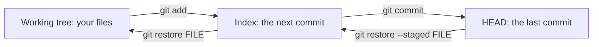
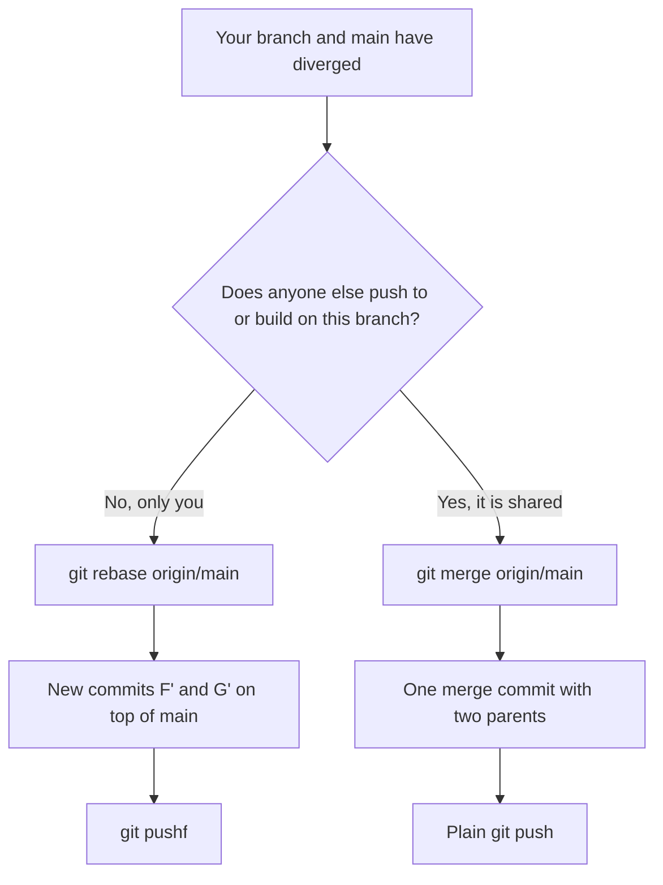
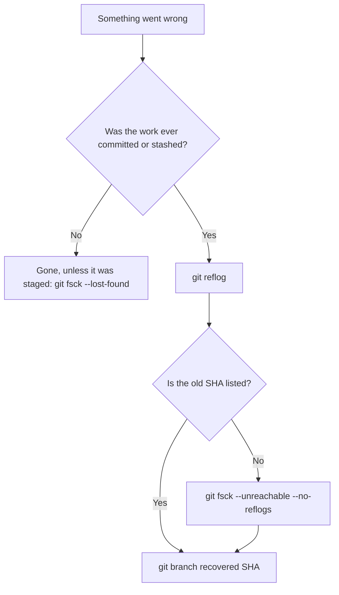
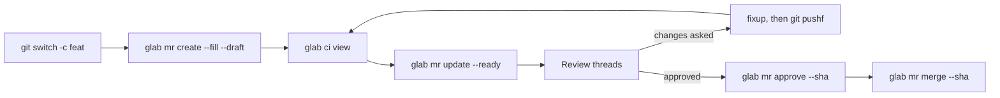
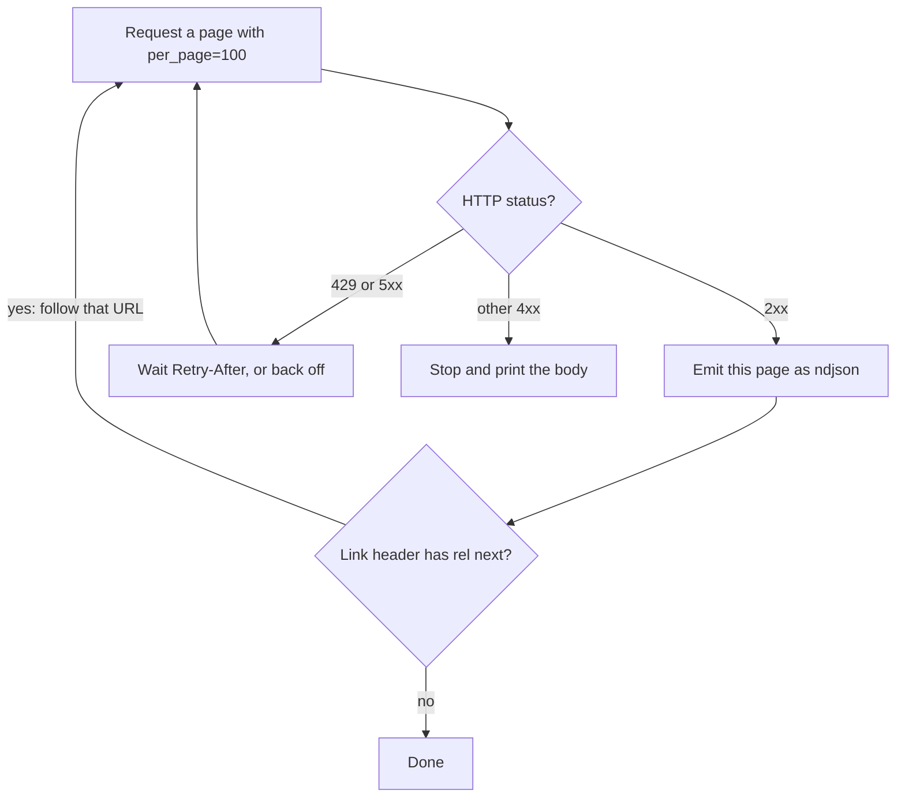

# Git & GitLab, A→Z

> One route from how Git actually stores your work to driving GitLab from the terminal: a config worth keeping, the daily loop, rewriting history safely, getting anything back, and glab plus the API for every merge request and pipeline. Follow the route once; afterwards use any waypoint as a cheat sheet.
> Full version: [Git & GitLab Field Manual](./git-gitlab-field-manual.md)

## Contents

- 01 · [How Git thinks](#ch01)
- 02 · [Set it up once](#ch02)
- 03 · [Look, stage, commit](#ch03)
- 04 · [Fetch, pull, push](#ch04)
- 05 · [Rebase and rewrite history](#ch05)
- 06 · [Recover and undo](#ch06)
- 07 · [Worktrees and big repos](#ch07)
- 08 · [glab: install, auth, tokens](#ch08)
- 09 · [MRs and pipelines with glab](#ch09)
- 10 · [The GitLab API: glab api and curl](#ch10)
- Z · [One-screen reference](#appendix)

---


<a id="ch01"></a>

## 01 · How Git thinks

*Git is a store of immutable, content-named objects with a few movable pointers on top, and every command either writes objects, moves a pointer, or copies between the three trees. Anything you ever committed is recoverable for about 30 days; anything you never committed was never an object.*

### Four ideas

Hold these four and "rebase rewrites history" or "you can't lose a commit" stop being folklore.

1. **Objects are immutable and named by their content.** A commit ID hashes its parents and tree too, so change anything and you get a new object.
2. **Refs are cheap, movable pointers.** A branch is just a name holding a commit ID. Creating, moving and deleting branches never touches history.
3. **There are three trees:** the working tree (your files), the index (your next commit) and `HEAD` (your last commit). Most commands copy between two of them.
4. **Reachability decides what survives.** An object is kept while a ref, a reflog entry or the index can reach it. Everything else is garbage on a timer.

### Objects: a commit is a snapshot

There are four object types. You meet three daily.

- **blob**: file content only, with no name or mode.
- **tree**: a directory listing of mode, type, hash and name per entry.
- **commit**: one tree, zero or more parents, author, committer and message.
- **tag** (annotated): a pointer to another object, plus tagger, message and signature.

Content alone decides the name, so `echo hello | git hash-object --stdin` gives the same ID as any file containing "hello". A commit is a **snapshot, not a diff**. Diffs are computed on demand by comparing two trees, and unchanged subtrees are shared by hash, which is why snapshots are cheap.

### Refs and HEAD

Branches live under `refs/heads/`, remote-tracking branches under `refs/remotes/`, tags under `refs/tags/`. `HEAD` normally names a branch, not a commit.

When you commit, Git writes the new commit and moves **the branch HEAD names**. HEAD itself still says "main".

**Detached HEAD** is when HEAD holds a commit ID directly (after `git switch --detach v1.2.0`, or mid-rebase). Commits made there move only HEAD, so after you switch away only the reflog reaches them (chapter 06).

### The three trees



The index is the tree of your next commit, already hashed. So `git add` doesn't mean "track this file"; it means **"hash this content now and put its ID in the index"**. Edit the file again and it shows as both staged and modified.

This table is the one to check before any command you're unsure of:

| Command | Copies from | To | Moves |
|---|---|---|---|
| `git add PATH` | working tree | index | nothing |
| `git restore PATH` | index | working tree | nothing |
| `git restore --staged PATH` | HEAD | index | nothing |
| `git commit` | index | new commit | the current branch |
| `git reset --soft REV` | nothing | nothing | the branch, to REV |
| `git reset --hard REV` | REV | index and working tree | the branch |
| `git switch BRANCH` | BRANCH | index and working tree | HEAD itself |

The critical line: **`reset` moves the branch HEAD points at; `switch` moves HEAD.** `reset --hard origin/main` on `feature` makes `feature` point at `origin/main`. `switch main` leaves `feature` where it was.

### Reachability and the 30-day net

Reflog entries for commits no longer on a branch tip expire after **30 days**, and unreachable objects survive two more weeks before pruning. So **anything you committed, even on a branch you deleted, is recoverable for about 30 days** on the machine where you did it. Untracked or unstaged changes wiped by `reset --hard` were never objects and are gone.

> **Gotcha.** Reflogs are **local**. A commit someone force-overwrote on the server lives in the reflog of whoever had it, not in any reflog your colleague can see. Recovery happens on the machine that had the commit.

### Why rebase makes new commits

A commit's ID covers its parent's ID. "Moving" commit `F` onto a new base therefore makes a **new commit `F'`** with a new ID. The originals stay in the object store, reachable through `ORIG_HEAD` and the reflog.

So anyone who had the old commits now has history your branch no longer contains (hence "don't rebase shared branches"), and pushing a rebased branch needs a force.

Amend, cherry-pick, squash-merge and `rebase -i` all work the same way. **Nothing in Git edits a commit. It writes a new one and moves a ref.**

### First parent and remotes

A merge commit's first parent is the branch you were on, so `git log --first-parent main` shows one line per merged MR.

**`origin/main` is a snapshot of the server as of your last fetch**, not a live view. Only `fetch` (and a successful `push`) moves it.

---


<a id="ch02"></a>

## 02 · Set it up once

*Git's defaults are tuned for backward compatibility, not for you, and about thirty lines of config fix conflicts, diffs, pushes and rebases for good. Add an includeIf identity split and SSH signing with a hardware key, and the wrong-email, unsigned commit becomes impossible.*

### Where config lives

Git reads system, then global, then repo config; **later wins, key by key**. Keep one global file, `~/.gitconfig`, with satellite files under `~/.config/git/`. If `~/.config/git/config` also exists, both are read, which is a fine way to spend an afternoon confused.

`git config list --show-origin --show-scope` shows every value and the file it came from.

### The opinionated ~/.gitconfig

Every line earns its place; the reasons follow.

```ini
# file: ~/.gitconfig
[user]
	name = YOUR NAME
	email = YOU@personal.example
	useConfigOnly = true
	signingKey = ~/.ssh/id_ed25519_sk.pub
[init]
	defaultBranch = main
[core]
	excludesFile = ~/.config/git/ignore
	untrackedCache = true
[gpg]
	format = ssh
[commit]
	gpgSign = true
	verbose = true
[tag]
	gpgSign = true
	sort = version:refname
[diff]
	algorithm = histogram
	colorMoved = plain
[merge]
	conflictStyle = zdiff3
[rerere]
	enabled = true
[fetch]
	prune = true
	writeCommitGraph = true
[pull]
	rebase = true
[push]
	autoSetupRemote = true
	followTags = true
	useForceIfIncludes = true
[rebase]
	autoSquash = true
	autoStash = true
	updateRefs = true
	missingCommitsCheck = error
[branch]
	sort = -committerdate
[alias]
	st = status -sb
	lg = log --graph --format='%C(auto)%h%d %s %C(dim)%an, %ar%C(reset)'
	pushf = push --force-with-lease --force-if-includes
	fixup = commit --fixup
	unstage = restore --staged
```

| Key | Why |
|---|---|
| `merge.conflictStyle = zdiff3` | shows the **base** between ours and theirs, so you resolve changes, not results. The single most valuable line |
| `diff.algorithm = histogram` | aligns on unique lines: far fewer "moved the brace" diffs |
| `rerere.enabled` | records conflict resolutions and replays them on the next rebase |
| `user.useConfigOnly` | refuses to commit until an email is set, instead of guessing one from the hostname |
| `pull.rebase = true` | no "Merge branch 'feat' of…" noise on shared feature branches |
| `push.autoSetupRemote` | the first `git push` sets upstream; no `-u origin HEAD` ritual |
| `push.useForceIfIncludes` | makes every `--force-with-lease` actually safe (chapter 04) |
| `rebase.updateRefs` | rebasing the top of a stack moves every branch in it |
| `rebase.missingCommitsCheck = error` | deleting a todo line by accident becomes an error; write `drop` to mean it |

> **Note.** `pull.rebase = true` versus `pull.ff = only` is a close call. The tiebreaker: if you often pull on main or release branches, `pull.ff = only` makes an accidental local commit an error. Set one of them; with neither, current Git refuses divergent pulls.

### One identity per context

Make the wrong identity impossible, not unlikely. Put the work email in its own file:

```ini
# file: ~/.config/git/work.inc
[user]
	email = YOU@corp.example
	signingKey = ~/.ssh/id_ed25519_sk_work.pub
[core]
	sshCommand = ssh -i ~/.ssh/id_ed25519_sk_work -o IdentitiesOnly=yes
```

Then include it for any repo cloned from the work GitLab, wherever it lives on disk. Each URL form needs its own line.

```ini
# file: ~/.gitconfig
[includeIf "gitdir:~/work/"]
	path = ~/.config/git/work.inc
[includeIf "hasconfig:remote.*.url:git@gitlab.example.com:*/**"]
	path = ~/.config/git/work.inc
[includeIf "hasconfig:remote.*.url:https://gitlab.example.com/**"]
	path = ~/.config/git/work.inc
```

Check it before the first commit in a new clone:

```bash
git config get --show-origin user.email
```

### SSH keys and signing

Use a **hardware-backed `-sk` key** if you have a FIDO2 key, ed25519 otherwise. The same key signs commits, so there's no gpg-agent to fight.

```bash
ssh-keygen -t ed25519-sk -O resident -O application=ssh:gitlab-work \
  -C "YOU@corp.example gitlab" -f ~/.ssh/id_ed25519_sk_work
ssh -T git@gitlab.example.com       # "Welcome to GitLab, @you!"
```

`git log --format='%h %G? %s'` shows each commit's signature status: `G` good, `N` none, `B` bad. (Local verification also needs an `allowed_signers` file listing your key.)

GitLab verifies SSH-signed commits from 15.7; badges for SSH-signed tags only arrived in 19.1.

> **Gotcha.** With a touch-to-sign key, **every rewritten commit asks for a touch**: a 25-commit rebase is 25 taps, and an unattended script just hangs. Script rewrites with `--no-gpg-sign` and re-sign at the keyboard.

### HTTPS credentials

Use SSH for Git. Where HTTPS is needed (port 22 blocked, Git LFS), let glab's login cover Git too, and use the keyring for everything else. The empty `helper =` line resets the inherited list.

```ini
# file: ~/.gitconfig
[credential]
	helper = libsecret
[credential "https://gitlab.example.com"]
	helper =
	helper = !glab auth git-credential
```

Never use `credential.helper = store` (plaintext), and never put a token in a remote URL: it ends up in `.git/config` and every `git remote -v` screenshot.

### Setup checklist

- [ ] `git config list --show-origin` shows one global file
- [ ] `git config get --show-origin user.email` in a work clone resolves to `work.inc`
- [ ] `zdiff3`, `histogram` and `rerere` are on
- [ ] `push.autoSetupRemote`, `push.useForceIfIncludes`, `fetch.prune` are `true`
- [ ] `git log --format='%G?'` shows `G`, and GitLab shows Verified
- [ ] no `helper = store`, no tokens in any remote URL

---


<a id="ch03"></a>

## 03 · Look, stage, commit

*Most daily Git is asking a question (what changed, who, why) and then moving exactly the right thing into the index. Learn the three-dot diff, add -p and switch/restore, and commit one logical change at a time.*

### What state am I in

These answer "where am I" before you change anything:

```bash
git status -sb          # branch, ahead/behind, short codes
git branch -vv          # every branch, its upstream, ahead/behind
git stash list
```

Short status has two columns, **index first, then working tree**: `M ` is staged, ` M` unstaged, `MM` staged then edited again, `??` untracked, `UU` a conflict.

Ahead/behind is relative to **your last fetch**, so `git fetch` first when it matters.

### What changed

The dots matter. `A...B` in `git diff` means **from the merge base to B**, which is exactly what an MR shows. `A..B` in diff is tip to tip, including everything main gained that you don't have.

| Want | Command |
|---|---|
| unstaged changes | `git diff` |
| what will be committed | `git diff --staged` |
| everything since the last commit | `git diff HEAD` |
| this branch's change (the MR view) | `git diff main...HEAD` |
| just the files | `git diff --name-status main...HEAD` |
| a file at another revision | `git show REV:path/to/file` |
| whitespace problems | `git diff --check` |

These are the log shapes worth having in your fingers:

```bash
git lg                                   # the graph alias from chapter 02
git log --first-parent --oneline main    # one line per merged MR
git log origin/main..HEAD                # what I'm about to push
git log --grep='JIRA-123' --oneline      # search messages
```

### Find the commit that…

**Pickaxe** searches diffs, not messages. `-S` finds commits where the count of a string changed; `-G` finds any added or removed line matching a regex.

```bash
git log -S'max_connections' --oneline            # when was it added or removed
git log -G'timeoutSeconds:\s*[0-9]+' -- charts/  # any edit to that line shape
git log -L :reconcile:ctrl.py                    # every change to one function
```

If `-S` finds nothing and you're sure it changed, use `-G`: `-S` misses in-place edits that keep the count the same.

Blame, with the flags that stop a reindent stealing authorship:

```bash
git blame -w -C -C -M path/to/file
```

To make everyone's blame skip a big reformat, list its SHA in a committed `.git-blame-ignore-revs` and set `blame.ignoreRevsFile` to it in each clone.

### Stage exactly what you mean

`add -p` walks each hunk. `y` stages, `n` skips, `s` splits, `e` edits the hunk by hand, `q` quits keeping your choices.

This is the loop that turns a messy session into clean commits:

```bash
git add -p                  # stage one logical change
git diff --staged           # read exactly what you're committing
git commit                  # commit.verbose shows the diff again
# repeat until git status is clean
```

New files are invisible to `add -p` until you mark them with `git add -N FILE`.

### switch and restore, never checkout

`git checkout` does two unrelated things depending on whether its argument is a branch or a path. Use two commands that each do one.

```bash
git switch BRANCH                     # go to a branch
git switch -c BRANCH START            # create and go
git switch -                          # back to the previous branch
git switch --detach v1.2.0            # look around a tag or SHA
git restore --staged FILE             # unstage, keep the edits
git restore FILE                      # discard edits to a file
git restore --source=REV --staged --worktree FILE   # a file as it was in REV
```

> **One-way door.** `git restore FILE` and `git restore .` discard uncommitted edits with **no undo**: they were never objects. If there's any doubt, `git stash push FILE` first.

### Commit hygiene

**One logical change per commit.** An imperative subject around 50 characters, a blank line, then a body saying why.

```text
charts/api: raise readiness timeout to 10s

The /healthz handler now checks Redis, which takes up to 6s on a cold
pool. With the 3s timeout, rollouts flapped under load.

Refs: OPS-412
```

Add trailers without editing by hand, and fix the last commit in place:

```bash
git commit --trailer 'Refs: OPS-412'
git commit --amend --no-edit                  # fold in what's staged
git commit --amend --reset-author --no-edit   # after fixing user.email
```

Fixing an **older** commit is a fixup, covered in chapter 05: `git commit --fixup=SHA`, then `git rebase -i --autosquash main`.

### Stash: for minutes, not days

A stash is a commit on a stack under `refs/stash`. It isn't pushed and it's easy to drop, so anything you'd hate to lose belongs on a branch.

```bash
git stash push -m 'wip: auth refactor'   # always name it
git stash push -u -m 'with untracked'
git stash show -p stash@{1}
git stash pop                            # apply and drop (drops only on a clean apply)
git stash branch NEWBRANCH stash@{0}     # when it won't apply: back to where you stashed
```

Always `-m`: a named stash is findable again even after you drop it by mistake (chapter 06).

---


<a id="ch04"></a>

## 04 · Fetch, pull, push

*Fetch updates your view of the server, pull also moves your branch, and push changes the server. Default to fetch-then-decide, and force-push only with --force-with-lease --force-if-includes, because a lease alone is fooled by background fetches.*

### What each one moves

- **`git fetch`** moves only your `origin/*` refs. Your branches and the server are untouched.
- **`git pull`** fetches, then moves **your current branch** too.
- **`git push`** changes **the server**, and updates the `origin/*` ref it pushed.

`pull` is just `fetch` followed by a rebase or merge. On your own feature branch with `pull.rebase = true` it's fine. Anywhere else, **fetch, look, then decide**:

```bash
git fetch --all --prune
git log --oneline HEAD..origin/main     # what arrived
git rebase origin/main                  # replay mine on top
git merge --ff-only origin/main         # or fast-forward only, fail if diverged
```

### Push

With `push.autoSetupRemote`, bare `git push` pushes the current branch to the same name on its remote and sets upstream the first time.

```bash
git push
git push origin --delete old-branch
git push origin v1.4.0                  # one tag
git push --atomic origin main v1.4.0    # both refs or neither
git push --dry-run
```

### Force-push safely

After a rebase or amend, your branch no longer contains the server's tip, so a plain push is refused. There are three ways to force, and only one is the default.

| Command | Overwrites the server if… | Verdict |
|---|---|---|
| `--force` | always | never on a branch anyone else touches |
| `--force-with-lease` | the server's tip equals your `origin/BRANCH` | fooled by background fetch |
| `--force-with-lease --force-if-includes` | the above, **and** your branch once contained that tip | **the default** |

This is the failure `--force-if-includes` prevents, reproduced on Git 2.55:

```bash
# a colleague pushes a commit to feat
# your IDE runs a background fetch: origin/feat now includes their commit
git commit --amend -m 'reword'                   # you never looked at it
git push --force-with-lease                      # SUCCEEDS: their commit is silently gone
git push --force-with-lease --force-if-includes  # REJECTED: "updated since the last checkout"
```

The lease only checks that the server hasn't moved since **your last fetch**, and the background fetch satisfied it. Set it once and use the alias from chapter 02:

```bash
git config set --global push.useForceIfIncludes true
git pushf
```

> **One-way door.** Force-pushing a **shared** branch (main, a release branch, a branch two people push to) drops commits from everyone else's view and breaks their next pull. Recovery needs whoever still has the old tip. Protect main and release branches in GitLab so the server refuses it.

### Working from a fork

The trick that removes the friction: **pull from the canonical project, push to your fork, automatically.**

```bash
git clone git@gitlab.example.com:YOU/project.git && cd project
git remote add upstream git@gitlab.example.com:group/project.git
git fetch upstream
git config set remote.pushDefault origin     # pushes go to your fork
git config set push.default current          # per repo, see the gotcha
git switch -c feat upstream/main
git branch --set-upstream-to=upstream/main   # rebases come from canonical
git push                                     # goes to origin/feat
```

Now `@{u}` (what you rebase onto) is `upstream/main` and `@{push}` (where you push) is `origin/feat`.

> **Gotcha.** With the global `push.default = simple`, the push still lands in the right place, but `@{push}` fails to resolve, which breaks `git log @{push}..` and any prompt showing unpushed commits. Setting `push.default = current` in the fork clone fixes it.

Keep your fork's main in sync without checking it out:

```bash
git fetch upstream
git push origin upstream/main:main
```

### Tags

**Use annotated tags for anything you release.** They carry tagger, date, message and signature, and `describe` and `push --follow-tags` consider only annotated tags by default.

```bash
git tag -a v1.4.0 -m 'v1.4.0'
git tag -l 'v1.*' --sort=-version:refname | head
git describe --tags --always --dirty     # v1.4.0-3-g4f2a1c9-dirty
git push origin v1.4.0
```

> **One-way door.** Moving or deleting a tag others have fetched doesn't propagate: their clones keep the old one, because fetch won't overwrite an existing tag. Release a new version instead of re-pointing `v1.4.0`.

---


<a id="ch05"></a>

## 05 · Rebase and rewrite history

*Rewrite freely what only you have, and revert what others have. Fixup plus autosquash keeps a branch clean as you go, --update-refs keeps a stack together, and zdiff3 plus rerere make conflicts readable and resolved once.*

### The rule

**Rewrite freely what only you have. Revert what others have.** A feature branch in an open MR is the middle case: rewriting it is normal on GitLab as long as nobody else pushes to it and you force-push with the lease from chapter 04.



Before any big rewrite, drop a marker with `git branch -f backup/feat HEAD`. If it goes wrong, `git reset --hard backup/feat`; to compare old and new commit by commit, `git range-diff backup/feat...HEAD`.

### Interactive rebase

```bash
git rebase -i main                    # everything since main
git rebase -i --keep-base main        # edit commits without moving onto main's new tip
```

**`--keep-base`** lets you squash and reorder mid-review without also pulling in 40 new commits from main.

The todo list uses these words:

```text
pick     keep as is
reword   keep, edit the message
edit     stop after it, to amend or split
squash   meld into the previous commit, combine messages
fixup    meld into the previous commit, keep its message
exec     run a command; a non-zero exit stops the rebase
drop     remove the commit
```

When a rebase stops, `git status` says what's happening; then `git rebase --continue`, `--skip`, or `--abort` to go back exactly as before.

`git rebase -x 'make test' main` proves every commit builds before you push, so the series bisects.

### Fixup and autosquash

The fastest way to keep a branch clean while you work: aim each fix at the commit it belongs to, and let rebase fold it in.

```bash
git add -p
git commit --fixup=SHA                # content into SHA
git commit --fixup=reword:SHA         # just a new message
git commit --fixup=':/readiness'      # aim by message instead of SHA
git rebase -i --autosquash main       # todo is pre-arranged; just save
```

`rebase.autoSquash` affects **interactive** rebases only; a plain `git rebase` needs `--autosquash` spelled out.

### Stacked branches

A stack is several branches, each building on the last, each its own MR. Rebasing the top without help leaves the lower branches pointing at the old commits. **`--update-refs` moves every branch in the rebased range**:

```bash
git switch feat/client
git rebase --update-refs origin/main       # feat/api moves too
git push --force-with-lease --force-if-includes origin feat/api feat/client
```

When the bottom branch is **squash-merged**, Git doesn't recognize its commits as merged. Cut the old base off with `--onto`: take the commits after `feat/api` and replay them on main.

```bash
git fetch origin
git rebase --onto origin/main feat/api feat/client
```

### Cherry-pick and backports

**Fix on main, then cherry-pick to the release branch** with `-x`, which records the source SHA. Merging a release branch into main drags in version bumps and release-only hacks.

```bash
git cherry-pick -x SHA
git cherry-pick -x A^..B          # A through B inclusive; A..B would exclude A
```

### Revert

Revert makes a **new commit** that undoes an old one, so history only grows and it's safe on shared branches. A merge needs `-m 1`: undo what it brought in relative to the branch it was merged into.

```bash
git revert --no-edit SHA
git revert -m 1 MERGE_SHA
```

> **Gotcha.** **Reverting a merge doesn't unmerge the branch.** If the branch is fixed and merged again, only commits made after the first merge come in. Revert the revert first (`git revert REVERT_SHA`), then merge the new work. GitLab's Revert button behaves the same way.

### Conflicts

With `zdiff3`, every conflict shows three versions:

```text
<<<<<<< HEAD
B2
||||||| 08c561c
b
=======
B1
>>>>>>> x
```

Read it as: **the base had `b`; our side changed it to `B2`; theirs changed it to `B1`.** Your resolution must keep both changes, not pick one result.

During a rebase you stand on the new base and replay your commits onto it, so **"ours" is upstream and "theirs" is your commit**. Everybody gets this wrong once.

| Case | Do |
|---|---|
| take one side for a whole file | `git restore --ours FILE` (or `--theirs`), then `git add FILE` |
| lockfiles, generated files | take either side, **regenerate**, then `git add` |
| same conflict on every commit of a long rebase | abort, and merge instead: one resolution, not twenty |

After resolving, `git add FILE` marks it done, then `git rebase --continue` (or `merge --continue`).

> **Gotcha.** `-X ours` resolves only the **conflicting hunks** in your favour. `-s ours` throws away **every** change from the other branch. Confusing them silently drops work.

rerere replays wrong resolutions as faithfully as right ones: `git rerere forget FILE` before redoing one.

---


<a id="ch06"></a>

## 06 · Recover and undo

*If it was ever committed or stashed, it's still in the object store and the reflog knows where, so recovery is "find the SHA, point a branch at it". The only truly lost work is work that never became an object, and a leaked secret is fixed by rotation, not by rewriting.*

### First: stop and mark

Two moves that can't make anything worse:

```bash
git status                            # is a rebase, merge or bisect in progress?
git branch rescue/$(date +%H%M) HEAD  # pin where you are now
```

Then **don't run `git gc`, `git prune`, `git reflog expire` or `git stash clear`** until you've found what you're after. If an operation is in progress, its own `--abort` is the cleanest undo.

### The recovery route



### The reflog

Every time a ref moves, Git logs the old and new value, and **HEAD has its own reflog** covering every checkout. After a bad reset, `git reflog` shows `6f4f8e4 HEAD@{1}: commit: lost`: on no branch, but still pointed at.

```bash
git branch recovered 6f4f8e4          # or: git reset --hard HEAD@{1}
```

After any big move (`reset`, `rebase`, `merge`, `pull`), `ORIG_HEAD` holds where you were, so `git reset --hard ORIG_HEAD` undoes the thing you just did. The next big move overwrites it.

### Reset, and why --keep wins

`git reset REV` moves the current branch; the mode decides what happens to your files.

```text
            index    working tree                      use for
--soft      kept     kept                              squash the last N commits
--mixed     reset    kept                              uncommit and re-split (the default)
--hard      reset    overwritten                       back to a known state, edits and all
--keep      reset    reset, refuses if edits would     move a branch you believe is clean
                     be lost
```

**Pick `--keep` over `--hard`.** If you're wrong about the tree being clean, `--keep` refuses; `--hard` destroys the edits with no reflog to save them.

> **One-way door.** `reset --hard`, `restore .` and `clean -fdx` destroy **uncommitted** work permanently. `git stash -u` first if there's any doubt, and always run `git clean -nd` (dry run) before `-fd`.

### The undo table

| I did | Undo |
|---|---|
| committed to the wrong branch (not pushed) | `git branch right && git reset --keep HEAD~1 && git switch right` |
| forgot a file in the last commit | `git add FILE && git commit --amend --no-edit` |
| amended and want the old commit | `git reset --soft HEAD@{1}` |
| rebased or merged and it went wrong | `git reset --hard ORIG_HEAD` |
| merged and pushed | `git revert -m 1 MERGE_SHA` |
| deleted a branch | the `(was 4f2a1c9)` that `branch -D` printed: `git branch NAME 4f2a1c9` |
| `git restore .` on edits | **nothing**: check your editor's local history |

### Lost commits and dropped stashes

When the reflog doesn't have it, search the object store for commits nothing references. A dropped stash shows up with a subject starting `On BRANCH:`, which is why `stash push -m` matters:

```bash
git fsck --unreachable --no-reflogs 2>/dev/null \
  | awk '/commit/ {print $3}' \
  | xargs git log --no-walk --format='%h %s'
git stash apply SHA
```

Anything you **staged** was hashed into a blob, so `git fsck --lost-found` can recover it even after a `reset --hard`.

### Bisect

Bisect binary-searches history for the commit that broke something: about 10 steps for 1,000 commits. Make the test a script and let Git drive it.

```bash
git bisect start HEAD v1.4.0
git bisect run sh -c 'make build || exit 125; ./bin/app --selftest'
git bisect reset
```

Exit `0` is good, `1`–`127` is bad, and **`125` means skip**, so a commit that doesn't build is skipped instead of blamed. Keep the script outside the repo, since old checkouts may change it.

Add **`--first-parent`** on a repo that merges MRs: it finds the breaking merge first, one step per MR.

### A leaked secret

The order is everything:

1. **Rotate the credential now.** Revoke it at its source and deploy the new one.
2. **Assume it was used.** Check the credential's audit logs since the commit time.
3. **Then decide whether to rewrite history.** Rewriting is cleanup, not remediation.

> **One-way door.** Rewriting doesn't un-leak anything: clones, forks, CI logs and GitLab's MR refs still have it. And it changes every commit ID from the first affected commit on, so open MRs and pinned SHAs break and everyone re-clones.

To rewrite pushed history, use **`git filter-repo` on a fresh mirror clone**, not `filter-branch` or BFG.

```bash
git clone --mirror git@gitlab.example.com:group/project.git project-clean.git
cd project-clean.git
git filter-repo --sensitive-data-removal --invert-paths --path config/secrets.env
git push --force --mirror origin
```

Then remove the blobs server-side (Settings > Repository > Repository maintenance, GitLab 17.9+) and have everyone re-clone.

`git reflog expire --expire=now --all && git gc --prune=now` deletes every recovery path in this chapter: right as the last step of a purge, wrong anywhere else.

---


<a id="ch07"></a>

## 07 · Worktrees and big repos

*Worktrees give you a second checkout without stash-and-switch, and big-repo pain splits into too many files (sparse-checkout), too much history (blob-less clone) and too many objects (maintenance). Hooks are fast feedback, not enforcement, and LFS is a decision for repo creation day.*

### Worktrees

A worktree is an extra checkout of the same repository: **one object store, many working directories, each on its own branch.** It replaces "stash, switch, rebuild, switch back, pop".

```bash
git worktree add ../proj-hotfix -b hotfix/1.4.1 origin/release/1.4   # new branch, new dir
git worktree add ../proj-review origin/feat/other                   # detached, for review
git worktree list
git worktree remove ../proj-hotfix                                  # refuses if dirty
git worktree prune                                                  # forget dirs you rm'd
```

Use them for a hotfix mid-feature, reviewing an MR beside your own code, long test runs, or agents that need an isolated checkout.

> **Gotcha.** **A branch can be checked out in only one worktree at a time.** In the second one, use `git switch --detach main`. Worktrees also **share stash, hooks, refs and config**: a stash made in one shows up in all of them.

### Big-repo clones

Three separate problems, three fixes, and they combine cleanly.

| Problem | Fix | Command |
|---|---|---|
| too many files on disk | sparse-checkout (cone mode) | `git sparse-checkout set services/api libs/common` |
| too much history to download | blob-less partial clone | `git clone --filter=blob:none URL` |
| slow status and log | fsmonitor, untracked cache, maintenance | `git maintenance start` |

**Blob-less plus sparse** is the monorepo combination: all of history, only your directories' contents.

```bash
git clone --filter=blob:none --sparse git@gitlab.example.com:group/mono.git
cd mono
git sparse-checkout set services/api libs/common
git backfill --sparse          # optional: pre-fetch blobs before going offline
```

> **Gotcha.** In a blob-less clone, commands that need old file contents (`log -p`, `blame`, `log -S`) fetch blobs on demand. On a slow VPN that feels like a hang. Run `git backfill` first, or scope the command to a path.

For per-repo speed on a big tree, turn these on where `git status` is actually slow:

```bash
git config set core.fsmonitor true
git config set core.untrackedCache true
git maintenance start          # systemd user timers: prefetch, commit-graph, incremental repack
```

Keep fsmonitor **per repo, not global**: each repo runs its own daemon holding inotify watches.

### Shallow clones belong in CI

A shallow clone cuts **history**, which breaks `git describe`, `merge-base`, changelogs and rebase. GitLab runners fetch shallow by default (the project's Git shallow clone setting, or `GIT_DEPTH`).

**For humans, prefer blob-less over shallow**: full history for a fraction of the download. In CI, keep shallow as the default and give full history only to the jobs that need it:

```yaml
release:
  variables:
    GIT_DEPTH: "0"          # full history for describe and changelogs
  script:
    - git describe --tags --always
```

### Git LFS

LFS keeps large files outside Git: the repo holds a small pointer, the content lives in GitLab's object storage. Use it for **large binaries that change** (design files, datasets, fixtures), not for build artifacts.

```bash
git lfs install                    # once per user
git lfs track '*.psd'              # writes .gitattributes
git add .gitattributes
git lfs ls-files
```

> **One-way door.** Moving existing files into LFS later (`git lfs migrate import --everything`) rewrites every commit: new SHAs, a force-push, everyone re-clones. Decide at repo creation.

### Submodules and subtree

**Default: neither.** Use a package, a container image or a Helm dependency. If you're forced to choose, use a submodule for something large or shared, and subtree with `--squash` for something small and static.

With submodules, set `push.recurseSubmodules check` so Git refuses to push a bump whose commit isn't pushed.

### Hooks are convenience, not policy

Hooks are local: **not cloned, and skippable** with `--no-verify`. Anything mandatory belongs in CI or server push rules.

Git 2.55 can define hooks in config, which is ideal for a personal secret scan in every repo:

```ini
# file: ~/.gitconfig
[hook "gitleaks"]
	event = pre-commit
	command = gitleaks git --pre-commit --staged --redact
```

```bash
git hook list pre-commit --show-scope        # what fires, from which config
git config set hook.gitleaks.enabled false   # turn it off in one repo
```

For team hooks, commit them and point each clone at the directory with `git config set core.hooksPath .githooks`.

Older Git silently ignores config-based hooks.

### Ignore rules in one line each

- Editor and OS noise goes in `~/.config/git/ignore`; build output goes in the project's `.gitignore`; personal scratch goes in `.git/info/exclude`.
- You can't re-include a file under an excluded directory: write `build/*` then `!build/keep.txt`, not `build/`.

---


<a id="ch08"></a>

## 08 · glab: install, auth, tokens

*On every call glab resolves a host, a token and a project, and almost every "glab is broken" is one of those resolving to something you didn't expect. Install the upstream RPM, log in with a keyring-backed token, and give automation a group access token, never your own PAT.*

### The resolution model

Before any flag matters, glab answers three questions, in this order:

1. **Host:** `-R` or `--hostname`, then the Git remote of the current directory, then `GITLAB_HOST`, then config `host`, then gitlab.com.
2. **Token:** `GITLAB_TOKEN` (and similar env vars), then the keyring, then `config.yml`.
3. **Project:** `-R GROUP/PROJECT`, then `GITLAB_REPO`, then the Git remote.

Two consequences you will hit:

- **An exported `GITLAB_TOKEN` beats everything, for every host.** Export a gitlab.com token in your shell rc and your self-hosted calls come back 401. `glab auth status` warns about it; read the warning.
- **Outside a Git repo there's no project**, and the host falls back to the config default. Scripts that run from cron need `--hostname` or `GITLAB_HOST` every time.

### Install the upstream RPM

Fedora's packaged glab trails upstream by many months, and glab's value is mostly in recent subcommands. **Default: the upstream `.rpm`**, checked against its checksums.

```bash
VER=$(curl -fsSL 'https://gitlab.com/api/v4/projects/gitlab-org%2Fcli/releases/permalink/latest' | jq -r '.tag_name | ltrimstr("v")')
cd "$(mktemp -d)"
BASE="https://gitlab.com/gitlab-org/cli/-/releases/v${VER}/downloads"
curl -fsSLO "${BASE}/glab_${VER}_linux_amd64.rpm"
curl -fsSLO "${BASE}/checksums.txt"
sha256sum --check --ignore-missing checksums.txt
sudo dnf install -y "./glab_${VER}_linux_amd64.rpm"
type -a glab                 # exactly one copy, please
```

> **Gotcha.** `glab auth login` writes glab's **absolute path** into `~/.gitconfig` as the credential helper. Move or reinstall glab and HTTPS Git starts failing while glab itself works. After changing install method, `grep -n glab ~/.gitconfig`.

### Log in to self-hosted GitLab

**Pick a personal access token read from stdin and stored in the keyring.** The token never touches argv, history or the process list.

```bash
secret-tool store --label='GitLab PAT gitlab.example.com' service gitlab host gitlab.example.com

secret-tool lookup service gitlab host gitlab.example.com \
  | glab auth login --hostname gitlab.example.com --stdin \
      --git-protocol ssh --api-protocol https --use-keyring

glab auth status --hostname gitlab.example.com
```

`glab auth status` tells you **where the token came from**. "Token is from environment variable GITLAB_TOKEN" is the answer to half of all auth mysteries.

> **Version-sensitive.** In glab 1.108 tokens go to plaintext `config.yml` unless you pass `--use-keyring`. From 1.111 the keyring is the default and `--use-keyring` is deprecated. Keep the flag in scripts that must run on both sides of 1.111.

Token versus OAuth is a close call. The tiebreaker: will your admins register an OAuth app? If yes, OAuth (no long-lived secret); if not, a 90-day PAT in the keyring.

### Config that matters on day one

`config set` without `--global` writes to the **current repo only**, which surprises everyone once.

```bash
glab config set host gitlab.example.com --global     # out-of-repo calls stop going to gitlab.com
glab config set telemetry false --global
glab config set ca_cert /etc/pki/ca-trust/source/anchors/corp-root.pem --host gitlab.example.com
```

In scripts and CI, set `GLAB_NO_PROMPT=1`, because a prompt in a cron job hangs forever. Export `GITLAB_TOKEN` only inside the script that needs it, never in `~/.zshrc`.

### Which token for which job

| Token | Acts as | Use for |
|---|---|---|
| personal access token | you | glab on your workstation |
| fine-grained PAT | you, limited to listed resources | scripts you run that shouldn't do everything you can |
| group access token | a bot in one group | **automation across a group** |
| project access token | a bot in one project | automation for a single repo |
| deploy token | nobody; Git and registries only, no API | a cluster or mirror pulling code or images |
| `CI_JOB_TOKEN` | the user who triggered the job | pipeline calls into GitLab |

**Default for automation: a group access token at the lowest role that works, 90-day expiry, rotated on a schedule.** It survives staff leaving (PATs die with their owner) and shows up in audit logs as itself. For report scripts, issue a separate `read_api` token: a read-only token can't be talked into deleting a branch by a buggy loop.

```bash
glab token create --group GROUP --access-level reporter --scope read_api \
  --duration 90d --description "weekly MR report" mr-report-bot
```

Rotation kills the old value **immediately**, so pipe the new one straight into its consumer:

```bash
glab token rotate --group GROUP mr-report-bot --duration 90d \
  | glab variable update REPORT_TOKEN --group GROUP --masked
```

> **One-way door.** `glab token rotate` and `revoke` break anything still using the old secret on its next call. Have the consumer's update path ready first.

Tokens expire at **00:00 UTC** on their expiry date: the evening before, in Toronto.

---


<a id="ch09"></a>

## 09 · MRs and pipelines with glab

*glab defaults every command to the MR or pipeline of the branch you're on, so the fastest workflow is to stay in the repo and let it infer. Create drafts with --fill, read red pipelines with glab ci view, and approve and merge with --sha so a late force-push can't ride your review.*

### The MR lifecycle

Inside a checkout, no argument means "the MR for this branch". `-R GROUP/PROJECT` points anywhere else.



### Open one

**Default: `glab mr create --fill --draft`** from the feature branch. `--fill` takes the title and body from your commits and **pushes the branch for you**.

```bash
glab mr create --fill --draft --yes

glab mr create --fill --yes \
  --reviewer alice,bob --label "type::bug" \
  --squash-before-merge --remove-source-branch

```

### Find and read

```bash
glab mr list --reviewer=@me --not-draft      # your review queue
glab mr view 123 --unresolved                # only open threads
glab mr view 123 -F json --jq '.detailed_merge_status'
glab mr checkout 123                         # review it locally
```

`detailed_merge_status` tells you **why** an MR won't merge (`not_approved`, `ci_must_pass`, `discussions_not_resolved`, `need_rebase`, `conflict`). It beats anything in the text view.

### Comment, update, approve, merge

```bash
glab mr note 123 -m "Rebased on main, ready for another look."
glab mr note create 123 --file charts/app/values.yaml --line 42 -m "Needs a schema entry"
glab mr update --ready
glab mr update 123 --reviewer +carol         # + adds; a bare name replaces the list
glab mr approve 123 --sha "$(git rev-parse HEAD)"
glab mr merge 123 --squash --remove-source-branch --sha "$(git rev-parse HEAD)" --yes
```

**Always approve with `--sha` after a local review.** Without it, a force-push between your review and your click gets your approval.

> **Gotcha.** In 1.108, **`glab mr merge` arms auto-merge by default** when a pipeline is running, and returns. If the pipeline then fails, nothing merges and nothing tells you. Use `--auto-merge=false` to merge now, or watch it.

`glab mr note create` is EXPERIMENTAL in 1.108 and 1.119, so pin glab in CI images that script it.

> **One-way door.** Nothing in glab un-merges a protected branch. You revert with a new MR (`git revert -m 1 MERGE_SHA`, chapter 05).

### Pipelines

**Default for "why is my MR red": `glab ci view`.** The TUI shows child and downstream pipelines in one tree, which the web UI hides behind clicks. `Enter` opens a job's log; `Esc` goes back.

```bash
glab ci status --live                                   # redraw until done
glab ci get --merge-request 42 --status failed -d       # failed jobs of the MR's head pipeline
glab ci trace lint                                      # stream a job's log by name
glab ci retry lint
glab ci run -b main --variables-env DEPLOY_ENV:staging
```

> **Gotcha.** `glab ci status` exits 1 **only when the final status is `failed`**. `canceled`, `skipped` and `manual` exit 0. A CI gate that means "anything but success fails" must read `glab ci get -F json --jq .status` and test it.

Before pushing CI changes, simulate the pipeline. Static lint doesn't evaluate `rules:`, so it can't catch "this job silently never runs"; the dry run can.

```bash
glab ci lint --dry-run --ref BRANCH --include-jobs
```

### Releases, variables, schedules

A few commands with sharp edges, each with its safe form:

```bash
glab release create v2.4.1 --ref main --notes-file notes.md
secret-tool lookup service gitlab item deploy-token | glab variable set DEPLOY_TOKEN --masked --protected --raw
glab schedule create --cron "0 6 * * 1-5" --cronTimeZone "America/Toronto" --ref main --description "Nightly rebuild"
glab repo prune --dry-run                         # local branches whose MR merged, squash included
```

| Trap | Why | Safe form |
|---|---|---|
| `release create` on a missing tag | creates the tag from the default branch tip, so a typo gives a wrong release | pass `--ref`, or push the tag first |
| variable without `--raw` | `$` is expanded at job time: `ab$cd` becomes `ab` | `--raw` for secrets |
| value on the command line | lands in history and `ps` | pipe it on stdin |
| schedule without a time zone | defaults to UTC | `--cronTimeZone "America/Toronto"` |
| `glab repo archive` | **downloads** a tarball, doesn't archive the project | `glab repo update PROJECT --archive` |

On `glab issue list`, JSON is `-O json`; everywhere else it's `-F json`.

---


<a id="ch10"></a>

## 10 · The GitLab API: glab api and curl

*glab api is curl that already knows your host, token and project, and paginates for you; use it interactively, and plain curl only where glab isn't installed. Follow the Link rel="next" header, write -X GET when you filter, and remember that a 404 usually means "you may not see this".*

### glab api essentials

`glab api` takes host and token from your glab login and the project from the Git remote. Use curl only in minimal CI images or tools others run.

```text
-X GET            force the method: needed whenever you filter with fields
-f key=value      string field
-F key=value      typed field: true, null, integers become JSON; @file reads a file
--paginate        follow every page
--output ndjson   one JSON value per line, streamed
--hostname HOST   explicit host for out-of-repo scripts
-i                print response headers
```

> **Gotcha.** **Any `-f` or `-F` switches the default method from GET to POST.** `glab api projects/:fullpath/merge_requests -f state=opened` is a POST to the create-MR endpoint. Always write `-X GET` when fields are filters.

So `glab api -X GET projects/:fullpath/merge_requests -f state=merged` and `glab api 'projects/:fullpath/merge_requests?state=merged'` are the same GET.

Inside a checkout, `:fullpath` expands to the URL-encoded project path and `:branch` to your **local** branch. Outside a repo, encode paths yourself (`/` becomes `%2F`):

```bash
P=$(jq -rn --arg p "GROUP/PROJECT" '$p|@uri')
G=$(jq -rn --arg p "GROUP" '$p|@uri')
```

### Pagination

Pages default to 20 items, **100 at most**, so pair `--paginate` with `per_page=100`. Above 10,000 results the total headers vanish; `Link: rel="next"` doesn't.



`--paginate` does this loop for you. In `json` mode it merges pages into one array; **`--output ndjson` streams**, so memory stays flat on big lists.

For deep lists, **keyset pagination** keeps a constant cost per page and survives the offset limit. Opt in with `pagination=keyset` and a supported `order_by`. Keyset responses carry **only** the `Link` header, no page numbers, which is why following `rel="next"` is the one rule that works everywhere.

### Recipes worth keeping

All GETs, safe with a `read_api` token.

```bash
# Open MRs across a group
glab api -X GET --paginate "groups/$G/merge_requests" \
  -f state=opened -F per_page=100 -f include_subgroups=true \
  | jq -r '.[] | [.references.full, .author.username, .title] | @tsv' | column -ts $'\t'

# Failed jobs in a pipeline, with the reason
glab api -X GET "projects/$P/pipelines/PIPELINE_ID/jobs" -f 'scope[]=failed' -F per_page=100 \
  | jq -r '.[] | [.id, .name, .failure_reason] | @tsv'

# CI variables, names only
glab api --paginate "projects/$P/variables?per_page=100" | jq -r '.[] | [.key, .masked, .protected] | @tsv'
```

`failure_reason` separates `script_failure` (your code) from runner and timeout failures (infrastructure).

> **Gotcha.** The variables endpoint **returns values** for anything not hidden. The `jq` projection is what keeps secrets out of your scrollback; never send that endpoint unfiltered to a file or log.

### curl, without leaking the token

`curl -H "PRIVATE-TOKEN: $GITLAB_TOKEN"` puts the token in argv, visible through `ps`. Feed the header from a file descriptor; `printf` is a builtin, so it never shows in the process table.

```bash
export GITLAB_URL=https://gitlab.example.com
export GITLAB_TOKEN="$(secret-tool lookup service gitlab host gitlab.example.com)"
curl -sS -H @<(printf 'PRIVATE-TOKEN: %s\n' "$GITLAB_TOKEN") "$GITLAB_URL/api/v4/user" | jq '{username, id}'
```

Inside a CI job, use the job token: `curl -sS -H "JOB-TOKEN: $CI_JOB_TOKEN" "$CI_API_V4_URL/projects/$CI_PROJECT_ID/releases"`. For project B to accept project A's job token, **B must allowlist A** (Settings > CI/CD > Job token permissions) and the triggering user needs access to B.

**Pick numeric project IDs in anything long-lived.** Paths change on rename and transfer; IDs never do.

### Status codes, honestly

| Code | Usually means |
|---|---|
| 401 | token missing, expired, revoked, or from the wrong source: check `glab auth status` |
| 403 | role too low, or scope too narrow (the body says `insufficient_scope` and names the scope) |
| 404 | **also "you can't see it"**: private project, wrong host, unencoded path, branch never pushed |

> **Gotcha.** GitLab answers 404, not 403, for anything you may not know exists. Debug top-down: host and identity (`glab api user`), group, project, role.

### Scripts that can't hurt you

A script holding a token is a loop that can delete things. Give every one this skeleton:

```bash
#!/usr/bin/env bash
set -euo pipefail
: "${GITLAB_HOST:?set GITLAB_HOST}"      # never rely on the current directory
export GLAB_NO_PROMPT=1
APPLY=0; [[ ${1:-} == --apply ]] && APPLY=1
run() { if (( APPLY )); then "$@"; else printf 'DRY-RUN:'; printf ' %q' "$@"; echo; fi; }
run glab api --hostname "$GITLAB_HOST" -X DELETE "projects/PROJECT_ID/repository/branches/BRANCH" --silent
```

- [ ] dry run is the default; writes need `--apply`
- [ ] idempotent: 409 is "already done", and use `add_labels`, not `labels`
- [ ] write a restore log (branch and SHA) before deleting anything

API writes have no undo. A deleted branch returns only from its recorded SHA while GitLab still has the objects; an overwritten CI variable keeps no history.

---


<a id="appendix"></a>

## Z · One-screen reference

*The commands worth memorizing, grouped by what you're trying to do, plus the revision and range syntax every other command accepts. Print it, pin it, and reach for the chapters only when a line surprises you.*

### Git by task

| Task | Command |
|---|---|
| branches, upstreams, ahead/behind | `git branch -vv` |
| mainline, one line per MR | `git log --first-parent --oneline main` |
| my MR's diff | `git diff main...HEAD` |
| when a string appeared or vanished | `git log -S'STRING'` / `-G'REGEX'` |
| who changed each line | `git blame -w -C -C -M FILE` |
| stage hunks | `git add -p` |
| unstage / discard (no undo) | `git restore --staged FILE` / `git restore FILE` |
| fold staged into an older commit | `git commit --fixup=SHA && git rebase -i --autosquash main` |
| update view of server | `git fetch --all --prune` |
| safe force-push | `git push --force-with-lease --force-if-includes` |
| edit commits without moving base | `git rebase -i --keep-base main` |
| rebase a stack | `git rebase --update-refs origin/main` |
| parent was squash-merged | `git rebase --onto origin/main OLD_PARENT BRANCH` |
| backport | `git cherry-pick -x A^..B` |
| undo a pushed commit / merged MR | `git revert SHA` / `git revert -m 1 MERGE_SHA` |
| undo the last big move | `git reset --hard ORIG_HEAD` |
| move a branch, refuse if dirty | `git reset --keep REV` |
| find dangling commits | `git fsck --unreachable --no-reflogs \| grep commit` |
| find the breaking commit | `git bisect start BAD GOOD && git bisect run CMD` |
| second checkout | `git worktree add ../DIR -b BRANCH START` |
| big-repo clone | `git clone --filter=blob:none --sparse URL` |

### Revisions and ranges

```text
HEAD~3        third generation back, following first parents
REV^2         second parent (the merged-in side of a merge)
@{u}          this branch's upstream          @{push}   where git push sends it
@{-1}         the previous branch             feat@{1}  where feat was one move ago
REV:path      a file as of REV                :/fix     youngest commit whose message matches
:1: :2: :3:   base, ours, theirs during a conflict
```

```text
                 git log                          git diff
A..B             on B, not on A                   tip to tip (same as A B)
A...B            on either, not both              merge base to B: the MR view
```

Reflog syntax (`@{1}`, `@{yesterday}`) is local: it doesn't exist in a fresh clone or in CI.

### Config worth knowing by name

```text
merge.conflictStyle = zdiff3      rerere.enabled = true       diff.algorithm = histogram
pull.rebase = true                push.autoSetupRemote = true push.useForceIfIncludes = true
fetch.prune = true                rebase.updateRefs = true    rebase.missingCommitsCheck = error
user.useConfigOnly = true         gpg.format = ssh            commit.gpgSign = true
```

### glab by intent

```bash
glab auth status --all                              # which host, which token source
glab mr create --fill --draft --yes                 # push and open a draft
glab mr list --reviewer=@me --not-draft             # review queue
glab mr view 123 -F json --jq .detailed_merge_status
glab mr checkout 123
glab mr approve 123 --sha "$(git rev-parse HEAD)"
glab mr merge 123 --squash --sha "$(git rev-parse HEAD)" --yes
glab ci view                                        # why is it red
glab ci get --merge-request 42 --status failed -d
glab ci lint --dry-run --ref BRANCH --include-jobs
glab repo prune --dry-run
```

### glab api and curl

```bash
P=$(jq -rn --arg p "GROUP/PROJECT" '$p|@uri')
glab api -X GET --paginate --output ndjson "projects/$P/merge_requests" -f state=opened -F per_page=100
curl -sS -H @<(printf 'PRIVATE-TOKEN: %s\n' "$GITLAB_TOKEN") "$GITLAB_URL/api/v4/projects/$P"
```

### One-way doors

- Force-pushing a shared branch.
- History rewrites with filter-repo or `lfs migrate --everything`.
- Rewriting instead of **rotating** a leaked secret.
- Moving or deleting a tag others have pulled.
- `reflog expire --expire=now` plus `gc --prune=now`.
- `glab token rotate` or `revoke` before the consumer is ready.
- Deleting pipelines, MRs, or overwriting a CI variable.

---
