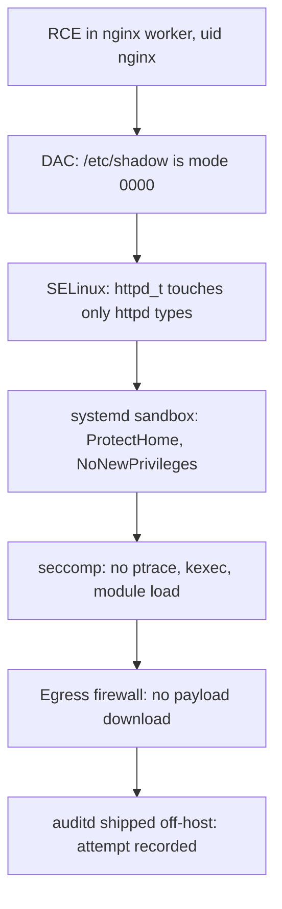
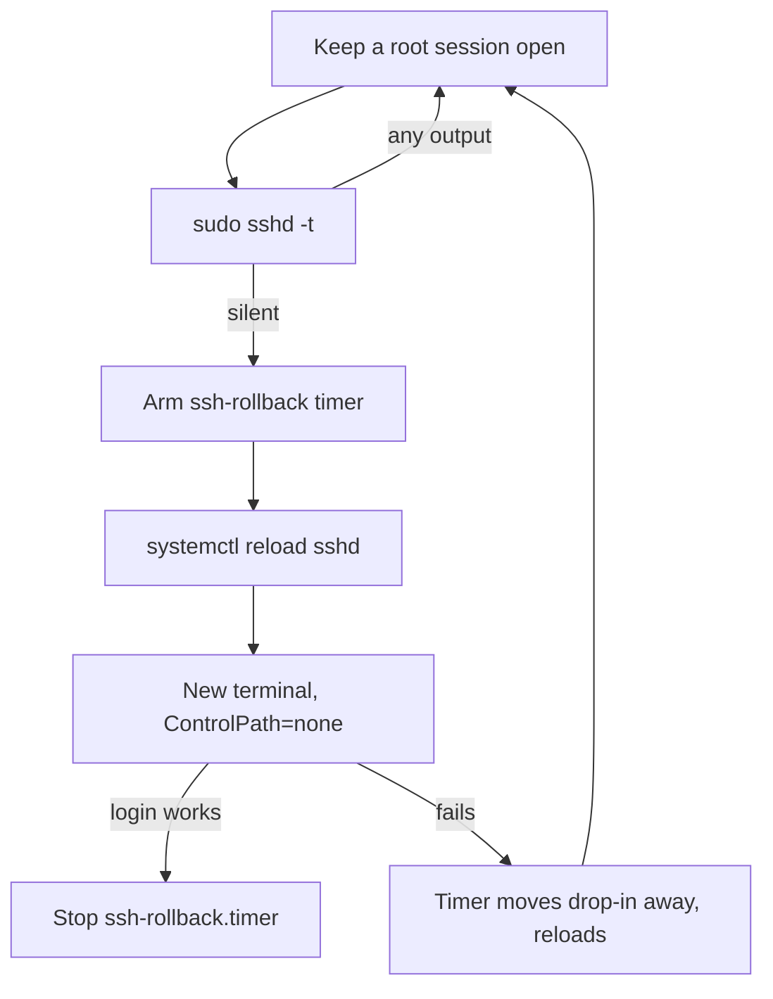
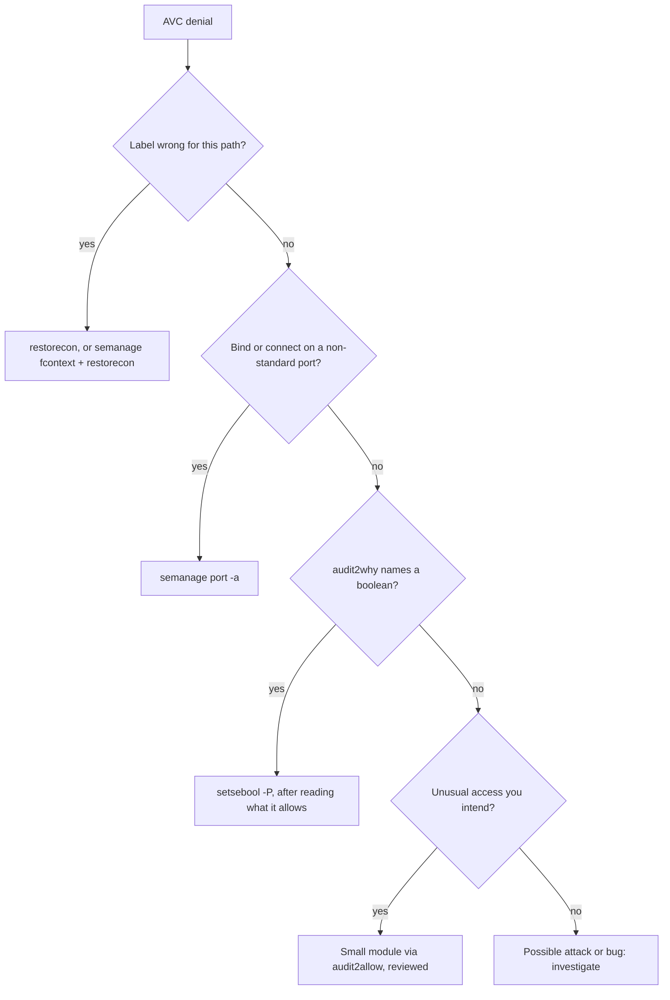
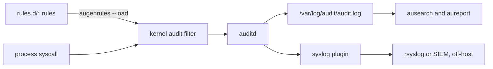
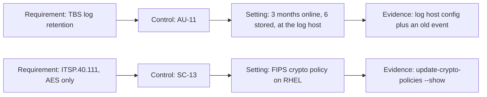
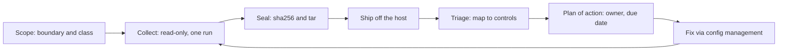
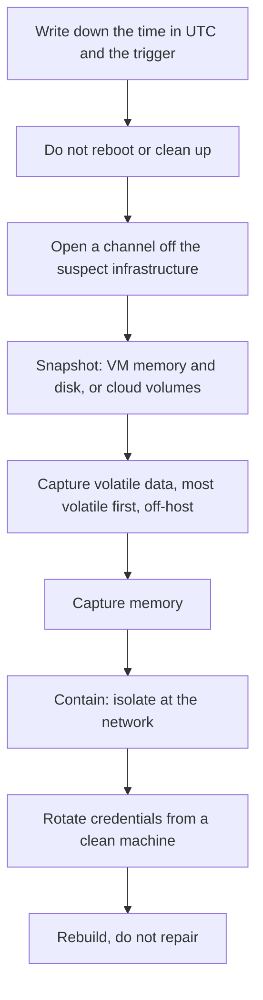

# Linux Security, A→Z

> One route through defending a Linux box you own: know what you are protecting, lock down accounts and SSH without locking yourself out, filter the network, keep SELinux on, then audit, watch for change, know the first fifteen minutes of a response, and map it all to Canadian requirements with evidence for permissions, containers and Kubernetes. Follow it once on a real host; afterwards each waypoint is a checklist.
> Full version: [Linux Security Field Manual](./linux-security-field-manual.md)

## Contents

- 01 · [Threat model and layers](#ch01)
- 02 · [First moves: a way back in, then patches](#ch02)
- 03 · [What listens, and the firewall](#ch03)
- 04 · [SSH without locking yourself out](#ch04)
- 05 · [Accounts, sudo and PAM](#ch05)
- 06 · [SELinux: read the denial, fix the label](#ch06)
- 07 · [Kernel, disk and service sandboxing](#ch07)
- 08 · [auditd and the journal](#ch08)
- 09 · [Integrity and baseline scans](#ch09)
- 10 · [Canadian rules, mapped to settings](#ch10)
- 11 · [Audit permissions and containers](#ch11)
- 12 · [Kubernetes and the audit programme](#ch12)
- 13 · [When something gets through](#ch13)
- Z · [One-screen reference](#appendix)

---


<a id="ch01"></a>

## 01 · Threat model and layers

*Every access on Linux passes a stack of independent checks, and an attacker has to beat all of them. Hardening means making each layer say no on its own, applied in an order that never locks you out.*

A threat model is three answers written down before you touch a config file: **what you're protecting, from whom, and what you'll accept losing.** Skip it and hardening turns into a checklist that grows until someone switches it off.

### Who actually attacks a server

For a typical self-hosted box (a CI runner, a build host, a bastion), these are the realistic attackers, most likely first:

| Attacker | How they arrive | What stops them |
|---|---|---|
| Internet scanner | Exposed service with a known CVE, or a weak password | Patching, default-deny inbound, key-only SSH |
| Supply chain | Malicious package, image or CI dependency running as a service user | SELinux, service sandboxing, egress filtering |
| Compromised laptop | Stolen SSH key or token used from a trusted network | FIDO2 keys, short-lived certificates, tight sudo |
| Insider | Legitimate access used beyond its purpose | sudo logging, auditd, off-host logs |
| Physical or console access | Stolen disk, snapshot, rescue boot | LUKS, Secure Boot, TPM-bound unlock |

**The first two rows cause most real incidents.** A box that's behind on `sudo` and `openssh` patches gets lost to something much cheaper than a kernel 0-day.

Write the assets down too. On a CI runner, that's its secrets and **the integrity of what it builds**, which is the asset people forget.

### Defence in depth, concretely

Defence in depth isn't about installing lots of tools. It means stacking **independent** checks, so that any one of them can fail without the attacker winning. Follow a remote code execution bug in nginx down the stack:



Any single layer can fall. DAC falls to a bug running as the right user, SELinux to a policy that's too broad, the sandbox to a unit someone forgot to harden. Stacked, they make the attacker find a bug in each one.

### How the kernel checks stack

Every open, bind or module load passes these checks, and **every one of them has to allow it**: seccomp (syscall filter), namespaces (what the process can see), DAC (mode bits, which root mostly bypasses), capabilities (unless root lost the one that grants the bypass), then MAC such as SELinux, which applies to root too. `cat /sys/kernel/security/lsm` lists the active security modules.

> **Note.** A layer can only deny. It can't override another layer's denial, so SELinux can't grant what DAC refused and DAC can't grant what SELinux refused. Whichever layer said no tells you which tool to reach for.

### The local escalation shortlist

These are the first things someone with an unprivileged shell tries. Run the checks before they do:

```bash
getent group docker                               # docker group membership is root
sudo find / -xdev -perm /6000 -type f             # unexpected SUID/SGID binaries
sudo -l -U USER                                   # sudo rules with shell escapes
sudo find / -xdev -type f -perm -0002             # world-writable files root may execute
dnf updateinfo list --security                    # unpatched kernel or sudo
getcap -r / 2>/dev/null                           # binaries carrying capabilities
```

> **Gotcha.** Membership of the `docker` group is root. `docker run -v /:/host --privileged` gives a root shell on the host with no password prompt and no sudo log. Rootless Podman doesn't have this property.

### Least privilege, and the route ahead

Apply least privilege to users, services and credentials alike, and ask of each: **if this identity were stolen right now, what's the blast radius?**

The chapters follow the order you'd harden a real box: a way back in, patches, the firewall, SSH, accounts, SELinux, then the kernel and services. After that you watch the box with auditd, verify it against AIDE and a benchmark, map it to Canadian requirements, audit permissions, containers and Kubernetes into sealed evidence, and respond when something gets through. The stage people skip is **verify**: a change nobody re-checks quietly reverts at the next update.

---


<a id="ch02"></a>

## 02 · First moves: a way back in, then patches

*Before any change that could cut you off, get a second way into the box. Then patch it and turn on automatic updates with reboots, which is the cheapest control with the largest effect.*

Hardening is mostly a sequencing problem: the same controls in the wrong order give you a locked-out box. Each early step makes the later ones recoverable.

### The order, and why

| Step | Do | Why it goes here | Chapter |
|---|---|---|---|
| 1 | Get a second way in | Everything after this can lock you out | here |
| 2 | Patch, turn on automatic updates | Cheapest control, largest effect | here |
| 3 | Check `getenforce` says `Enforcing` | It already confines every network daemon | SELinux |
| 4 | Inventory listeners, default-deny inbound | A port nothing listens on needs no rule | Firewall |
| 5 | Harden SSH from a second session | Keys only, first-wins drop-in | SSH |
| 6 | Fix accounts and sudo | Local escalation rarely needs an exploit | Accounts |
| 7 | Sysctls, sandboxing, LUKS header backup | Contains daemons and the kernel | Kernel |
| 8 | auditd rules, logs shipped off-host | A record the attacker can't edit | Audit log |
| 9 | AIDE baseline, then a benchmark scan | Baseline the *hardened* state, then prove it | Verify |
| 10 | Write down what you did | So nobody flips `ptrace_scope` back | all |

Step 3 is a one-line check at this stage. If it doesn't say `Enforcing`, go to permissive (not disabled), relabel, fix the denials, then enforce.

### Step 1: a second way in

Before touching sshd, the firewall, PAM or sudo, make sure a mistake is survivable. That means a console, a serial or cloud rescue console, or a second admin account with a tested key. Confirm two admins can really use sudo before you ever lock root:

```bash
sudo -l -U ADMIN1
sudo -l -U ADMIN2
```

> **One-way door.** Locking the root password with no working sudo path means a rescue boot and `rd.break`. On remote bare metal with no out-of-band access, getting SSH or the firewall wrong means a trip to the datacentre. Once you have a second way in, every later step becomes a reversible edit.

### Step 2: patch, then automate it

Bring the box current and reboot into the new kernel:

```bash
sudo dnf upgrade --refresh
sudo systemctl reboot
```

On Fedora 41 and later, `dnf-automatic` is a dnf5 plugin:

```bash
sudo dnf install dnf5-plugin-automatic
```

Set it to apply updates and to reboot only when a kernel, glibc or systemd update needs one:

```ini
# file: /etc/dnf/automatic.conf
[commands]
upgrade_type = default
download_updates = yes
apply_updates = yes
reboot = when-needed
reboot_command = shutdown -r +10 'Rebooting to apply security updates'
random_sleep = 900

[emitters]
emit_via = motd,stdio
```

Enable the timer and see when it will run next:

```bash
sudo systemctl enable --now dnf5-automatic.timer
systemctl list-timers dnf5-automatic.timer
```

Move it into a maintenance window with `sudo systemctl edit dnf5-automatic.timer`. The empty `OnCalendar=` clears the packaged schedule; without it, both schedules apply:

```ini
# file: /etc/systemd/system/dnf5-automatic.timer.d/override.conf
[Timer]
OnCalendar=
OnCalendar=Tue..Thu 03:00
RandomizedDelaySec=30m
```

> **Gotcha.** `upgrade_type = security` installs only packages named in a security advisory. On Fedora the packager picks each update's type, so **a CVE fix filed as `bugfix` gets skipped**. Use `default` on Fedora. On RHEL, AlmaLinux and Rocky, errata are classified centrally, so `security` is fine there.

### Check what's pending and whether you need a reboot

These show outstanding advisories, what the timer did, and whether the running kernel is stale:

```bash
dnf advisory list --security                  # updateinfo is an alias
journalctl -u dnf5-automatic.service --since '7 days ago'
dnf needs-restarting; echo $?                 # non-zero: reboot needed
dnf needs-restarting -s                       # services on old libraries
```

Updates without reboots leave the old kernel and glibc running, and only `dnf needs-restarting` will tell you. A repo whose metadata fails to load contributes no advisories and no warning.

On Debian and Ubuntu, `unattended-upgrades` with `Automatic-Reboot "true"` does the same job.

**If you only get one thing done today, make it automatic security updates that actually reboot.** Every other control raises the bar; a public exploit for a known sudo CVE drops it to the floor.

- [ ] A second way in exists and has been tested.
- [ ] Two admin accounts pass `sudo -l`.
- [ ] `dnf5-automatic.timer` is enabled with `apply_updates = yes` and `reboot = when-needed`.

---


<a id="ch03"></a>

## 03 · What listens, and the firewall

*A port nothing listens on needs no firewall rule, so start from what listens, not from rules. Then default-deny both directions with firewalld, test every restrictive change behind a rollback timer, and remember that containers and IPv6 punch their own holes.*

### Start with what listens

List every listening socket and the process that owns it. Run it as root, or other users' processes stay hidden:

```bash
sudo ss -tulpn
systemctl list-sockets            # socket-activated listeners, easy to miss
```

The local address column tells you who can reach each one:

| Local address | Reachable from |
|---|---|
| `127.0.0.1:PORT`, `[::1]:PORT` | This host only. Fine |
| `0.0.0.0:PORT` | Every IPv4 interface, including public ones |
| `[::]:PORT` or `*:PORT` | Every IPv6 interface, and usually IPv4 too |
| `192.168.0.17:PORT` | That one interface |
| `172.17.0.1:PORT` | A container bridge: every container on it |

For each `0.0.0.0` or `[::]` line, ask: **what is it, who needs it, and from where?** If you can't answer, stop it and see who complains. `systemctl status PID` names the unit, and `rpm -qf "$(readlink -f /proc/PID/exe)"` names the package.

Turn off whatever you don't need. `mask` links the unit to `/dev/null`, so nothing can start it:

```bash
sudo systemctl disable --now avahi-daemon.socket avahi-daemon.service
sudo systemctl mask avahi-daemon.service avahi-daemon.socket
sudo dnf remove cups
```

> **Gotcha.** Disabling a socket-activated `.service` isn't enough: the `.socket` unit keeps listening and starts the service on the first connection. Disable and mask both.

### firewalld, and the zone that isn't safe

On Fedora and RHEL, use **firewalld**; its runtime/permanent split gives you a free undo. Use raw nftables on routers, and **never run both on the same traffic.** Start every audit here:

```bash
firewall-cmd --state
firewall-cmd --get-active-zones
firewall-cmd --list-all
```

> **Gotcha.** Fedora Workstation's default zone, `FedoraWorkstation`, allows **TCP and UDP 1025–65535 inbound** by design, so a dev server on 8080 is reachable from the LAN. On anything that leaves your desk, run `sudo firewall-cmd --set-default-zone=public`.

### Change it safely: runtime first, behind a timer

Runtime changes vanish at reload, and permanent ones **do nothing until `--reload`**. For anything that could cut you off: arm a timer that reloads the permanent config, change only the runtime config, test from a new connection, then commit:

```bash
sudo systemd-run --on-active=5min --unit=fw-rollback /usr/bin/firewall-cmd --reload
sudo firewall-cmd --zone=public --add-rich-rule='rule family="ipv4" source address="ADMIN_CIDR" service name="ssh" accept'
sudo firewall-cmd --zone=public --remove-service=ssh
# test from a NEW connection, then:
sudo systemctl stop fw-rollback.timer
sudo firewall-cmd --runtime-to-permanent
```

> **Gotcha.** `--timeout` only applies to *add* operations. Pair a timed allow with an untimed `--remove-service=ssh` and when the timer expires, the allow disappears and the removal stays. That's the exact lockout you were avoiding. Never use `--complete-reload` over SSH either: it drops your session.

### Default-deny inbound, admin access by source

`public` rejects anything not allowed. Source zones beat interface zones, which is how you give SSH to the admin network only:

```bash
sudo firewall-cmd --permanent --zone=internal --add-source=10.10.0.0/24
sudo firewall-cmd --permanent --zone=internal --add-service=ssh
sudo firewall-cmd --permanent --zone=public --remove-service=ssh
sudo firewall-cmd --check-config && sudo firewall-cmd --reload
```

### Default-deny egress

Almost every post-exploitation step (fetching a payload, reaching C2, exfiltration) is an outbound connection. A server with five known destinations fits on a short allow-list:

```bash
sudo firewall-cmd --permanent --new-policy=egress
sudo firewall-cmd --permanent --policy=egress --add-ingress-zone=HOST
sudo firewall-cmd --permanent --policy=egress --add-egress-zone=ANY
sudo firewall-cmd --permanent --policy=egress --set-target=REJECT
sudo firewall-cmd --permanent --policy=egress --add-service=dns
sudo firewall-cmd --permanent --policy=egress --add-service=ntp
sudo firewall-cmd --permanent --policy=egress --add-rich-rule='rule family="ipv4" destination address="10.20.0.5/32" port port="5432" protocol="tcp" accept'
sudo firewall-cmd --check-config && sudo firewall-cmd --reload
```

What breaks is anything the host *starts* that you forgot (OCSP, cloud metadata at `169.254.169.254`, image pulls), so build it at runtime behind the rollback timer first.

### Containers and IPv6

`docker run -p 5432:5432` publishes on `0.0.0.0` through the engine's own rules, which **bypass firewalld zone input rules**. Bind to loopback (`-p 127.0.0.1:5432:5432`), or set `"ip": "127.0.0.1"` in `/etc/docker/daemon.json`. Rootless Podman goes through the input chain normally.

**Leave IPv6 on and firewall it.** firewalld zones cover both families; a hand-written iptables ruleset with no ip6tables twin leaves everything open over IPv6.

### Network sysctls

Put these in one file. For sysctl.d **the last file wins**, so a `60-` name overrides systemd's `50-default.conf`:

```ini
# file: /etc/sysctl.d/60-net-hardening.conf
net.ipv4.conf.all.rp_filter = 1
net.ipv4.conf.default.rp_filter = 1
net.ipv4.tcp_syncookies = 1
net.ipv4.conf.all.accept_redirects = 0
net.ipv6.conf.all.accept_redirects = 0
net.ipv4.conf.all.send_redirects = 0
net.ipv4.conf.all.accept_source_route = 0
net.ipv4.conf.all.log_martians = 1
net.ipv4.icmp_echo_ignore_broadcasts = 1
```

Load them with `sudo sysctl --system`, then read a value back with `sysctl` to confirm. Never set `ip_forward = 0` on Docker, rootful Podman, libvirt or Kubernetes hosts, because it breaks container networking instantly. Use `rp_filter = 2` on multi-homed hosts with asymmetric routing.

### Banning, and the outside view

fail2ban belongs in front of **services that still accept passwords**, and ships with every jail disabled on Fedora. Once a week, scan from a *different* host, and only hosts you own, to see what the network actually sees: `nmap -sS -sU --top-ports 200 -Pn HOST`, and again with `-6`.

---


<a id="ch04"></a>

## 04 · SSH without locking yourself out

*With keys only, brute force stops mattering and the real risk becomes a stolen private key, which hardware keys and short-lived certificates fix. sshd keeps the first value it reads, so your drop-in is 10-, and every change goes through a loop that can roll itself back.*

What reduces risk, in order: **no passwords**, **keys that can't be copied** (FIDO2), **keys that expire** (certificates), and **fewer paths in**. Changing the port or running fail2ban on a key-only sshd only cuts log noise; OpenSSH 9.8+ throttles abusive sources itself with `PerSourcePenalties`.

### First value wins

On Fedora 43, `sshd_config` includes `/etc/ssh/sshd_config.d/*.conf` in lexical order before anything else, and the distro ships `40-redhat-crypto-policies.conf` and `50-redhat.conf`. **For most keywords sshd uses the first value it reads**, so a `99-hardening.conf` silently loses to `50-redhat.conf`.

> **Gotcha.** This is the opposite of systemd drop-ins and sysctl.d, where the last file wins, so a `99-` file "to make sure it overrides" is exactly backwards. Name yours `10-` and check with `sshd -T`, never by reading files. Cloud images often add `50-cloud-init.conf` with `PasswordAuthentication yes`.

### The hardened drop-in

`AllowGroups` is checked before authentication. Create the group, add everyone who should get in, and confirm with `id` from a **fresh** login:

```bash
sudo groupadd --system sshusers
sudo usermod -aG sshusers USER
```

Then write the drop-in:

```ini
# file: /etc/ssh/sshd_config.d/10-hardening.conf
PermitRootLogin no
AllowGroups sshusers

AuthenticationMethods publickey
PasswordAuthentication no
KbdInteractiveAuthentication no
PermitEmptyPasswords no
GSSAPIAuthentication no

MaxAuthTries 3
LoginGraceTime 20s
MaxStartups 10:30:60
ClientAliveInterval 300
ClientAliveCountMax 2

DisableForwarding yes
PermitTunnel no
PermitUserEnvironment no

# VERBOSE logs the fingerprint of the key used for each login
LogLevel VERBOSE

HostKey /etc/ssh/ssh_host_ed25519_key
HostKey /etc/ssh/ssh_host_ecdsa_key
```

`KbdInteractiveAuthentication no` closes the PAM password path that `PasswordAuthentication no` alone leaves open on some setups. `LogLevel VERBOSE` is what tells you *which* key was stolen.

### The lockout-safe change loop

Existing sessions survive a reload. That's your safety net, so don't throw it away. Every sshd change goes round this loop:



As commands: validate, arm a timer that moves the drop-in aside unless you cancel it, then reload rather than restart:

```bash
sudo sshd -t
sudo systemd-run --on-active=5min --unit=ssh-rollback \
  /bin/sh -c 'mv /etc/ssh/sshd_config.d/10-hardening.conf /root/10-hardening.conf.rolledback && systemctl reload sshd'
sudo systemctl reload sshd
```

Test from a new terminal with multiplexing off, then cancel the timer:

```bash
ssh -o ControlMaster=no -o ControlPath=none -o IdentitiesOnly=yes -i ~/.ssh/id_ed25519_sk USER@HOST 'id; sudo -n true && echo sudo-ok'
sudo systemctl stop ssh-rollback.timer
```

> **Gotcha.** With `ControlMaster auto` in `~/.ssh/config`, a "new" `ssh HOST` rides the existing authenticated connection and succeeds whatever you broke. Always test with `-o ControlPath=none`.

Other common ways people lock themselves out:

| Mistake | Prevention |
|---|---|
| `AllowGroups` before adding yourself | `id` from a fresh login shows the group |
| `PasswordAuthentication no` before a key works | Log in once with `-o PasswordAuthentication=no` first |
| New `Port` without SELinux and firewall | `semanage port -a -t ssh_port_t -p tcp PORT` and `firewall-cmd --add-port=PORT/tcp` first |
| `RevokedKeys` pointing at a missing file | Create an empty KRL: `ssh-keygen -k -f /etc/ssh/revoked_keys` |

### Verify with sshd -T

`sshd -T` prints the effective config after every include (add `-C user=USER,addr=IP` for `Match` blocks):

```bash
sudo sshd -T | grep -E '^(permitrootlogin|passwordauthentication|kbdinteractiveauthentication|allowgroups|disableforwarding) '
```

### FIDO2 keys, and certificates

A FIDO2 key's file is **useless without the token**. For admin access, use a non-resident key with a PIN, and enrol **two tokens**:

```bash
ssh-keygen -t ed25519-sk -O verify-required -C "USER@LAPTOP" -f ~/.ssh/id_ed25519_sk
```

Once you're past about ten hosts, a user CA replaces `authorized_keys` sprawl: every host trusts one CA key, and users present certificates that expire. **Short validity is the real revocation mechanism.** Sign a key for eight hours:

```bash
ssh-keygen -s ~/ssh-ca/user_ca -I "USER@LAPTOP $(date -I)" -n USER -V +8h ~/.ssh/id_ed25519_sk.pub
```

Hosts trust it with `TrustedUserCAKeys /etc/ssh/user_ca.pub` and `AuthorizedPrincipalsFile /etc/ssh/auth_principals/%u` in the drop-in.

> **One-way door.** Whoever holds the user CA private key can log in as any principal on every host that trusts it, until you rotate the CA everywhere. Keep it offline, on a hardware token, or in OpenBao, never on a build server.

### Bastions and algorithms

Reach inner hosts with `-J`, never `-A`. Agent forwarding lets root on the bastion use your agent as you. ProxyJump forwards only an encrypted stream:

```bash
ssh -J USER@BASTION USER@INTERNAL_HOST
```

On Fedora and RHEL, tighten algorithms with `sudo update-crypto-policies --set DEFAULT:NO-SHA1`, not hand-written `Ciphers` lines. It moves OpenSSH, OpenSSL, GnuTLS and NSS together, so `curl` your internal endpoints afterwards.

---


<a id="ch05"></a>

## 05 · Accounts, sudo and PAM

*Local privilege escalation almost never needs an exploit: it needs a sudo rule with a shell escape, a forgotten SUID binary or a group that is root by another name. Audit those first, then turn on faillock and length checks through authselect.*

### Who can log in

Start with facts: who exists, who has a password, who's in a privileged group.

```bash
awk -F: '$3 == 0 {print $1}' /etc/passwd                                  # must be only root
sudo passwd -S -a 2>/dev/null | awk '{print $1, $2}'                      # P usable, L locked, NP none
getent group wheel docker libvirt disk adm
```

Several groups are root under another name:

| Group | What it really grants |
|---|---|
| `wheel` | sudo to root, plus polkit admin |
| `docker` | Root on the host through the Docker socket |
| `libvirt` | A VM that mounts the host disk; effectively root |
| `disk` | Raw read and write on block devices; root |

In every access review, treat `docker`, `libvirt` and `disk` like `wheel`.

### Disabling someone properly

To fully disable a departing user, **lock and expire** the account and move their keys aside (then `loginctl terminate-user USER`):

```bash
sudo usermod -L -e 1 USER
sudo mv /home/USER/.ssh/authorized_keys /home/USER/.ssh/authorized_keys.disabled
```

> **Gotcha.** `passwd -l` on its own **doesn't stop SSH key logins**. Public key auth skips the password check entirely; only account expiry or `AllowGroups` stops it. It's the most common "we disabled that account" failure in incident reviews.

Turn password ageing off (`sudo chage -M -1 USER`): forced rotation produces `Summer2026!` then `Autumn2026!`, which is why NIST SP 800-63B dropped it. Expire a password with `sudo passwd -e USER` only after a suspected leak.

### sudo, one file per role

Never edit `/etc/sudoers`. Put one file per role in `/etc/sudoers.d/` and edit it through `visudo`, which checks the syntax:

```bash
sudo visudo -f /etc/sudoers.d/10-webops
sudo visudo -c
```

A least-privilege rule names exact commands with absolute paths, and pins `--no-pager` wherever a pager could open:

```ini
# file: /etc/sudoers.d/10-webops
Cmnd_Alias WEB_SVC = /usr/bin/systemctl restart nginx.service, \
                     /usr/bin/systemctl reload nginx.service, \
                     /usr/bin/systemctl --no-pager status nginx.service
Cmnd_Alias WEB_LOG = /usr/bin/journalctl --no-pager -u nginx.service

%webops ALL=(root) WEB_SVC, WEB_LOG
%webops ALL=(root) sudoedit /etc/nginx/conf.d/app.conf

Defaults          use_pty
Defaults          logfile=/var/log/sudo.log
Defaults          timestamp_timeout=5
```

> **Gotcha.** A file named `10-webops.conf` is **silently ignored**, because sudo skips files whose names contain a dot. Nothing logs it. Name them `10-webops`, `20-ci-deploy`.

Rules for writing rules:

- **Never allow an editor, pager, interpreter or archiver as root.** `vim`, `less`, `find`, `awk`, `tar`, `git`, `python`, `env` and `systemctl edit` all have documented shell escapes. Use `sudoedit` for files.
- **Argument wildcards match spaces**: `cat /var/log/*` permits `cat /var/log/../../etc/shadow`.
- **A `NOPASSWD` script must not be writable by the user.**

> **One-way door.** A syntax error in any included sudoers file breaks sudo for everybody, and with no root password the fix is a rescue boot. Run `visudo -cf FILE` before copying a file into place, and keep a root shell open.

Review a user's rules and hunt for broad grants:

```bash
sudo -ll -U USER
sudo grep -rn 'NOPASSWD' /etc/sudoers /etc/sudoers.d/
```

### PAM through authselect

On Fedora and RHEL, `authselect` generates the PAM files and overwrites any hand edits. Enable features instead:

```bash
sudo authselect enable-feature with-faillock
sudo authselect enable-feature with-pwhistory
sudo authselect apply-changes
authselect check
```

Configure lockout in its own file. Leave `even_deny_root` off, or anyone can lock root out by failing on purpose:

```ini
# file: /etc/security/faillock.conf
deny = 5
fail_interval = 900
unlock_time = 600
audit
silent
```

Length is the password control that matters: set `minlen = 14`, `minclass = 0`, `dictcheck = 1` and `enforce_for_root` in a drop-in, `/etc/security/pwquality.conf.d/50-local.conf`.

SSH key failures never go through PAM, so faillock mostly protects the console, `su` and `sudo`.

### SUID, world-writable, capabilities

Find the files that let a user climb:

```bash
sudo find / -xdev -type f -perm /6000 -exec ls -l {} + 2>/dev/null
sudo find / -xdev -type d -perm -0002 ! -perm -1000 -print 2>/dev/null
sudo getcap -r / 2>/dev/null
```

Run `rpm -qf` on each SUID binary and `sudo rpm -Va --nomtime` to catch changed ones. **A SUID file owned by no package is an incident until proven otherwise.**

Get rid of unneeded SUID binaries by removing the package, since `chmod u-s` comes back with the next update. Mount data paths `nodev,nosuid`.

Set `UMASK 027` in `/etc/login.defs` on servers. Services get `UMask=0022` from systemd instead, so set `UMask=0077` in units that write secrets. And review `/etc/polkit-1/rules.d/` alongside sudoers: polkit is a second privilege path.

- [ ] Exactly one UID 0 account, and none with status `NP`.
- [ ] `wheel`, `docker`, `libvirt` and `disk` membership reviewed.
- [ ] sudo rules name absolute commands, and `visudo -c` passes.
- [ ] `authselect check` passes, with faillock on.
- [ ] Every SUID binary is owned by a package.

---


<a id="ch06"></a>

## 06 · SELinux: read the denial, fix the label

*Almost every SELinux denial is a file label that doesn't match where the file lives, a port you didn't declare, or a boolean you didn't flip. Read the denial, fix the label, keep the box enforcing, and a custom policy module is almost never needed.*

### The model

Every process has a **domain** (`httpd_t`), and every file and port has a **type** (`httpd_sys_content_t`, `ssh_port_t`). The policy lists what each domain may do to each type, and denies everything else, root included. File labels come from path regexes that `restorecon` applies, and **booleans** are switches the policy authors built in. A denial means DAC already said yes and the policy said no.

### Stay enforcing

Check the mode, then debug a single service by making only its domain permissive. **Don't reach for `setenforce 0`.** Per-domain permissive keeps every other daemon confined, and it shows up in a list so nobody forgets it:

```bash
getenforce
sudo semanage permissive -a httpd_t
sudo semanage permissive -l
sudo semanage permissive -d httpd_t
```

> **One-way door.** With `SELINUX=disabled` or `selinux=0`, new files get **no labels at all**. Re-enabling means a full relabel (`sudo touch /.autorelabel` and a long reboot), and whatever happened while the box was unconfined stays unknown. Permissive keeps labels. For a one-off recovery boot, add `enforcing=0` at the GRUB menu instead.

### Reading a denial

Pull recent denials from the audit log and let `audit2why` explain them:

```bash
sudo ausearch -m AVC,USER_AVC -ts recent
sudo ausearch -m AVC -ts recent --raw | audit2why
```

Here's one, annotated:

```text
type=AVC msg=audit(1758620000.123:4521): avc:  denied  { read } for  pid=2211
  comm="nginx" name="index.html" dev="dm-0" ino=123456
  scontext=system_u:system_r:httpd_t:s0              <- who: nginx in domain httpd_t
  tcontext=unconfined_u:object_r:user_home_t:s0      <- what: a file labelled user_home_t
  tclass=file permissive=0                           <- object class, and it was blocked
```

It reads as **domain `httpd_t` was denied `read` on a `file` of type `user_home_t`.** A web server hitting a home-directory label means the file's label is wrong, not the policy.

### The decision tree

Work down this tree in order. Each step grants more than the one before:



### Fix the label

Compare what a path *should* be with what it *is*. **When `matchpathcon` and `ls -Z` disagree, you've found the bug:**

```bash
matchpathcon /srv/www/index.html
ls -Z /srv/www/index.html
sudo restorecon -Rv /var/www/html
```

For a custom path, record the rule and then apply it. It always takes both steps:

```bash
sudo semanage fcontext -a -t httpd_sys_content_t '/data/web(/.*)?'
sudo restorecon -Rv /data/web
sudo semanage export > selinux-local.txt      # customisations, for Git
```

> **Gotcha.** `mv` keeps the source file's label, while `cp` and `install` take the destination's. A config written in your home directory and `mv`ed into `/etc/nginx/` arrives as `user_home_t`, and nginx can't read it. `chcon` only lasts until the next `restorecon`, so make fixes permanent with `semanage fcontext`.

### Ports and booleans

A daemon binding a non-standard port gets denied `name_bind`. Label the port:

```bash
sudo semanage port -a -t http_port_t -p tcp 8443
```

Read the descriptions (`sudo semanage boolean -l | grep httpd`), then flip the narrowest boolean that works, with `-P` so it persists: `sudo setsebool -P httpd_can_network_connect_db on`.

| Boolean | Allows | Verdict |
|---|---|---|
| `httpd_can_network_connect_db` | Web server to database ports only | Prefer this |
| `httpd_can_network_relay` | Web server as a proxy to HTTP ports | Fine for proxies |
| `httpd_can_network_connect` | Web server outbound to **any** port | Broad: what a reverse shell needs |

### A local module, last

`audit2allow` turns whatever happened into policy: a mislabelled file becomes a grant on a generic type, an attacker's probe becomes legal. When a module really is needed, collect denials in per-domain permissive and **read the rules before you build**:

```bash
sudo ausearch -m AVC -ts recent --raw > avc.log
audit2allow -i avc.log -M local_myapp
cat local_myapp.te
sudo semodule -i local_myapp.pp
```

Red flags in the `.te`: generic types (`user_home_t`, `var_t`, `tmp_t`), `self:capability { sys_admin dac_override }`, `shadow_t` reads, `execmem`. Keep the `.te` in Git.

### Containers and :Z

Container bind mounts are denied until relabelled: `:Z` for one container, `:z` for sharing:

```bash
podman run --rm -v ~/data:/data:Z fedora:43 ls /data
```

> **One-way door.** `:Z` and `:z` **relabel host files in place**. `-v /home/USER:/h:Z` relabels your whole home, sshd can no longer read `authorized_keys`, and your next SSH login fails. Recovery is `restorecon -RF /home/USER` from a console. Use `:Z` only on directories that exist for the container.

- [ ] `getenforce` prints `Enforcing`, and `semanage permissive -l` is empty or owned.
- [ ] Custom paths use `semanage fcontext`, exported to Git.
- [ ] Every changed boolean and local module is justified.

---


<a id="ch07"></a>

## 07 · Kernel, disk and service sandboxing

*Most kernel exploits need a subsystem an ordinary server never uses, so switch those off with one sysctl file. Encrypt the disk and back up its header, then sandbox every service you run so a compromised daemon stays a compromised daemon.*

### Kernel sysctls

Every setting here removes surface an ordinary server never uses. sysctl.d is last-file-wins, so `60-` overrides systemd's `50-default.conf`:

```ini
# file: /etc/sysctl.d/60-kernel-hardening.conf
kernel.kptr_restrict = 2
kernel.dmesg_restrict = 1
kernel.yama.ptrace_scope = 2
kernel.unprivileged_bpf_disabled = 1
net.core.bpf_jit_harden = 2
fs.protected_symlinks = 1
fs.protected_hardlinks = 1
fs.protected_fifos = 2
fs.protected_regular = 2
fs.suid_dumpable = 0
kernel.randomize_va_space = 2
kernel.sysrq = 0
dev.tty.ldisc_autoload = 0
vm.unprivileged_userfaultfd = 0
kernel.io_uring_disabled = 2
kernel.kexec_load_disabled = 1
```

Apply every file in order, then check the live values:

```bash
sudo sysctl --system
sysctl kernel.kptr_restrict kernel.yama.ptrace_scope
```

Know what each one costs before you ship it:

| Key | Breaks |
|---|---|
| `kernel.yama.ptrace_scope = 2` | `gdb -p` and `strace -p` without root. 3 blocks all ptrace **until reboot** |
| `kernel.io_uring_disabled = 2` | Software that uses io_uring: some databases, QEMU (kernel 6.6+) |
| `kernel.kexec_load_disabled = 1` | kdump kernels loaded after boot. Holds until reboot |

> **Gotcha.** `ptrace_scope = 3`, `kexec_load_disabled = 1` and `kernel.modules_disabled = 1` can't be lowered without a reboot. Set 3 in production and the next time you need `strace -p` on a hung process, you can't. Use 2.

`user.max_user_namespaces = 0` closes a large class of escalations but breaks rootless Podman, Flatpak and browser sandboxes. It's a close call. The tiebreaker is whether anything on the box uses rootless containers (`lsns -t user`).

Block obscure filesystems and protocols (`cramfs`, `udf`, `dccp`, `sctp`, `rds`, `tipc`) with lines like `install sctp /bin/false` in `/etc/modprobe.d/60-blacklist-rare.conf`. That beats `blacklist`, because it also stops an explicit `modprobe`.

### Secure Boot and lockdown

Secure Boot makes firmware verify the bootloader and kernel. Fedora kernels switch on `integrity` lockdown with it, so even root can't rewrite the running kernel:

```bash
mokutil --sb-state
cat /sys/kernel/security/lockdown
```

Turn Secure Boot on *before* enrolling the TPM. Enrol module-signing keys through shim and MOK (`mokutil --import`), never by replacing the platform keys. Lockdown refuses unsigned DKMS modules (NVIDIA, ZFS) until signed.

### LUKS2: back up the header first

Check for `Version: 2`, `argon2id` keyslots, and every slot accounted for. Then back up the header and move the copy off this disk:

```bash
sudo cryptsetup luksDump /dev/DEVICE | less
sudo cryptsetup luksHeaderBackup /dev/DEVICE --header-backup-file /root/HOSTNAME-luks-header.img
```

> **One-way door.** The header holds the wrapped volume key. Lose or corrupt it and no passphrase, recovery key or TPM can open the disk. Back it up at creation and **after every keyslot change**, and keep it off-host, protected like a key.

### TPM2 unlock, in order

Recovery key first, then TPM2 bound to PCR 7, test it, and only then decide about the passphrase:

```bash
sudo systemd-cryptenroll --recovery-key /dev/DEVICE
sudo systemd-cryptenroll --tpm2-device=auto --tpm2-pcrs=7 /dev/DEVICE
```

Add `tpm2-device=auto` to the device's `/etc/crypttab` line, add `tpm2-tss` to dracut's modules, and rebuild with `sudo dracut -f`.

> **Gotcha.** Without `--tpm2-pcrs`, `systemd-cryptenroll` binds to **no PCRs at all**, and the TPM hands the key to any OS booted on the machine, live USBs included. Always pass `--tpm2-pcrs=7`. Binding 0+2+4 breaks unattended boot after every update.

Never wipe the last slot you know works. Enrol, reboot, test, *then* `sudo systemd-cryptenroll --wipe-slot=password /dev/DEVICE`, and take a fresh header backup.

### Sandbox your services

systemd can wrap each service in namespaces, capability limits and seccomp, one line per directive, but none of it is on by default. Score what you have. 0.0 is fully sandboxed, 10.0 is nothing:

```bash
systemd-analyze security --no-pager | sort -k2 -n -r | head -20
systemd-analyze security --threshold=30 ./myapp.service    # CI gate: fail above 3.0
```

**Aim for under 5.0 on anything you wrote and under 2.0 for network-facing services.** A 9.6 on `sshd.service` is expected, since its job is to become any user. This unit scores 1.3 on systemd 258:

```ini
# file: /etc/systemd/system/myapp.service
[Unit]
Description=MyApp API
Wants=network-online.target
After=network-online.target

[Service]
Type=simple
ExecStart=/usr/local/bin/myapp --listen :443 --config ${CONFIGURATION_DIRECTORY}/myapp.toml
Restart=on-failure
DynamicUser=yes
StateDirectory=myapp
CacheDirectory=myapp
LogsDirectory=myapp
ConfigurationDirectory=myapp
UMask=0077
LoadCredentialEncrypted=db-password
ProtectSystem=strict
ProtectHome=yes
PrivateTmp=yes
PrivateDevices=yes
DevicePolicy=closed
ProtectProc=invisible
ProcSubset=pid
NoNewPrivileges=yes
CapabilityBoundingSet=CAP_NET_BIND_SERVICE
AmbientCapabilities=CAP_NET_BIND_SERVICE
RestrictSUIDSGID=yes
RemoveIPC=yes
ProtectKernelTunables=yes
ProtectKernelModules=yes
ProtectKernelLogs=yes
ProtectControlGroups=yes
ProtectClock=yes
ProtectHostname=yes
LockPersonality=yes
MemoryDenyWriteExecute=yes
RestrictRealtime=yes
RestrictNamespaces=yes
SystemCallArchitectures=native
SystemCallFilter=@system-service
SystemCallFilter=~@privileged @resources
SystemCallErrorNumber=EPERM
RestrictAddressFamilies=AF_INET AF_INET6 AF_UNIX
IPAddressDeny=any
IPAddressAllow=localhost 10.20.0.0/16
SocketBindAllow=tcp:443
SocketBindDeny=any

[Install]
WantedBy=multi-user.target
```

`MemoryDenyWriteExecute=yes` crashes JIT runtimes (Node.js, the JVM, .NET), sometimes hours in. `PrivateUsers=yes` defeats `CAP_NET_BIND_SERVICE`. For units you didn't write, never edit `/usr/lib/systemd/system/`. Use `sudo systemctl edit UNIT` and add one group of directives at a time, restarting in between.

### Secrets as encrypted credentials

Keep secrets out of `Environment=`, which `systemctl show` exposes. Encrypt the secret to the host key and TPM, and `LoadCredentialEncrypted=db-password` delivers it to that service alone at `$CREDENTIALS_DIRECTORY/db-password`:

```bash
sudo mkdir -p /etc/credstore.encrypted
sudo systemd-creds encrypt --name=db-password SECRET_FILE /etc/credstore.encrypted/db-password
```

---


<a id="ch08"></a>

## 08 · auditd and the journal

*The kernel audit subsystem records what happened at the syscall boundary, tagged with the human who logged in, even after they sudo. Start with a lean ruleset, search it with ausearch, never grep, and ship it off the host, because a local log is the attacker's log.*

### How the pieces fit



Three facts shape everything else:

- **Every event carries `auid`, the login UID.** It's set once at login and survives `sudo` and `su`, so `uid=0 auid=1001` means "root, but it was alice".
- **Syscall rules cost on every syscall**; filesystem rules (`-F path=`) are cheap.
- **One event is several records** sharing a serial number. `ausearch` reassembles them; `grep` shows fragments.

### Check the current state

Everything here needs root:

```bash
sudo auditctl -s
sudo auditctl -l
```

| Field | Healthy | When it isn't |
|---|---|---|
| `enabled` | `1`, or `2` for immutable | `0`: auditing is off |
| `lost` | `0`, or not climbing | Dropped events: rules too noisy or buffer too small |
| `backlog` | Well under `backlog_limit` | Near the limit under load: loss is coming |

### A lean starter ruleset

Rules go in `/etc/audit/rules.d/`, and `augenrules` concatenates them in order. The full `30-stig` set floods build hosts, so start lean and measure. Base config first:

```bash
# file: /etc/audit/rules.d/10-base.rules
-D
-b 8192
--backlog_wait_time 60000
-f 1
--loginuid-immutable
```

Watch identity files and sudoers. Every rule gets a searchable `key` **and a `b32` twin**, because a 32-bit process walks straight past `b64`-only rules:

```bash
# file: /etc/audit/rules.d/30-identity.rules
-a always,exit -F arch=b64 -F path=/etc/passwd  -F perm=wa -F key=identity
-a always,exit -F arch=b32 -F path=/etc/passwd  -F perm=wa -F key=identity
-a always,exit -F arch=b64 -F path=/etc/shadow  -F perm=wa -F key=identity
-a always,exit -F arch=b32 -F path=/etc/shadow  -F perm=wa -F key=identity
-a always,exit -F arch=b64 -F dir=/etc/sudoers.d/ -F perm=wa -F key=sudoers
-a always,exit -F arch=b32 -F dir=/etc/sudoers.d/ -F perm=wa -F key=sudoers
```

Record module loads and every program a human runs:

```bash
# file: /etc/audit/rules.d/50-exec.rules
-a always,exit -F arch=b64 -S init_module,finit_module -F key=module-load
-a always,exit -F arch=b32 -S init_module,finit_module -F key=module-load
-a always,exit -F arch=b64 -S execve,execveat -F auid>=1000 -F auid!=unset -F key=exec
-a always,exit -F arch=b32 -S execve,execveat -F auid>=1000 -F auid!=unset -F key=exec
```

Load the rules and confirm nothing is being lost:

```bash
sudo augenrules --check
sudo augenrules --load
sudo auditctl -s | grep -E 'enabled|lost|backlog'
```

> **Gotcha.** `systemctl restart auditd` is refused on Fedora and RHEL by design. Reload rules with `augenrules --load`, and restart the daemon after editing `auditd.conf` with `service auditd restart`.

The `exec` rule is the expensive one: on build hosts, narrow it to `-F euid=0`, and use `sudo aureport --key --summary` to find noisy keys. Upstream deprecates the old `-w PATH -p wa` form.

### Search by question

Always add `-i` so IDs come out as names:

```bash
sudo ausearch -k identity -ts today -i
sudo ausearch -ul 1001 -ts today -i                               # everything one login did
sudo ausearch -m USER_LOGIN,USER_AUTH --success no -ts today -i   # failed logins
sudo ausearch -m USER_CMD -ts today -i                            # sudo commands
```

An event, trimmed to the records that matter:

```text
type=SYSCALL msg=audit(1790171016.967:4242): arch=x86_64 syscall=openat success=yes exit=3
  ppid=2201 pid=2250 auid=alice uid=root gid=root euid=root ... tty=pts1 ses=7
  comm="vim" exe="/usr/bin/vim" subj=unconfined_u:unconfined_r:unconfined_t:s0 key="sudoers"
type=PATH msg=audit(1790171016.967:4242): item=0 name="/etc/sudoers.d/90-ops" nametype=CREATE ...
```

It reads as **alice (`auid`), as root, in session 7, used vim to create `/etc/sudoers.d/90-ops`.** `uid=root` on its own tells you nothing.

### Immutable mode, later

`-e 2` in `99-finalize.rules` locks the rules until reboot, so an attacker with root can't quietly turn auditing off.

> **One-way door.** Once `-e 2` is loaded, any rule change needs a reboot, including removing a rule that floods the backlog. Run without it for a week, watch `lost` and log volume, then turn it on.

### Ship it off the host

Point the syslog plugin into your rsyslog pipeline and on to the SIEM. Route `local6` to its own forwarding action, or the local journal doubles in size:

```ini
# file: /etc/audit/plugins.d/syslog.conf
active = yes
direction = out
path = /usr/bin/audisp-syslog
type = always
args = LOG_INFO LOG_LOCAL6
format = string
```

### The journal is the auth log

Fedora has no `/var/log/secure` by default. sshd, sudo and PAM all log to the journal:

```bash
journalctl -u sshd.service --since today -g 'Failed|Invalid user'
journalctl -u sshd.service --since "-7d" -g 'Accepted'
journalctl -t sudo --since today
```

From OpenSSH 9.8, authentication messages come from `sshd-session`, so `_COMM=sshd` queries miss them; use `-u sshd.service`. Check `/var/log/journal` exists, or the journal vanishes at reboot.

- [ ] `auditctl -s` shows `enabled 1` and `lost 0`.
- [ ] Every syscall rule has a `b32` twin and a key.
- [ ] Audit events and the journal leave the host.

---


<a id="ch09"></a>

## 09 · Integrity and baseline scans

*Integrity checking only works if the known-good copy is out of the attacker's reach, so baseline AIDE on the hardened box and keep its database hash off-host. Then scan with Lynis for a to-do list and OpenSCAP for a benchmark, and treat both as lists to decide on, not scripts to run.*

### Has anything shipped been touched?

Ask the package manager, as root (unprivileged runs return quiet, partial results):

```bash
sudo rpm -Va --noconfig
```

No output means clean. Each line of output starts with a code:

| Char | Meaning | Worry level |
|---|---|---|
| `5` | Content differs | High on anything not marked `c` (config) |
| `M` | Mode changed | High on binaries: a new setuid bit is a classic backdoor |
| `L` | Symlink target changed | High for binaries and libraries |
| `P` | File capabilities changed | High: quieter than setuid |
| `?` | Test couldn't run | You weren't root |

**A `5` on a `c` file is normal, since you edited it. A `5` on a binary in `/usr/bin` is the finding.** `rpm -Va` trusts the rpm database on the same disk, so it catches careless attackers and broken updates, not careful attackers.

### AIDE: baseline the hardened state

AIDE catches what package verification can't: files no package owns, like `/etc/sudoers.d/*`, `/root/.ssh/authorized_keys` and systemd drop-ins. Build the database **after** hardening, so it records the hardened box and not the defaults. Nothing becomes the reference until you promote it with the rename:

```bash
sudo aide --init
sudo mv /var/lib/aide/aide.db.new.gz /var/lib/aide/aide.db.gz
```

> **Gotcha.** Initialise from a known-good state: right after provisioning, or in the image build. A database built on a compromised host faithfully records the compromise as normal.

The check's exit code is a bitmask: **1** new, **2** removed, **4** changed, with 14 and above meaning an error. Script on the bits:

```bash
sudo aide --check > /var/log/aide/check-$(date +%F).log; rc=$?
(( rc >= 14 )) && echo "AIDE error $rc" && exit 1
(( rc & 4 ))   && echo "changed files"
(( rc & 1 ))   && echo "new files"
```

After a package update, run `sudo aide --update`, read `/var/log/aide/aide.log`, and only then promote the new database with the same `mv`.

> **Gotcha.** `aide --update` followed by an automatic `mv` in the same cron job turns AIDE into a stamp that approves every change, the attacker's included. Promotion is a human decision, or at least gated on "only files from packages dnf just updated".

The database lives on the host it protects. Record its hash where the host can't write, and verify from the trusted side before each check:

```bash
sha256sum /var/lib/aide/aide.db.gz /etc/aide.conf /usr/bin/aide \
  | ssh audit@vault.example.internal "cat > aide/$(hostname -s).sha256"
ssh audit@vault.example.internal "cat aide/$(hostname -s).sha256" | sha256sum -c -
```

### Lynis: what's weak here

Run Lynis as root. An unprivileged run skips tests, so its index isn't comparable:

```bash
sudo lynis audit system
```

Read the **warnings** first, then sort suggestions into do it, decide once, or not applicable. Record decisions in a profile so nobody re-argues them:

```ini
# file: /etc/lynis/custom.prf
machine-role=server
# NIST SP 800-63B: no forced periodic rotation
skip-test=AUTH-9286
# /var on a separate partition: one-way door on installed hosts
skip-test=FILE-6310
# exit 78 on any warning, for CI
error-on-warnings=yes
```

Gate CI on **warnings**, not the index, which invites fixing cheap suggestions while a warning sits there.

### OpenSCAP: where you stand against a benchmark

OpenSCAP output is what an auditor accepts. Use the data stream that matches the host's OS, and start from **CIS Level 1 Server**. Level 2 and STIG disable things normal servers need:

```bash
sudo dnf install openscap-scanner scap-security-guide
sudo oscap xccdf eval --profile cis_server_l1 \
  --results-arf /var/tmp/oscap-arf.xml --report /var/tmp/oscap-report.html \
  /usr/share/xml/scap/ssg/content/ssg-rhel9-ds.xml
```

Exit 2 means some rules failed. Fedora's CIS profiles are DRAFT, so treat Fedora results as advisory, and never run it unprivileged. Turn the failures into a playbook you can review:

```bash
RID=$(grep -o 'xccdf_org.open-scap_testresult_[A-Za-z0-9_.-]*' /var/tmp/oscap-arf.xml | head -1)
oscap xccdf generate fix --fix-type ansible --result-id "$RID" \
  --output remediate.yml /var/tmp/oscap-arf.xml
```

> **One-way door.** `--remediate`, or running a generated script on a live host, changes hundreds of settings at once (SSH, PAM, sudo, mounts, audit), and some of them lock you out. The undo is a rebuild. Review the playbook, apply it to a throwaway clone, re-scan, then land what survives through config management.

Record exceptions in a tailoring file (`autotailor`, in `openscap-utils`) kept in Git. **A documented exception counts as a finished item.** Month to month, diff the rule results, not the score.

### Beyond OS packages

For language packages dnf doesn't track, use `sudo trivy rootfs --scanners vuln --ignore-unfixed /opt/app`, pinned by version and digest. Trivy has no Fedora OS data, so its silence about RPMs isn't a clean bill.

- [ ] `sudo rpm -Va --noconfig` is clean or explained.
- [ ] AIDE initialised after hardening, with its hash off-host.
- [ ] Lynis warnings fixed or recorded, and CIS Level 1 failures fixed or tailored.

---


<a id="ch10"></a>

## 10 · Canadian rules, mapped to settings

*Canada publishes the controls and the profile, but not the numbers: the values come from TBS guidance, CCCS crypto publications and a CIS or STIG baseline you choose and write down. Every requirement then follows one chain, from requirement to control to setting to the evidence file that proves it.*

"We follow ITSG-33" isn't a configuration. The Canadian profile tells you **which** controls apply and mostly leaves the **values** blank, so the password length, log retention and patch deadline are yours to pick and record.

### One chain per requirement

Every question an assessor asks sits somewhere on this chain. Know which link it's about before you answer:



There's **no official CCCS mapping from controls to Linux settings**. The mapping in the full manual is derived from control intent and CIS/STIG content, and your system security plan should say so.

### The names changed in 2026

ITSG-33 was partly superseded. Two things change for an engineer:

| Old | New | What it is |
|---|---|---|
| ITSG-33 Annex 3A | **ITSP.10.033** (31 March 2026) | The control catalogue, aligned with NIST SP 800-53 Rev. 5 |
| Annex 4A Profile 1 (PBMM) | **ITSP.10.033-01** Medium | Which controls apply to Protected B / Medium / Medium |
| NIST SP 800-171 Rev. 3 | **ITSP.10.171** | The CPCSC standard |

**Control IDs are zero-padded**: `AC-06`, `AU-02`, `IA-05(01)`, not NIST's `AC-6`. A spreadsheet keyed on `AC-6` won't join against an assessor's. CPCSC uses Rev. 3 IDs like `03.01.01`.

### CPCSC, the defence contract clause

The Canadian Program for Cyber Security Certification has three levels:

- **Level 1**: 13 controls, annual self-assessment, live in select defence contracts from summer 2026. Keep evidence for the attestation cycle, or at least a year.
- **Level 2**: 98 controls, assessed by an SCC-accredited body, appearing in contracts from spring 2027.
- **Level 3**: 200 controls, assessed by National Defence.

> **Gotcha.** A CMMC mapping doesn't transfer. US CMMC uses 800-171 **Rev. 2** (`3.1.1`), and Rev. 3 merged, split and renumbered requirements. Re-key any CMMC-derived Level 1 mapping to ITSP.10.171 IDs before an assessor does.

### The numbers Canada does publish

These are the values most often missing from a control matrix:

| Area | Value | Source |
|---|---|---|
| Log retention | 3 months online, 6 months stored, incidents 2 years | TBS Event Logging Guidance |
| Patching | Critical 48 h, High 14 d, Medium 30 d, Low 90 d | TBS Guideline on Vuln Mgmt |
| Scanning | Internal weekly, external monthly, config checks monthly and after changes | same |
| Symmetric crypto | AES only; no SHA-1 in signatures; RSA at least 2048 | ITSP.40.111 |
| TLS | 1.3 recommended, 1.2 where required, nothing older | ITSP.40.062 |
| Crypto modules | CMVP-validated | ITSP.10.033-01 §3.1 |

Retention is set **where logs land, not where they start**. Local `auditd.conf` rotation on a busy host covers days. For anything in a DND contract's scope, use the stricter of TBS and your own internal SLAs.

### Crypto: check the policy, not the cipher list

Read the system-wide policy and FIPS state, and prove old TLS is refused:

```bash
update-crypto-policies --show
cat /proc/sys/crypto/fips_enabled
sudo sshd -T | grep -E '^(ciphers|macs|kexalgorithms)'
openssl s_client -connect HOST:443 -tls1_1 </dev/null     # must fail
```

`DEFAULT` enables ChaCha20 and Camellia, so it fails AES-only. **`FIPS` is the only shipped policy that restricts symmetric ciphers to AES**, and RHEL's OpenSSL module is the one with a CMVP certificate.

> **Gotcha.** Fedora's crypto modules aren't CMVP-validated. A Fedora-based appliance can run the `FIPS` *policy* but can't claim the CMVP requirement. That's a base-image decision, not a setting.

> **One-way door.** Switching FIPS mode on after install leaves earlier keys and certificates outside it, and RHEL 10 makes it install-time only. Decide at image build; changing a running fleet means reinstalling.

### The baseline supplies the values

CCCS publishes no Linux, container or Kubernetes benchmark; it recommends CIS and discusses STIGs. Pick one per layer and record it as your `CM-06` values: **CIS Level 1 Server** for hosts, CIS Docker for container hosts, CIS Kubernetes 2.0.1 for clusters. STIG only when a contract names it.

Tools lag the benchmarks, so check which version a profile implements before you quote it:

```bash
oscap info --profile cis /usr/share/xml/scap/ssg/content/ssg-rhel9-ds.xml | grep -A1 Description
```

SSG 0.1.82's CIS RHEL 9 profile is v2.0.0 while CIS is at v3.0.0. Write "CIS RHEL 9 Level 1 Server v2.0.0 as implemented by SSG 0.1.82" in every report. And don't present the `cui` profile as CPCSC evidence: it's DRAFT and written against Rev. 2.

- [ ] The SSP names ITSP.10.033-01 Medium, tailored, and a versioned baseline per layer.
- [ ] The CPCSC Level 1 mapping uses ITSP.10.171 Rev. 3 IDs.
- [ ] Retention is set at the log host; FIPS is decided at image build.

---


<a id="ch11"></a>

## 11 · Audit permissions and containers

*A permission audit answers three questions: who can become root, who can change what root runs, and who can read what they shouldn't. For containers, read the isolation back from the kernel, because the engine's defaults leave several layers open and inspect output only shows what was requested.*

Hardening is done once. An audit runs every quarter, produces the same files, and gets diffed against the last run. **You choose the review frequency, the privileged-role list and the permitted SUID set, and write them down**; `AC-06(07)` can't pass without a written frequency. Quarterly is the pick.

### Who can become root

Walk every local mount. `find / -xdev` on Fedora **stops at `/home`**, which is a separate btrfs subvolume:

```bash
for m in $(findmnt -rn -o TARGET -t ext4,xfs,btrfs); do
  sudo find "$m" -xdev -type f -perm /6000 2>/dev/null
done | sort -u > suid-sgid.txt
while read -r f; do rpm -qf "$f" >/dev/null 2>&1 || echo "UNOWNED $f"; done < suid-sgid.txt
diff -u BASELINE/suid-sgid.txt suid-sgid.txt
```

A new entry is a package install (check `dnf history list`) or a human, and a human goes to incident handling. Don't accept a package-owned SUID binary just because a package owns it: `pkexec` was a local root exploit for twelve years.

File capabilities are SUID in pieces and don't show in `ls -l`. `cap_setuid`, `cap_dac_read_search` and `cap_sys_admin` are root-equivalent:

```bash
sudo getcap -r / 2>/dev/null
```

Then the groups and rules that grant root:

```bash
sudo visudo -c                                   # every file parses
sudo -ll -U USER                                 # what USER actually gets, per rule
sudo find /etc/sudoers.d -type f \( -name '*.*' -o -name '*~' \)   # silently ignored
sudo grep -l 'Result.YES' /etc/polkit-1/rules.d/*.rules /usr/share/polkit-1/rules.d/*.rules
lastlog2                                         # dormant accounts (Fedora 43)
```

> **Gotcha.** `getent group docker` omits users whose **primary** group is `docker`. And polkit can make a group root with no sudo rule: Fedora's `50-libvirt.rules` gives every `libvirt` member passwordless VM management, while `pkaction` still reports `auth_admin_keep`. Audit the rules directory as root; a non-root audit sees nothing there.

In sudoers, a command with no arguments listed permits **any** arguments, and `""` means none. `cat /var/log/*` matches `../../etc/shadow`. Rewrite wildcard rules as anchored regex (`^...$`) or `sudoedit`.

### Who can change what root runs

**A root cron job is only as safe as the least-protected directory above its script.** Walk the chain for each target:

```bash
p=/opt/app/bin/cleanup.sh
while [ "$p" != / ]; do stat -L -c '%a %U:%G %n' "$p"; p=$(dirname "$p"); done
```

Every link should be root-owned with no other-write. Do the same for each root timer's `ExecStart`, found with `systemctl list-timers --all`.

### Who can read what they shouldn't

Home directories should be `700`, and `.netrc`, `.pgpass`, `.docker/config.json` and `.kube/config` `600`. `HOME_MODE` only applies to homes `useradd` creates, so audit the real mode. ACLs hide behind a `+` in `ls -l`; list only files with extended entries:

```bash
sudo getfacl -R -s -p --one-file-system /etc /srv /opt /var/lib /home > acls.txt
```

The full manual's read-only `perm-audit.sh` does all of this and diffs against a baseline:

```bash
sudo ./perm-audit.sh -o /var/tmp/perm-audit-$(date +%F) -b BASELINE_DIR
```

Copy the output off the host the same day, keep a year of runs, and record a verdict for every `FLAG`: fixed, accepted with an expiry, or false positive.

### Containers: read the kernel's view

Every isolation layer is a kernel feature on one shared kernel, so **segment by data sensitivity first** (ITSP.80.023), then shrink each container. Defaults on Fedora 43:

| Layer | Docker, rootful | Podman, rootless |
|---|---|---|
| User namespace | Off: container root is host root | On |
| Capabilities | 14, including `NET_RAW`, `MKNOD`, `AUDIT_WRITE` | 11 |
| no-new-privileges | Off | Off |
| SELinux | **`spc_t`, unconfined** | `container_t` with MCS pair |
| Memory and pids limits | None | `pids_limit = 2048` only |

Inspect shows what was requested; `/proc` shows what the kernel did:

```bash
PID=$(docker inspect -f '{{.State.Pid}}' CONTAINER)
sudo cat /proc/$PID/uid_map                       # 0 0 4294967295 = no user namespace
sudo grep -E '^(CapEff|Seccomp|NoNewPrivs):' /proc/$PID/status
ps -eo pid,label,comm | grep -E 'container_t|spc_t'
docker info --format '{{.SecurityOptions}}'       # name=selinux, name=rootless or userns?
```

> **Gotcha.** `getenforce` saying `Enforcing` tells you nothing about containers. docker-ce without `"selinux-enabled": true` runs them as `spc_t`, and `--privileged` silently drops seccomp too. **Root also can't see rootless Podman containers**: audit once per user.

Snapshot inspect once, then query it for the findings that mean root on the host:

```bash
docker ps -aq | xargs docker inspect > inspect.json
jq -r '.[] | select(.HostConfig.Privileged) | .Name' inspect.json
jq -r '.[] | select(any(.Mounts[]?; .Source | test("(docker|podman|containerd)\\.sock$"))) | .Name' inspect.json
```

Take **CIS Docker 1.6.0** as the baseline of record, since docker-bench and Trivy both implement it; carry the 1.8.0 changes as manual checks. Key every scan, SBOM and signature by **digest, never tag**:

```bash
syft REGISTRY/APP@sha256:DIGEST -o cyclonedx-json=sbom.cdx.json
grype sbom:./sbom.cdx.json -o json > grype.json
```

- [ ] SUID, capability, account and sudo inventories diffed against an off-host baseline, quarterly.
- [ ] Container processes show `container_t`, not `spc_t`; no privileged containers or socket mounts.
- [ ] Every image report is keyed by digest.

---


<a id="ch12"></a>

## 12 · Kubernetes and the audit programme

*An assessor doesn't want to hear the cluster is hardened; they want the control, the setting and a dated file that proves it. Pick one baseline, let scheduled tools write the evidence, seal each run into one bundle off the host, and turn every failure into an owner and a date.*

### Kubernetes: one baseline, one tool per job

**CIS Kubernetes 2.0.1, measured by kube-bench**, with a STIG V2R6 overlay only when a contract names DISA STIGs. kube-bench is the only scanner that matches the benchmark version; Kubescape tops out at `cis-v1.12.0`, so it stays for the NSA/CISA and RBAC view. Pin the benchmark:

```bash
kube-bench run --targets master,etcd,controlplane,node,policies --benchmark cis-2.0 --json --outputfile kube-bench-NODE.json
```

> **One-way door.** Naming a baseline in an SSP, IATO package or contract response takes one line, and the customer assesses you against it for the life of the authorization. Name the version too: "CIS Kubernetes 2.0.1", not "CIS".

The settings that carry most controls:

| Control | Setting |
|---|---|
| `AC-02`, `AC-06` | One ServiceAccount per workload, automount off, no workload cluster-admin |
| `AU-02`, `AU-12` | `--audit-policy-file` with a tiered policy; without it, no audit log at all |
| `CM-06`, `CM-07` | PSA `restricted` as the cluster default; Kyverno for the rest |
| `SC-07` | Default-deny NetworkPolicy in every namespace |
| `SC-28` | etcd EncryptionConfiguration with KMS v2 or `aesgcm` |
| `SI-07`, SR | cosign signatures, `ImageValidatingPolicy`, digest pinning |

Set PSA's default in the admission config, so every new namespace starts `restricted` and exemptions sit in one reviewed list. Kyverno covers what PSA can't (registry, digest, signatures). Run it on `policies.kyverno.io/v1`, in `Audit` first.

> **Version-sensitive.** Kyverno 1.17 deprecated `ClusterPolicy`, and the migration guide says it **will be removed in 1.20**. Migrate to `ValidatingPolicy` and `ImageValidatingPolicy` before that upgrade.

The audit policy logs Secrets, ConfigMaps and `serviceaccounts/token` at `Metadata` only, because a TokenRequest's response is a live bearer token. That fails STIG V-242403's literal `RequestResponse` rule, so record it as a documented deviation. For etcd, `aescbc` is "weak" per the Kubernetes docs and `secretbox` isn't AES; use KMS v2 where a production plugin exists, `aesgcm` in the air gap.

Three read-only checks that find most gaps:

```bash
kubectl rbac-tool who-can list secrets -A
comm -23 <(kubectl get ns -o name | cut -d/ -f2 | sort) \
  <(kubectl get netpol -A -o json | jq -r '.items[] | select(.spec.podSelector=={}) | .metadata.namespace' | sort -u)
kubectl get pods -A -o json | jq -r '.items[].spec.containers[].image' | sort -u | grep -v '@sha256:'
```

All three should list only what you expect: named controllers, then nothing, then nothing. rbac-tool computes permissions from Role objects, so the auditor never needs `impersonate`.

### The audit programme

An audit isn't a scan. It's a scoped system, a repeatable read-only run, a sealed bundle and a POA&M:



Write the boundary first: components, flows, data classification, profile, exclusions, and one named owner. **The CI runners and the offline media handoff are in scope**; the supply chain is what an assessor cares about most.

The full manual's `collect-evidence.sh` runs every tool it finds, records each exit code as data and seals the bundle. Run it as root, because unprivileged OpenSCAP marks unreadable checks as `fail`:

```bash
sudo OSCAP_PROFILE=cis_server_l1 IMAGES="REGISTRY/app:TAG" ./collect-evidence.sh /var/lib/evidence
cd BUNDLE_DIR && sha256sum -c --quiet SHA256SUMS && echo intact
```

Schedule it monthly on a systemd timer (`OnCalendar=*-*-01 03:00:00`, `Persistent=true`), matching TBS's monthly configuration checking. For images and the cluster, a scheduled GitLab pipeline does the same:

```bash
glab schedule create --cron "0 4 1 * *" --cronTimeZone "UTC" \
  --description "Monthly audit evidence" --ref main --variable "AUDIT:1"
```

In the air gap, import the vulnerability DB with each media drop and record its date, because **"0 Critical" against a stale DB isn't `RA-05` evidence**:

```bash
grype db import vulnerability-db_VERSION.tar.zst
grype db status
```

> **Gotcha.** GitLab job artefacts aren't an archive: they expire and vanish with the pipeline. Publish the sealed bundle to the generic package registry or write-once storage, keep it **13 months minimum**, 2 years for incidents, and record the tarball hash somewhere separate from the file.

### From failure to POA&M

Every failed rule ends one of three ways: **fixed**, **tailored out** with a reason, or a POA&M row with one owner, a verifier for Critical and High, and due dates from the SLAs in your vulnerability management process (VMP). An example policy, capped by TBS:

| Tier | VMP target | VMP hard | Hard, capped by TBS |
|---|---|---|---|
| Critical | 24 h | 72 h | 48 h |
| High | 7 d | 14 d | 14 d |
| Medium | 30 d | 60 d | 30 d |
| Low | 90 d | 180 d | 90 d |

Protected B candidate data moves every finding one tier stricter. Keep "detected" as the date a finding **first** appeared; regenerating the POA&M from each scan resets every clock.

- [ ] The SSP names CIS Kubernetes 2.0.1; PSA `restricted` is the default; every namespace has a default deny.
- [ ] Monthly bundles run as root, are sealed, shipped off-host and kept 13 months.
- [ ] Every failure is fixed, tailored or on the POA&M with an owner and a date.

---


<a id="ch13"></a>

## 13 · When something gets through

*Every command you run on a suspect host changes it, and the most valuable evidence is the most fragile. Snapshot, capture volatile data off the host in order, isolate at the network instead of rebooting, rotate what it could reach, then rebuild.*

### The first fifteen minutes

Print this. The order matters more than the commands:



> **One-way door.** Powering off, rebooting or running a cleaner that deletes files destroys process memory, network state and deleted-but-running binaries, and "how did they get in" may then have no answer. Fifteen more minutes of network-isolated uptime rarely changes the outcome.

### Order of volatility

Collect from the top down:

| Order | What | Lifetime | How |
|---|---|---|---|
| 1 | Process and kernel memory | Until exit or power-off | `virsh dump --memory-only`, or AVML to external media |
| 2 | Connections, neighbour cache, routes | Seconds to minutes | `ss`, `ip neigh`, `ip route` |
| 3 | Processes, open files, modules | Until exit or reboot | `ps`, `/proc`, `lsof`, `lsmod` |
| 4 | Logged-in users | Until logout | `who`, `w`, `loginctl` |
| 5 | tmpfs: `/tmp`, `/dev/shm`, `/run` | Until reboot | copy off-host |
| 6 | Volatile journal | Until reboot | `journalctl -o export` |
| 7 | Disk | Until overwritten | Snapshot or image |
| 8 | Remote logs | Retention period | SIEM, log server, cloud audit logs |

### Rules on a suspect host

- **Write output off the host**, and hash everything you collect.
- **Never `ssh -A`.** Use an incident key with `-o ForwardAgent=no`.
- **Distrust the host's binaries.** If `ps` and `/proc` disagree, that's the finding.
- **Don't install anything** with `dnf` or `apt`.

This wrapper sends each command's output to a collector you control, with a header, and never touches the suspect disk:

```bash
CASE=IR-2026-0923
COLLECTOR=ir@collector.example.internal
run() {
  { printf '### %s\n### %s UTC\n' "$*" "$(date -u +%FT%TZ)"; "$@" 2>&1; } \
    | ssh -o ForwardAgent=no -i ~/.ssh/ir_ed25519 "$COLLECTOR" \
        "cat >> cases/$CASE/$(hostname -s).txt"
}
run date -u
run uptime
```

### Volatile evidence

Take the process tree and cross-check it against `/proc`. A gap between the counts means something is hiding:

```bash
date -u; uptime; journalctl --list-boots | tail -5
ps -eo pid,ppid,user,lstart,etime,stat,cmd --forest -ww
ps -e --no-headers | wc -l; ls -d /proc/[0-9]* | wc -l
```

For a suspicious PID, read `/proc/PID/exe`, `cwd`, `environ` and `fd/`. Look twice at an `exe` in `/tmp` or `/dev/shm`, a bracketed "kernel thread" with an `exe` link, `LD_PRELOAD` in the environment, or a web server with a shell as a child.

Record connections **before** containing anything, because isolation kills them. For logins, cross-check `wtmp` (editable by root) against `aulast`:

```bash
ss -tanp; ip route; ip neigh
last -F -i -x | head -50
aulast -i 2>/dev/null | head -30
```

### Deleted binaries and persistence

An attacker's binary deleted after starting is still held by the kernel. Copy it out:

```bash
ls -l /proc/[0-9]*/exe 2>/dev/null | grep '(deleted)'
cat /proc/PID/exe | ssh -o ForwardAgent=no "$COLLECTOR" "cat > cases/$CASE/pid-PID.exe"
```

A deleted *executable* behind a running process is suspicious, unless an upgrade replaced it. Then check the top persistence spots:

```bash
cat /etc/ld.so.preload 2>/dev/null && echo "!! ld.so.preload exists"
awk -F: '$3 == 0 {print "uid0:", $1}' /etc/passwd
ls -la /var/lib/systemd/linger/ 2>/dev/null
systemctl list-timers --all
find /etc /usr /var/spool /root /home -xdev -cmin -1440 -type f 2>/dev/null
```

Search on `ctime`, because `touch -d` fakes mtime. Also check drop-ins adding `ExecStartPre=`, `/etc/pam.d/` and `--restart=always` containers.

### Preserve logs

Export the journal window with `journalctl --since DATE --utc -o export` and tar `/var/log/audit`, both piped to the collector. **The off-host copy is the one the attacker couldn't edit.** Gaps in the local copy compared with it are evidence of tampering.

### Contain, least destructive first

Network isolation stops exfiltration and keeps the evidence. Do it outside the host (security group, VLAN, hypervisor firewall). As a fallback, add an nft table that drops everything except SSH from your IR workstation.

> **Gotcha.** Root can undo host-level isolation with `nft flush ruleset`, so treat it as an extra layer, not the only one. Isolating also tells a watching attacker you've noticed.

Freeze one process with `kill -STOP PID`. Power off only if active destruction outweighs the evidence.

### Rotate, then rebuild

From a clean machine, rotate everything the host held or saw: SSH keys, CI and GitLab tokens, registry and cloud credentials, kubeconfigs, database secrets, and every password typed there, yours included.

**Rebuild, don't repair.** No tool can prove clean a host an attacker had root on. Rebuild from the image pipeline, restore *data* from a backup older than the first evidence, patch the entry point, and write the review while it's fresh.

- [ ] Snapshot taken, and every action logged in UTC, off the host.
- [ ] `ps` cross-checked against `/proc`, deleted binaries copied out.
- [ ] Credentials rotated from a clean machine, host rebuilt.

---


<a id="appendix"></a>

## Z · One-screen reference

*The default for every job, every one-way door, and the command for every check, on one page. Print it and keep it next to the console.*

### The default per job

| Job | Pick |
|---|---|
| Updates | `dnf5-automatic`, `apply_updates = yes`, `reboot = when-needed`; `upgrade_type = default` on Fedora, `security` on RHEL-family |
| Firewall | firewalld; raw nftables for routers and Debian/Ubuntu |
| MAC | SELinux enforcing, targeted; AppArmor on Ubuntu |
| Privilege | sudo, one file per role in `/etc/sudoers.d/` |
| Remote access | Keys only, FIDO2 `ed25519-sk`, certificates past ~10 hosts |
| Brute force | Key-only plus `PerSourcePenalties`; fail2ban for password services only |
| Services | systemd directives, `systemd-analyze security` under 5.0 |
| Secrets | `LoadCredentialEncrypted=` |
| Disk | LUKS2, TPM2 on PCR 7, recovery key, header backup off-host |
| Audit | Lean auditd set, shipped off-host, `-e 2` after a week |
| Integrity / scans | AIDE with hash off-host; Lynis; OpenSCAP `cis_server_l1` |
| Incident | Isolate at the network, snapshot, investigate a copy |
| Compliance profile | ITSP.10.033-01 Medium, tailored; zero-padded IDs (`AC-06`) |
| Crypto (Protected B) | `FIPS` policy on RHEL, set at image build |
| Log retention | At the log host: 3 months online, 6 stored, incidents 2 years |
| Containers | Podman rootless; CIS Docker 1.6.0 via docker-bench; reports keyed by digest |
| Kubernetes | CIS 2.0.1 via kube-bench; PSA `restricted` default; Kyverno `policies.kyverno.io/v1` |
| etcd | KMS v2, or `aesgcm` in the air gap; never `secretbox` |
| Evidence | Monthly sealed bundle as root, off-host, kept 13 months |

### One-way doors

| Door | Mitigation |
|---|---|
| SSH or firewall lockout | Second way in, `sshd -t`, rollback timer, test with `ControlPath=none` |
| `SELINUX=disabled` | Per-domain permissive instead |
| sudoers syntax error | `visudo -cf FILE` first, root shell open |
| LUKS header loss, last slot wiped | Header backup after every slot change; enrol, test, then wipe |
| TPM sealed to PCRs 0, 2, 4 | PCR 7 only, plus a recovery key |
| auditd `-e 2` | Stage for a week first |
| `ptrace_scope=3`, `modules_disabled=1` | Use 2; fixed appliances only |
| `:Z` on a home directory | Only on directories made for the container |
| `oscap --remediate` live | Generate Ansible, test on a clone |
| Rebooting a compromised host | Snapshot and capture first |
| Baseline named in a submitted SSP | Name the version; decide before it leaves |
| FIPS mode after install | Decide at image build |
| Kyverno 1.20 with `ClusterPolicy` | Migrate to `ValidatingPolicy` first |
| Old etcd key removed early | Rewrite every Secret first; escrow old keys |
| Deleting an evidence bundle | 13-month retention; a named person deletes |

### Precedence people get backwards

| Where | Rule | So |
|---|---|---|
| `sshd_config.d/` | **First** value wins | `10-hardening.conf` |
| `sysctl.d/` | **Last** file wins | `60-*.conf` |
| auditd `never` rules | Before `always` | `20-*.rules` |
| firewalld `--permanent` | Live only after `--reload` | Diff `--list-all` against `--list-all --permanent` |

### Verify commands

```bash
getenforce
sudo ss -tulpn
firewall-cmd --state; firewall-cmd --get-default-zone
sudo sshd -T | grep -E '^(permitrootlogin|passwordauthentication|kbdinteractiveauthentication) '
sudo visudo -c; authselect check
sysctl kernel.yama.ptrace_scope net.ipv4.conf.all.rp_filter
systemd-analyze security --no-pager | sort -k2 -n -r | head
mokutil --sb-state; cat /sys/kernel/security/lockdown
sudo auditctl -s | grep -E 'enabled|lost|backlog'
dnf advisory list --security; dnf needs-restarting
sudo rpm -Va --noconfig; sudo aide --check
```

### Audit and evidence commands

```bash
update-crypto-policies --show; cat /proc/sys/crypto/fips_enabled
oscap info --profile cis /usr/share/xml/scap/ssg/content/ssg-rhel9-ds.xml | grep -A1 Description
findmnt -rn -o TARGET -t ext4,xfs,btrfs          # walk each mount, not find / -xdev
sudo getcap -r / 2>/dev/null
sudo -ll -U USER; sudo visudo -c
sudo grep -l 'Result.YES' /etc/polkit-1/rules.d/*.rules /usr/share/polkit-1/rules.d/*.rules
sudo grep -E '^(CapEff|Seccomp|NoNewPrivs):' /proc/PID/status
ps -eo pid,label,comm | grep -E 'container_t|spc_t'
docker info --format '{{.SecurityOptions}}'
kube-bench run --targets master,etcd,controlplane,node,policies --benchmark cis-2.0 --json
kubectl rbac-tool who-can list secrets -A
grype db status
sha256sum -c --quiet SHA256SUMS && echo intact
```

### Canadian numbers

| Requirement | Value |
|---|---|
| Patch (TBS) | Critical 48 h, High 14 d, Medium 30 d, Low 90 d |
| Scans (TBS) | Internal weekly, external monthly, config monthly and after change |
| Crypto | AES only, no SHA-1 signatures, RSA 2048+, TLS 1.3 (1.2 where required) |
| CPCSC | Level 1: 13 controls, keep evidence 1 year; Level 2: 98, from spring 2027 |

### Watch and search

| Task | Command |
|---|---|
| Audit by key | `sudo ausearch -k KEY -ts today -i` |
| Failed logins | `sudo ausearch -m USER_LOGIN,USER_AUTH --success no -ts today -i` |
| SELinux denials | `sudo ausearch -m AVC -ts recent --raw \| audit2why` |
| SSH logins | `journalctl -u sshd.service -g 'Accepted\|Failed' --since today` |
| sudo use | `journalctl -t sudo --since today` |

### Incident triage

| Step | Command |
|---|---|
| Process tree | `ps -eo pid,ppid,user,lstart,cmd --forest -ww` |
| Hidden processes | `ps -e --no-headers \| wc -l; ls -d /proc/[0-9]* \| wc -l` |
| Logins | `last -F -i -x`, cross-check `aulast -i` |
| Deleted but running | `ls -l /proc/[0-9]*/exe \| grep '(deleted)'` |

- [ ] Tested second way in before any SSH or firewall change.
- [ ] `getenforce` prints `Enforcing`, and `ss -tulpn` holds no surprises.
- [ ] Security updates install automatically, and reboots happen.
- [ ] The LUKS header backup lives off the disk it describes.
- [ ] Logs leave the host.
- [ ] The SSP names the profile and a versioned baseline per layer.
- [ ] Evidence bundles leave the host monthly, and every failure has an owner and a date.

---
